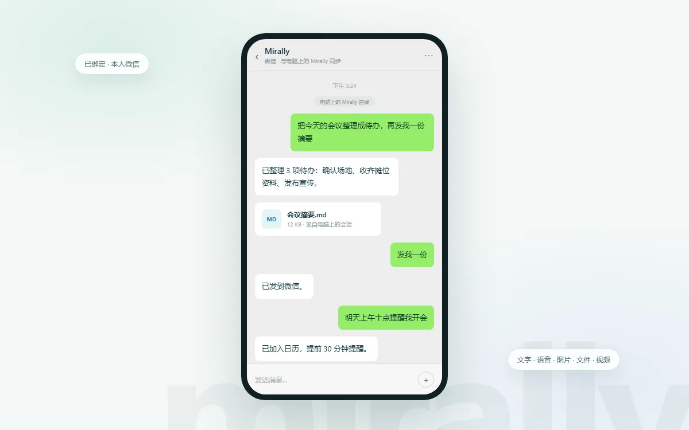
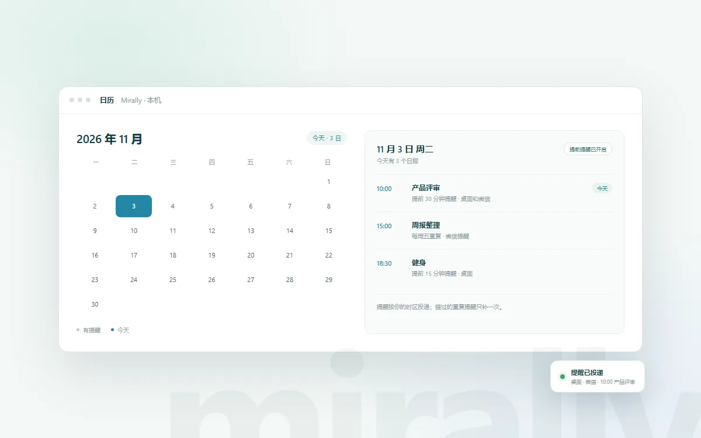
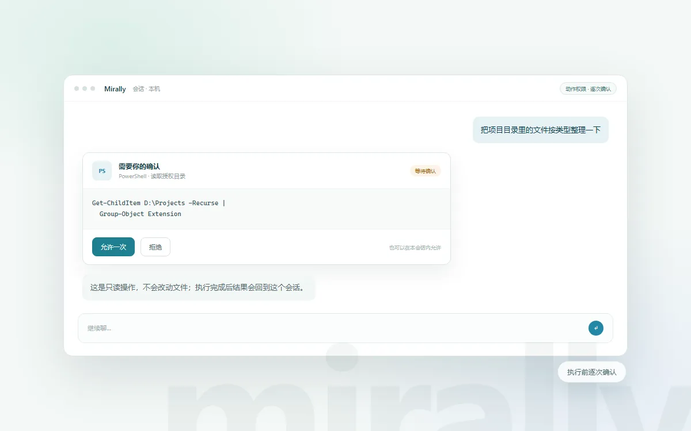

## 新功能

**微信渠道**：支持扫码绑定、文字私聊、会话切换与停止回复。可以接收语音、图片、文件和视频；整理好的成果能作为文件或图片回传微信。

**日历与提醒**：支持在对话中创建日程和提前提醒，日程可以按每日或每周重复。提醒会按用户时区投递到桌面和微信，也可以查看或取消整个系列。

**定时执行**：会话可以按指定时间执行一次或周期任务，支持暂停和取消。到期前会复核会话和授权状态；异常重启后，结果不明的执行不会重放。

**桌面执行**：模型可以调用 PowerShell、受管理的后台进程和独立的 Edge 浏览器，也能按需观察窗口和屏幕。动作默认逐次确认；可以在当前会话里临时自动批准，或在设置中开启持续信任。

**模型连接**：模型配置拆成服务、凭据和模型三层，一个连接可以保存多个模型。对话和后台可以分别指定模型，会话也可以切换自己的模型。

**结构化提问**：聊天页支持结构化提问、计划审核和手动上下文压缩；微信收到完整问题后，可以用 /answer 在同一模型回合回答。

**会话协作**：会话现在也是协作入口，可以查询正在运行的后台作业、继续之前的对话。微信可以通过原会话查询通用后台作业。

## 优化

**微信回执**：微信里的提示改成了一致说法：进入哪种会话模式、是否忙碌、为什么停止或失败，都会直接说明。长回复会标出截断位置。

**会话列表**：会话按最近活动排序，置顶项稳定留在顶部，不再因为顺序变化跳到侧栏标题上方。

**摘要与标题**：后台模型开启时会自动生成会话摘要和标题。手动改过的标题优先；历史内容变化后，摘要会被标记为过期。

**消息来源**：每条消息都会标明来自电脑还是微信。

**视觉效果**：统一主窗口的字号和行高，伙伴展开改为淡入和小幅位移。

## 修复

**停止提示**：停止回复只提示一次，不再重复出现。

**其他修复**：修复伙伴返回主窗口时的深色底板、置顶会话位置，以及微信调用网页搜索时工具名称不匹配导致的拦截。
