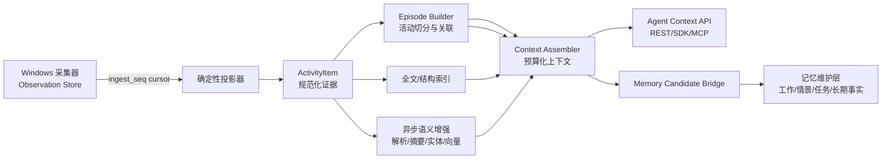

# Activity Knowledge Layer 设计方案

日期：2026-10-08  
状态：存储、基础投影、检索与 OpenClaw 按需访问链路已实现；内容质量、证据关联和行为理解尚未通过数据验收，见 [Activity 数据层评估与验收](activity-data-acceptance.md)。本地 stdio MCP 协议出口已实现；应用语义解析器、向量检索、音频历史和远程认证保留为扩展点

2026-10-11 的数据层完善使用 `activity.v2`：在声明的采集范围内完整保留原始文字、结构和来源，按原帧关联迟到 OCR，隔离采集 epoch 和明确的资源缺口，分开维护显示器与前台活动，持久化事务失败；预算与摘录限制只作用于派生摘要和查询。`activity.event.v1` 将已有 Episode 中的动作、窗口状态与文字组织为可追溯的观察事件，具体语义、分页和 CLI 见 [Activity 事件视图](activity-events.md)。新样本的实际检查与复验见 [Activity 新数据检查](activity-fresh-data-review.md)。这些工程验证不能替代真实输入、复制粘贴及模型理解验收。

## 1. 目的

当前的 Activity Sensor 已经负责从 Windows 采集前台窗口、应用标题、浏览器 URL、UIA 结构、截图、OCR、输入和剪贴板等 Observation。它回答的是“系统观察到了什么”。

Agent 需要的是另一种数据：用户正在做哪件事、哪些内容属于同一段活动、某个结论来自哪些证据、最近上下文中哪些内容值得带入当前任务。为此，在采集层和记忆维护层之间增加一个独立的 **Activity Knowledge Layer（活动知识组织层）**。

这一层不替代采集层，也不直接等同于长期记忆。它把不可变的原始证据投影为可检索、可聚合、可追溯的活动知识，供 OpenClaw、未来支持 MCP 的消费者以及记忆维护层使用；原生 UFO 循环不直接消费 Activity 知识。



### 1.1 设计目标

- 原始 Observation 永远可追溯，派生结果可以删除并从原始数据重建。
- 同一批输入重复处理不会产生重复 ActivityItem 或 Episode。
- 采集器、组织层和 Agent 解耦；组织层故障不能阻塞持续采集。
- 为 Agent 返回有限、紧凑、带证据的上下文，而不是直接暴露数据库或大量截图。
- 同时支持实时上下文、历史搜索、活动摘要和记忆候选生成。
- 允许以后加入语音转写、应用解析器、向量检索和跨设备数据，而不改变现有 Observation 协议。

### 1.2 不属于这一层的职责

- 不执行鼠标、键盘、窗口或浏览器操作。
- 不修改 UFO 子模块，也不让 UFO 直接查询 Activity 数据库。
- 不把每一帧截图同步发送给模型。
- 不把模型推断直接写成不可撤销的长期事实。
- 不把 OpenClaw 会话历史当作 Windows 活动数据源；对话历史和桌面活动仍是两个独立来源。

## 2. 当前基础和设计依据

当前 `openassist/core/activity/` 已提供版本化的 `Observation`、单写入 SQLite Store、资产引用、游标、保留清理和质量字段。`openassist/runtime/activity/` 与 `openassist/platform/activity/` 负责采集服务、Windows worker、OCR、WGC、UIA、输入和诊断界面。

设计参考了本地 `tmp/screenpipe/` 快照及其 MCP/API 文档。Screenpipe 的核心做法包括事件驱动采集、屏幕内容和可访问性树配对、SQLite FTS5 搜索、活动摘要、紧凑的 outline/automation 输出和独立的 MCP 转发层。[Screenpipe 项目说明](https://github.com/screenpipe/screenpipe/blob/main/README.md)、[Screenpipe MCP 接口](https://github.com/screenpipe/screenpipe/blob/main/packages/screenpipe-mcp/README.md)

此外采用以下业界实践：

- 事件记录使用事件时间、接收时间、来源标识和扩展属性分离的方式，接近 OpenTelemetry Logs Data Model 的事件模型。[OpenTelemetry Logs Data Model](https://opentelemetry.io/docs/specs/otel/logs/data-model/)
- 文本索引使用 SQLite FTS5 的 external-content/contentless 设计，避免在索引中重复保存大段正文。[SQLite FTS5](https://www.sqlite.org/fts5.html)
- 记忆写入区分提取、更新、删除和实体匹配，参考 Mem0 的记忆提取与显式更新/删除方式。[Mem0 How It Works](https://github.com/mem0ai/mem0/blob/main/docs/core-concepts/how-it-works.mdx)
- 将始终可见的短期记忆与可检索的长期记忆分离，参考 Letta 的 memory blocks 与 archival/recall memory 模式。[Letta Memory Blocks](https://docs.letta.com/v1-sdk/memory/memory-blocks)
- Windows Recall 采用“时间线 + 快照 + 语义索引”的交互模型，说明活动组织层需要同时支持时间导航和语义查询。[Microsoft Recall 概览](https://learn.microsoft.com/windows/apps/develop/windows-integration/recall)

这些资料只用于借鉴架构和接口，不复制 Screenpipe 的源码、数据库迁移、许可证代码或应用解析器。

## 3. 核心概念和边界

### 3.1 Observation：不可变原始事实

Observation 是采集层已经落库的原始记录，例如：

- `window_context`
- `foreground_changed`
- `context_snapshot`
- `content_snapshot`
- `ocr_result`
- `input_batch`
- `input_text`
- `clipboard_changed`
- `agent_control_changed`
- `collection_gap`

Observation 保留 `observation_id`、`ingest_seq`、来源 epoch/seq、观察时间、接收时间、应用和窗口身份、actor、采集策略、质量、缺失原因以及资产引用。组织层不修改原始 Observation。

### 3.2 Evidence：可引用的证据单元

Evidence 是组织层从一条或多条 Observation 中提取的最小证据，例如一个标题、一个 URL、一段 UIA 文本、一个 OCR 文本块、一个输入批次或一张代表性截图。

Evidence 必须保留：

```text
evidence_id
source_observation_ids
observed_at / received_at
content_type
content_hash
quality
confidence
asset_refs
extractor_version
```

Evidence 是 Agent 判断上下文的材料，不能单独被解释为用户意图或任务结果。

### 3.3 ActivityItem：规范化活动项

ActivityItem 是组织层输出的原子活动记录，例如“Edge 中打开某 URL”“编辑器中的一段文本发生变化”“用户复制了一段文本”“某个 UIA 文档区域在一段时间内可见”。

建议字段：

```text
id
kind                       # screen, web, document, chat, code, email, input, clipboard...
start_time / end_time
app_id / process_instance_id / window_instance_id
title / url / document_ref
text_summary
structured_payload         # UIA、OCR blocks、输入统计等
asset_refs
source_observation_ids
actor / actor_basis
quality / missing_reasons
confidence / importance / sensitivity
content_hash
projection_version
created_at / updated_at
```

ActivityItem 是主要的检索单元。它保存必要的文本和结构化信息，但不复制截图二进制；截图只通过 `asset_refs` 引用采集层资产。

### 3.4 ActivityEpisode：连续活动

Episode 把相关 ActivityItem 组织成一个可理解的活动区间，例如：

```text
用户在 Edge 中查找 Gmail 邮件
10:21:03 - 10:27:44
包含 3 个 URL、12 个文本证据、4 张代表性截图和 2 次输入批次
```

Episode 不是模型生成的结论，而是带边界、成员和证据引用的活动聚合。摘要可以异步生成，但摘要必须保留其输入的 `item_ids` 和版本。

### 3.5 ContextBundle：给 Agent 的查询结果

ContextBundle 是上下文装配器的结果，包含时间线、活动项、证据引用、质量提示和截断状态。Agent 只能通过 Context API 获取它，不直接访问底层 SQLite。

### 3.6 MemoryCandidate 和 MemoryFact

- `MemoryCandidate`：组织层或记忆维护层提出的候选记忆，尚未成为稳定事实。
- `MemoryFact`：经过规则、重复证据或用户确认后进入记忆系统的事实。

两者都要保留来源、时间有效期、置信度、冲突关系和生命周期状态。

## 4. 处理架构

组织层采用“两条处理通道”：先运行确定性投影，再运行可失败、可重跑的语义增强。

### 4.1 确定性投影通道

本节描述设计目标。来源合并、内容去重和完整的关联／质量投影尚未全部实现；已复现差距及验收依据见 [数据层评估](activity-data-acceptance.md#3-组织层已复现的问题)。

该通道不调用模型，必须稳定、快速、可重放：

1. **增量读取**：按照 `ingest_seq` 读取 Observation，使用独立 consumer cursor。
2. **时间标准化**：保留观察时间和接收时间，处理时钟回拨、重启和延迟到达。
3. **身份归一化**：使用已有的 `app_id`、process/window instance、窗口 generation 和浏览器 URL；无法确认时保留空值和 `identity_confidence`。
4. **内容提取**：从 `payload`、UIA summary、OCR summary 和 `asset_refs` 提取 Evidence。
5. **来源合并**：把同一 capture group、同一窗口和相近时间的证据关联起来。
6. **去重**：使用内容哈希、来源引用和时间窗口合并重复项；不删除原始 Observation。
7. **类型分类**：根据应用、URL、标题、UIA role 和内容特征决定 `kind`，使用 generic fallback 保证未知应用也能工作。
8. **活动切分**：维护活动 Episode 状态机。
9. **索引写入**：写入派生库的结构化表和 FTS5 索引。

### 4.2 语义增强通道

本节为目标设计。当前 parser 在投影流程中同步调用；尚未实现独立增强队列与失败重试机制。

该通道异步运行，失败不影响确定性投影：

- 应用专用解析器：网页、邮件、聊天、文档、代码审查等。
- OCR/UIA 语义压缩：把扁平控件树整理成文本树、标题、列表和表格。
- 实体与主题提取：项目、联系人、应用、文档和任务名称。
- Episode 标题、摘要和关键事件生成。
- 可选 embedding 索引。
- MemoryCandidate 提取。

所有增强结果都必须记录：

```text
input_item_ids
extractor_name
extractor_version
model_name（如果有）
prompt_or_rule_version
generated_at
confidence
status
error
```

模型服务不可用时，ActivityItem、Episode 成员关系、FTS 和结构化查询仍然可用。

### 4.3 延迟事件和版本

以下为目标策略；当前迟到证据归属仍有缺陷，Episode 的 revision 增加时覆盖同一行，尚未保留历史版本。

Windows worker、OCR 和 UIA 可能在原始事件之后返回结果。组织层不能假设按观察时间严格有序。

- 用 `ingest_seq` 作为读取游标，用 `observed_at` 作为活动排序字段。
- 为每个处理器设置允许迟到窗口，例如默认 60 秒，具体值由配置决定。
- 活跃 Episode 在迟到窗口内可追加或重新切分。
- 已封存 Episode 收到迟到数据时，创建新 revision，并保留旧 revision 的来源。
- 派生记录使用 `(source_observation_ids, projection_version)` 或等价幂等键。
- 处理器升级不覆盖旧结果，使用新 `projection_version` 重建或并存，便于比较和回滚。

## 5. Episode 切分规则

Episode Builder 使用确定性规则，模型只负责可选标题和摘要。

### 5.1 开始新 Episode 的条件

- 前台应用或窗口身份变化，且持续超过 settle 时间。
- 浏览器有效 URL 变化。
- 从空闲状态恢复并出现新的输入或内容变化。
- UFO/OpenClaw 任务开始，且任务拥有新的 `agent_task_id`。
- 用户手动开始一段活动。

### 5.2 延续当前 Episode 的条件

- 应用、窗口和 URL 相同或属于同一应用上下文。
- 两个证据之间的空闲间隔小于配置阈值。
- 输入、滚动、OCR、UIA 和截图变化能被同一窗口身份解释。

### 5.3 结束 Episode 的条件

- 超过空闲阈值没有新的有效证据。
- 应用/窗口改变并经过 settle。
- Agent 任务完成、取消或被用户接管。
- 采集器产生重启、登录会话变化或明确的 collection gap。

Episode 要记录 `end_reason`、`data_gaps` 和 `finalized_at`。不能因为没有记录就推断用户什么都没有做。

## 6. 派生数据库设计

建议新建独立数据库：

```text
<activity-data>/activity-knowledge.sqlite3
```

采集层的数据库仍由 `ObservationStore` 单写入。组织层使用只读连接读取原始库，并由自己的 writer 写入派生库。派生数据库丢失时，可以根据原始库和处理器版本重建。

### 6.1 核心表

```text
knowledge_schema_meta
organizer_checkpoints
activity_items
activity_item_evidence
activity_episodes
activity_episode_items
activity_links
semantic_annotations
memory_candidates
memory_facts
```

### 6.2 FTS5 索引

使用 external-content FTS5 表保存以下可搜索字段：

```text
title
url
text_summary
uia_text
ocr_text
clipboard_text
document_ref
entity_names
```

正文只保留在 `activity_items` 或证据引用中，FTS 表只保留索引。查询先使用结构化过滤，再使用 FTS5/BM25 排序；向量检索作为可选的第二路召回，不能取代时间、应用和来源过滤。

### 6.3 推荐的检索排序

最终得分由可解释项组成：

```text
score =
    lexical_score * w_lexical
  + semantic_score * w_semantic
  + recency_score * w_recency
  + app_match * w_app
  + episode_cohesion * w_episode
  + evidence_quality * w_quality
```

每个分数和过滤原因都应该能在诊断模式中查看，避免 Agent 得到无法解释的排序结果。

### 6.4 清理和重建

- 原始 Observation 到期后，派生项保留但标记 `evidence_missing`，或者按相同保留策略清理。
- 资产被清理时不删除 ActivityItem，只移除不可用的 asset ref 并记录原因。
- 支持按时间、应用、窗口和敏感级别删除，并将删除传播到派生项、FTS、候选记忆和缓存。
- 提供 `organizer rebuild --from --to` 和全量 rebuild，不能依赖手工删除数据库。

## 7. Agent Context API

### 7.1 查询请求

```python
@dataclass(frozen=True)
class ContextQuery:
    query: str | None = None
    start_time: int | None = None
    end_time: int | None = None
    apps: tuple[str, ...] = ()
    windows: tuple[str, ...] = ()
    kinds: tuple[str, ...] = ()
    episode_id: str | None = None
    mode: str = "outline"          # outline / structured / evidence
    purpose: str = "agent_context"
    max_items: int = 30
    token_budget: int = 4000
    include_assets: bool = False
    include_uia: bool = False
    include_ocr: bool = True
    cursor: str | None = None
```

`purpose` 用于审计和策略控制，例如 `agent_context`、`memory_maintenance`、`diagnostics`。查询范围必须明确，不能让一个普通问答隐式读取全天历史。

### 7.2 查询结果

```python
@dataclass(frozen=True)
class ContextBundle:
    schema_version: int
    query_id: str
    generated_at: int
    index_watermark: int
    episodes: tuple[ActivityEpisodeView, ...]
    items: tuple[ActivityItemView, ...]
    evidence: tuple[EvidenceRef, ...]
    gaps: tuple[DataGap, ...]
    truncated: bool
    next_cursor: str | None
```

结果必须明确：

- 当前索引处理到哪个 `ingest_seq`。
- 是否存在采集缺口、OCR/UIA 不可用或截图已过期。
- 内容是否被 token budget 截断。
- 某个摘要或结论对应哪些 `observation_id`。

### 7.3 最小接口

```text
recent_activity(query)
search_activity(query)
get_activity_around(time_or_item)
get_episode(episode_id)
get_evidence(evidence_ids)
activity_summary(query)
organizer_health()
```

当前由 `ActivityOrganizer` 和 `ActivityContextSource` 提供这些能力；OpenClaw 通过 `mcp.servers.mirally-activity` 的本地 stdio MCP 工具按需调用同一接口。OpenClaw 发现工具时可能启动子进程；配置读取、桥接实例和数据库访问延迟到实际工具调用，服务退出时关闭连接，不启动采集器。Python bridge 负责参数校验、预算、索引追赶和结构化错误，MCP 层只做协议适配，不能直接绕过 ContextSource 读取 SQLite。旧版 OpenClaw 可显式选择兼容插件路径。Screenpipe MCP 采用本地 daemon API 转发和紧凑输出，这种分层方式适合沿用。[Screenpipe MCP API 说明](https://github.com/screenpipe/screenpipe/blob/main/packages/screenpipe-mcp/README.md)

### 7.4 三种返回格式

| 格式 | 用途 | 默认内容 |
| --- | --- | --- |
| `outline` | 普通 Agent 上下文 | 时间线、应用、标题、摘要、关键文本、质量 |
| `structured` | 需要理解 UI 或输入时 | UIA 节点、OCR blocks、URL、输入统计 |
| `evidence` | 需要核实事实时 | 原始 Observation 引用、资产引用、完整文本 |

历史 UIA 节点和截图不能直接当成当前可操作句柄。需要执行桌面动作时，执行器必须重新观察当前窗口并获得实时控件引用。

## 8. 记忆维护接口

组织层向记忆维护层提供事件和候选，不直接决定长期事实。

### 8.1 记忆分层

| 层级 | 保存内容 | 生命周期 | 典型读取方式 |
| --- | --- | --- | --- |
| 工作记忆 | 当前任务最近上下文 | 当前会话/任务 | 直接注入上下文 |
| 情景记忆 | 完整 ActivityEpisode 和结果 | 天到月 | 时间线/检索 |
| 任务记忆 | 用户要求、补充、执行计划、结果 | 任务生命周期 | 任务恢复 |
| 语义记忆 | 偏好、项目、联系人、稳定事实 | 长期，可过期 | 按实体/事实检索 |

### 8.2 MemoryCandidate 状态机

```text
candidate -> accepted -> superseded
     |          |
     v          v
  rejected   retracted
```

候选字段：

```text
candidate_id
fact_key / subject / predicate / object
statement
valid_from / valid_to
source_episode_ids
source_observation_ids
confidence
extraction_method / version
status
conflicts_with
created_at / updated_at
```

建议规则：

- 用户明确说出的偏好或事实可以直接成为高置信候选，但仍保留来源。
- 单次截图、一次输入或一次模型猜测不能自动成为长期事实。
- 多次独立 Episode 支持同一事实时提高置信度。
- 新事实与旧事实冲突时创建新版本并标记 `supersedes`，不物理覆盖旧证据。
- 用户纠正、删除和隐私清理可以直接撤回候选或事实。
- 当前值由确定性时间和状态规则选择，不能让模型自由决定哪个旧事实“看起来更合理”。

## 9. Screenpipe 对齐方案

| Screenpipe 能力 | Mirally 方案 | 处理边界 |
| --- | --- | --- |
| event-driven capture | 继续由 Activity Sensor 负责 | 组织层消费 Observation，不重复采集 |
| frames | `ActivityItem(kind="screen")` + asset refs | 不复制图片二进制 |
| elements | UIA Evidence + 语义树投影 | 历史节点不能作为实时句柄 |
| OCR/audio/input 搜索 | FTS5 统一索引，音频作为未来 Observation kind | 输入仍标记 actor 和质量 |
| activity-summary | Episode 聚合和时间统计 | 明确 `data_status` 和缺口 |
| frame-context | `get_evidence` / `get_activity_around` | 返回来源和时间精度 |
| compact outline | ContextBundle 的 `outline` | 默认限制 token 和字段 |
| app parsers | Parser Registry | 未知应用使用通用解析器 |
| pipes/MCP | Context API + 本地 stdio MCP server | 由服务层控制权限 |
| update-memory | MemoryCandidate/MemoryFact API | 记忆维护层负责接受、更新、撤回 |

Screenpipe 官方 API 特别强调以下边界，应直接纳入我们的接口契约：

- 活动摘要负责时间统计，搜索负责具体证据，不用搜索结果数量推算活跃时长。
- 捕获到的屏幕文字、音频和网页内容是不可信证据，不能被 Agent 当作指令执行。
- 历史控件 ID、坐标和截图不能证明某个动作已经发生，也不能直接复用为当前控件句柄。
- 默认输出应使用紧凑 outline，只有自动化目标或证据核实时才请求完整结构。

## 10. 运行和故障模型

### 10.1 进程边界

第一版可以由产品启动独立的 `OrganizerService` 进程或后台 worker。采集服务、组织服务、Gateway 和 UI 通过 loopback/本地接口协作：

```text
Collector -> ObservationStore
Organizer -> read ObservationStore / write KnowledgeStore
API       -> read KnowledgeStore
Agent     -> API
```

组织服务停止时，采集层继续写入；服务恢复后按 checkpoint 追赶积压。API 返回 `index_lag`，不能把“索引尚未追上”误报成“没有活动”。

### 10.2 健康指标

下列是目标指标集合，并非都已实现。当前提供游标、积压和运行统计；`projection_errors` 等持久错误指标及增强队列指标尚未完整落地。

至少记录：

- `source_newest_ingest_seq`
- `organizer_processed_seq`
- `organizer_lag_seconds`
- `active_episode_count`
- `projection_errors`
- `enrichment_queue_size`
- `fts_index_size`
- `query_latency_ms`
- `last_successful_checkpoint`
- `evidence_missing_count`

### 10.3 失败恢复

下列为目标策略。当前坏记录仅计入批次错误统计，随后仍推进 checkpoint；没有持久化失败队列、retry 或 dead-letter。游标追上不代表每条记录都已成功投影。

- 单个坏 Observation 进入 `projection_errors`，不阻塞后续序列。
- 模型或应用解析器超时只影响该条 enrichment，确定性结果保持可用。
- 派生库损坏时删除并 rebuild，不触碰原始数据库和资产目录。
- 处理器升级时使用 schema/version migration 和可重建索引，不用手工编辑 SQLite 文件。
- 所有异步任务都有 retry budget 和 dead-letter 记录，避免无限重试导致 UI 看起来卡死。

## 11. 代码组织建议

在现有代码上增加以下产品层模块：

```text
openassist/core/activity/
  models.py                  # 已有 Observation
  store.py                   # 已有原始存储
  knowledge/
    models.py                # Evidence, ActivityItem, Episode, ContextBundle
    normalizer.py            # 确定性字段归一化
    projector.py             # Observation -> ActivityItem
    episode_builder.py       # ActivityItem -> Episode
    semantic.py              # parser/enrichment 协议
    index.py                 # FTS5 与结构化索引
    context.py               # ContextBundle 装配和预算
    memory_bridge.py         # Candidate/Fact 适配
    repository.py            # KnowledgeStore 读写

openassist/runtime/activity/
  organizer_service.py       # 生命周期、checkpoint、队列、健康状态
  organizer_config.py        # 配置桥接
  organizer_api.py           # loopback REST/SDK/MCP 适配
```

`platform/activity/` 继续只放 Windows 采集实现；`runtime/activity/mcp_server.py` 将 Context API 作为 stdio MCP 提供给 OpenClaw，不直接依赖 Windows worker 或 UFO 内部对象。`runtime/ufo/` 只保留桌面执行兼容适配。

## 12. 实现交付范围

这次实现应以一个可运行的完整闭环交付，而不是先做一个只能存派生 JSON 的半成品。完整范围包括：

1. 版本化的 KnowledgeStore 和独立 writer。
2. 基于 `ingest_seq` 的增量消费、checkpoint、幂等和重建。
3. Observation 到 Evidence、ActivityItem 的确定性投影。
4. Episode 切分、迟到事件修订和数据缺口表达。
5. 标题、URL、OCR、UIA、输入和剪贴板的结构化/FTS 索引。
6. `recent/search/around/episode/summary/evidence/health` 查询协议。
7. `outline/structured/evidence` 三种上下文输出和 token budget。
8. Parser Registry 和异步语义增强接口；没有解析器时 generic fallback 可用。
9. MemoryCandidate、Fact 版本、冲突、撤回和证据追溯。
10. 诊断页面和 CLI 能看到采集水位、组织水位、Episode、索引和错误。
11. OpenClaw 可复用的只读 ContextSource 适配；MCP 作为同一 API 的协议出口。

当前 ContextSource 已具备 `recent_activity`、`search_activity`、`get_activity_around`、`get_episode`、`get_evidence`、`activity_summary` 和 `organizer_health` 方法；CLI 与监控 API 可独立验证同一套结果。向量索引、音频历史、跨设备同步和更丰富的应用解析器应接入上述扩展点。它们不是另一个数据模型，也不能绕过 Evidence、ContextBundle、MemoryCandidate 和 MemoryFact 的生命周期。

## 13. 验收标准

### 正确性

- 同一 Observation 重放两次，派生库结果和 ID 稳定，不产生重复项。
- 迟到的 OCR/UIA 结果能加入已有 Episode，并留下 revision 和来源。
- 同一窗口连续相同截图被合并，但代表性资产和原始 Observation 可追溯。
- 浏览器标题、URL、OCR 和 UIA 文本能在同一 Episode 中关联。
- 采集缺失、黑帧过滤、权限拒绝和超时都能在 ContextBundle 中看到。

### Agent 使用

- “我刚才在哪个网页看到某段文字”可以先通过摘要定位 Episode，再获得具体证据。
- OpenClaw 可以按需读取任务相关的历史 Context；桌面执行前仍必须重新观察实时窗口，原生 UFO 循环不直接读取 Activity。
- 当前任务补充要求能够写入任务记忆，并与旧任务 revision 区分。
- 普通对话不会无条件读取全量历史或截图。

### 记忆

- 单次观察不会自动生成长期偏好。
- 重复事实能够形成候选，用户纠正后旧事实仍可追溯但不再作为当前值。
- 删除原始证据后，候选记忆和摘要不会继续引用已删除内容。

### 可靠性

- 组织服务停止时采集仍可工作，恢复后可以追赶。
- 语义模型不可用时，结构化和 FTS 查询仍可工作。
- 派生数据库删除后可从原始 Observation 重建。
- 查询能够返回索引延迟、截断和缺口状态。

## 14. 推荐执行顺序

实现时按依赖顺序推进，但最终验收以完整闭环为准：

1. 先冻结 Evidence、ActivityItem、Episode、ContextBundle 和 MemoryCandidate 协议。
2. 实现 KnowledgeStore、checkpoint、投影器和 Episode Builder。
3. 加入 FTS5、结构化过滤、Context Bundle 和诊断接口。
4. 接入 generic parser、App Parser Registry 和异步摘要/实体增强。
5. 接入记忆候选、冲突与撤回生命周期。
6. 通过通用 stdio MCP 将 ContextSource 接入 OpenClaw；UFO 保留为桌面执行兼容路径。
7. 用录制的 Observation fixture 做 replay、迟到、删除、重建和 Agent 场景验收。

任何阶段都不能把“模型已经生成摘要”当作组织层完成的标志；只有原始证据、派生活动、查询上下文和记忆生命周期全部连通，才算完成这层能力。
