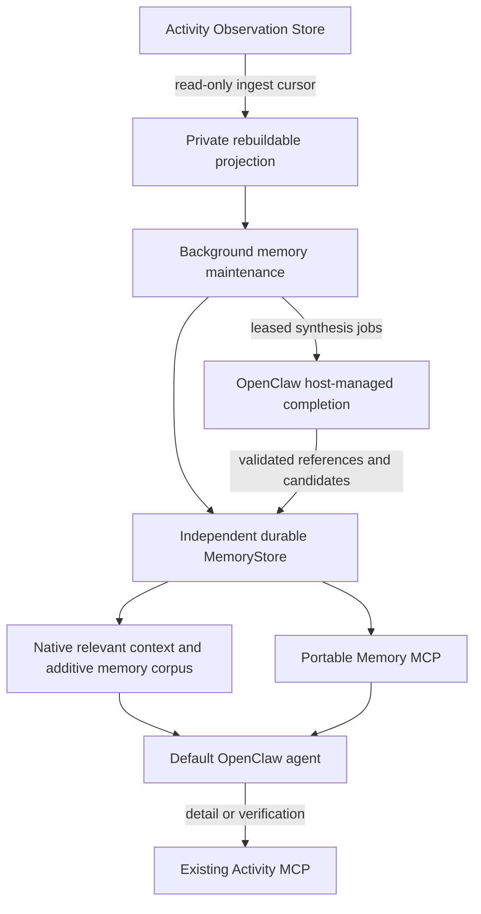

# Mirally Activity Memory

Activity memory is continuously maintained outside conversations. A user does
not need to ask a question to project new observations, prepare a working
snapshot, or enqueue semantic consolidation. OpenClaw's model remains stateless;
the durable memory store and bounded recall provide continuity across sessions.



## Desktop settings

Mirally's **Settings → Activity & Memory** shows the saved capture profile,
the current window's capture session, persisted collector diagnostics, and
the independent Gateway memory worker status. Its memory shortcut opens the
native **Memory** workspace; history and web monitor shortcuts inspect existing
data. Memory browsing is maintained in this one location.
Activity capture defaults to enabled and starts with the desktop window.
The page's enable switch saves the preference in the Activity profile;
explicit `enabled: false` is respected. Pause affects only the current capture
session. Closing the window ends its capture without changing the saved
preference. The Gateway's independent memory worker may continue processing
already collected data. Viewing history or searching memory does not invoke a
model.

The page distinguishes local organization from model synthesis. Local
maintenance defaults to enabled: every two seconds it processes up to 200 new
observations, grouping them into five-minute memory windows. A window closes
after its five-minute interval and a 60-second grace period for late evidence.
Working snapshots expire after 24 hours; episodic summaries remain durable.
Model synthesis is off by default and has its own switch in the ordinary
Activity & Memory settings, independently of recording. The same page selects
an optional model and adjusts hourly calls and daily token limits. Leaving the
model blank uses the configured host conversation model.

## Viewing saved memories

Open **Memory → Memories** (or the main agent's Memory tab) to see **Local
Activity Memories**. The same contribution is available on the Memory overview.
It reads the durable Mirally store without a model call and preserves the native
workspace's other memory features. Only the local main agent shows these owner
activity memories; selecting another agent does not expose them.

The default source filter shows all saved sources, so older rule records remain
visible even when their model synthesis has not completed. Source filters can
isolate model summaries, user-confirmed memories or rule-based observed context,
each with an explicit label rather than presenting rules as model output. A model summary is
still an inference; a saved status does not mean user confirmation. Optional
candidates remain unconfirmed when viewed.

Search by keyword, source, type and local date, then select a result to read its
body, observation time, provenance and source IDs. A model summary can link to
its parent observed memory. Long bodies are paginated, including very long OCR
lines. Archived source IDs remain provenance: the page reports when raw
evidence has been cleaned and cannot reopen deleted originals. Source and date
filters run before database pagination. Natural queries use bounded lexical
candidates; an empty keyword query browses the filtered store with full paging.

**Settings → Models** also exposes the synthesis model and its output limit
(128–16000 tokens), separately from the capture/synthesis switches and budgets.
This is an independent background task, not the host's utility-model route for
titles and other short tasks. Synthesis requests reasoning off; the selected
model's reasoning capability and request format must match the provider for
that request to take effect. See [model settings](openclaw-native-setup.md#配置模型服务商).

## Production and recall

The product plugin `integrations/openclaw/memory/` registers a Gateway service.
It supervises one long-lived `mirally.runtime.memory.worker` process. The
worker starts deterministic maintenance when the service starts, not on the
first conversation or MCP call. Windows helpers run hidden and use the root
virtual environment. Closing the desktop window leaves the Gateway and worker
running. Closing the Gateway ends this service; no system startup service is
installed. A standalone `memory.cli run` is also available.

The worker consumes raw Activity through a read-only source and an independent
rebuildable projection. Ingest cursors, window state and failed processing are
durable. Changes update affected time windows, including late evidence. Short
observations are grouped across foreground applications within a bounded time
window; this is observed context, not a claim that all windows belong to one
completed task. Deterministic memories name applications, titles, URLs and
bounded observed text with source references and coverage gaps.

Working snapshots expire according to the original observation time. Replaying
old data cannot manufacture a current working state. Episodic memories retain
their historical dates. Task and semantic candidates remain unreviewed until
explicit confirmation; displaying a page does not establish a preference,
intent, completed task, saved document or sent message.

When semantic processing is enabled, stable changed windows create idempotent
jobs. Enabling it also queues available raw evidence from the previous hour;
it does not automatically backfill the full history or recover evidence already
deleted. Previously settled local windows older than that hour, which never
received a semantic job, can remain protected without being queued. Existing
older jobs still follow their normal retry and budget rules. The model receives
the complete captured text fields for that window, including OCR, UIA, input and clipboard
text permitted by the capture policy, together with source references. Images
are not sent. Overlapping sources in the same time bucket are combined; large
windows are split into model inputs and their results are consolidated before
the final window summary is committed. Complete input coverage does not make
the resulting summary lossless, or reconstruct text that was never captured.

The dispatcher checks for work at its configured interval (30 seconds by
default). Limits default to 24 model calls per hour and 60,000 tokens per day;
fragment and consolidation calls share these limits. Both limits are adjustable
in settings. The daily default does not guarantee uninterrupted processing for
an entire day: busy or text-heavy activity may exhaust it sooner. Exhausted
budgets defer work until the corresponding UTC hour or UTC day boundary. A zero
limit leaves no budget for new model calls.

Budget waiting describes Mirally's local synthesis limits, not the provider's
account balance. The settings page displays usage, limits and the next eligible
time in the local timezone. A previous failure remains labeled with its time;
it does not imply that the currently deferred job has just failed. Empty or
non-JSON model output cannot be committed as a memory. It may reflect output
truncation, reasoning consuming the output allowance or a provider response
issue; inspect model capability, compatibility format and task output settings
before retrying. Raw evidence remains protected until a valid summary and
matching completion receipt are committed.

The Gateway uses its official `runtime.llm.complete` with the configured
agent/model and managed credentials, without desktop tools or a chat turn. The
worker validates strict JSON, citations and candidate fields before committing
the result and its durable completion receipt. Provider failures retry with
backoff, with at most three attempts; leases fence late results. Calls and token
reservations persist across restarts and limit processing. Turning synthesis
off stops dispatching new calls; it does not erase successful summaries or
invalidate an already committed completion receipt.
Unsupported provider/model paths fail visibly while deterministic recall stays
available. Model summaries remain labeled inference and do not become verified
user facts. Credentials never enter the worker, memory configuration or jobs.
The native `mirally.memory.status` RPC exposes service readiness, ingest lag,
recall receipts and semantic processing state, including failures and budget
waiting. Its attempt/success counters describe the current service instance;
durable job and usage totals come from the memory store.
Read responses expose `coverage.durable_coverage` for active, unexpired saved
memories, including local timestamps with timezone offsets. Existing `source_*`
bounds describe remaining raw Activity only. Neither pair of bounds proves
continuous coverage between its endpoints.

`before_prompt_build` reads committed relevant memories for the current local
owner request. It honors native tool authority, prompt-injection policy, agent
runtime and sandbox boundaries. It never scans raw observations, waits for
consolidation, starts a model, rewrites the original system prompt or grants new
tools. General questions receive no recalled historical content. Context is
bounded, dated and marked untrusted; failures return no dynamic context.
Recalled data is never authority to execute commands or change preferences.

Recall recognizes platform names such as B站/哔哩哔哩/bilibili and interprets
today, yesterday, explicit dates and recent intervals using the host's local
calendar. A missing requested day never falls back to a different day.

Time-of-day phrases also narrow the requested local calendar range (for example,
凌晨 is 00:00–06:00). Subjective descriptions such as "有意思" are not required
literal search terms; a video question can find candidates from video URLs or
explicit video titles without already knowing the platform or title. Related
model summaries and confirmed memories take priority, with observed records
available as supporting evidence. Excerpts target matching titles and nearby
URLs instead of spending the whole context allowance on the record's header.
Search and detail responses include computed local observation timestamps with
an explicit UTC offset; native corpus snippets and provenance carry the same
local calendar dates. Raw body timestamps ending in `Z` remain UTC and must not
be combined with an already converted local clock time.
The synthesis prompt also asks the configured model to preserve supported page
and video titles, project names and usable URLs in new summaries. Existing
summaries are not silently regenerated.
Calendar-day MCP queries retain their natural date or YYYY-MM-DD in `query`;
the service resolves the local boundary. The model is instructed to omit epoch
filters for these questions rather than risk an incorrect timestamp conversion.

This is lexical retrieval with date and platform normalization, not embedding
or general semantic vector search. A subjective clue such as "an interesting
video" may need clarification among candidates. A captured page title or
player does not prove the whole video was watched or that its audio/images
were understood. Multiple windows showing the same video are observation
buckets and cannot establish repeated views. Missing records mean the answer is unavailable, not that the
user did nothing. The product memory skill instructs the model to retrieve
details, cite available evidence and admit these limits.

The plugin also registers an additive native memory corpus, retaining the
existing `memory-core` slot. In the pinned OpenClaw release, native
`memory_search(corpus: "all")` or `corpus: "wiki"` includes corpus supplements;
omitting `corpus` may search only the existing memory backend. Returned
`mirally-memory/<id>` paths can be read with `memory_get(corpus: "wiki")`;
the default read corpus only accepts workspace Markdown. A product skill
advertises this distinction. Detailed evidence is available through Activity
MCP for data that remains within the raw retention window.

OpenClaw can load separate plugin registries for Gateway services and agent
preparation. They share the service-owned worker for the same canonical root
and memory profile; merely loading a registry does not start another process.
Each callback checks the permissions supplied to that invocation. Automatic
recall is verified through the Control UI's native `chat.send` path. A low-level
`agent` RPC that lacks native tool authority cannot inject this context.
New Control UI chats use native `dashboard:<uuid>` sessions. Their keys alone
do not grant memory access: recall verifies the authoritative native session
entry for local human-owner creation and internal direct delivery, alongside
the existing agent, sandbox, channel, runtime and tool-authority restrictions.
Unavailable or untrusted session metadata denies recall.

## Hourly raw cleanup

When Memory maintenance is enabled, `raw_retention.enabled` defaults to true
and `raw_retention.interval_seconds` to `3600`. The first cleanup is scheduled
one hour after maintenance begins; the schedule survives worker restarts.
Each pass removes completed batches only after a successful model summary and
its matching completion receipt are durably committed for the stable activity
window. A local deterministic summary alone does not authorize deletion.
Receipt checks bind the summarized input and source generation to the current
window. Pending, failed, budget-deferred, unresolved or currently changing
windows retain their raw evidence for a later pass. This protection continues
when synthesis is disabled. Previously completed windows with valid receipts
remain eligible for cleanup after the switch is turned off.

Cleanup covers original observations, associated screenshots, and raw text
copies in both the Activity knowledge index and Memory's private projection.
It preserves durable memories, provenance IDs, checkpoints and the current
collection tail. Readers mark archived evidence unavailable; screenshots and
complete OCR/UIA/input history from cleaned batches can no longer be reopened.
Saved memories remain searchable, but they are lossy summaries. Local rules
provide observed context, and the optional model summarizes captured text;
neither every captured detail nor the original images are preserved in memory.
Archived original records cannot be reopened from their provenance IDs.

The exact-ID cleanup journal uses a fully synchronized Memory commit before
evidence deletion. Cleanup rechecks committed memory under the Memory writer
lock, so concurrent explicit forgetting cannot race an old in-memory journal.
Deletion is retryable across database and filesystem failures. Status exposes
the schedule, blocked work, last completed cleanup and actual reclaimed bytes
in **Settings → Activity & Memory**. Merely opening this page does not run
cleanup. The ordinary memory ingestion source is read-only; the scheduled
cleanup phase obtains a separate bounded writer for deletion. Collector age
and image-quota cleanup also protect evidence that lacks a successful summary
receipt, rather than deleting it to free space. If protected images fill the
quota, all Activity collection pauses; it does not silently overwrite
unprocessed evidence. The configured `image_retention_hours` and
`observation_retention_days` do not bypass this protection or guarantee deletion
at those ages. After cleanup frees space, use Continue in settings to resume
collection manually.

There is no full-history automatic backfill. Older windows already settled by
local rules while synthesis was off may never have received a semantic job;
enabling synthesis only backfills the previous hour. These older records can
continue occupying the image quota, so enabling synthesis or pressing Continue
does not guarantee that the backlog will clear. If disk space permits, increase
`storage.image_quota_mib` in the active Activity YAML, stop the current collection
and start it again through settings to load the change, then press Continue if
it remains paused. This only increases capacity; it does not delete or reprocess
old records. Merely resuming a running collector does not reload its storage
configuration.

Set `raw_retention.enabled: false` to disable the hourly raw cleanup. A Memory
settings save reports whether the owning worker has applied the profile;
direct edits to the Memory YAML are also detected automatically.

## Storage, correction and forgetting

`mirally/core/memory/` owns a separate SQLite database, migrations, FTS/literal
search, immutable revisions, background jobs, usage reservations and tombstones.
Rebuilding the private Activity projection never resets confirmed memories.
Records preserve observation time, provenance, source references, scope,
revision, status and optional expiry. Readers use SQLite read-only connections
and never create missing stores; WAL permits background writes during recall.

Proposals are candidates. Use the maintenance CLI to explicitly confirm a
reviewed candidate and, when appropriate, supersede an old fact. Candidate,
superseded, retracted and expired records do not appear in normal recall.
Forgetting removes memory content from current records, revisions, indexes,
related cached state and jobs, and stores tombstones so the background worker
cannot recreate it from the same source observations. Raw Activity and OpenClaw
conversation deletion are separate operations. Natural source retention marks
evidence unavailable rather than silently treating an inferred memory as a
newly verified fact.

## Configuration

Local memory maintenance defaults to enabled when the profile or `enabled`
field is missing; an explicit `enabled: false` remains effective. Copy
`config/mirally/memory.yaml.template` to `memory.yaml` to customize storage,
budgets or the Activity profile. Semantic model calls remain disabled by
default. Model/provider settings and credentials stay in OpenClaw. The memory
service processes existing data; desktop startup owns automatic collection.

```powershell
.\.venv\Scripts\python.exe tools\configure_memory_agent.py
.\.venv\Scripts\python.exe tools\configure_memory_agent.py --apply
```

The helper uses native targeted patches. It preserves default agents, existing
models, credentials, memory slot, authored skill directories and explicit
denials. For a new memory plugin it grants native
`hooks.allowConversationAccess`, required for current-request recall. An
explicit false conversation-access or prompt-injection policy remains effective.
The handler uses only the current request, even though the host hook contract
can supply session messages. It registers the plugin and a `mirally-memory` stdio MCP server. A new
plugin may require a Gateway restart when idle. Model processing is bounded by
`semantics.max_calls_per_hour` and `semantics.max_tokens_per_day`; enabling it
incurs configured-provider charges and sends captured text evidence to that
provider. The Activity & Memory settings save the switch, model and budgets
and request a worker profile reload; they report saved-but-not-applied settings
separately if the service is unavailable. Budget exhaustion is distinct from
empty history. Direct edits to the memory YAML automatically take effect within
a few seconds, including the global and semantic switches, model route, budgets,
polling and cleanup intervals. The worker watches even while memory is disabled;
the host periodically synchronizes the effective settings. Disabling stops new
work and lets in-flight results finish safely. Budget usage is preserved.

The worker validates a stable file snapshot before applying it. Missing, empty
or invalid edits retain the last valid settings and expose `config_reload` in
worker health (`configReload` in Gateway diagnostics). Formatting-only edits do
not retry failed work or replay history. Enabling synthesis or changing its model
route retries failed jobs; budget changes wake budget-deferred jobs. An explicit
settings save remains a deliberate retry. Storage paths and `window_seconds`
require a service restart; a change to either rejects the entire update and
reports `restart_required`. A changed Activity source database also requires
a restart. Existing working-memory expiry timestamps are retained when changing
`working_ttl_seconds`; new or refreshed records use the new lifetime. A cleanup
interval change reschedules the next cycle; an active cleanup journal finishes
before the new interval is used.

To process an existing dataset without a collector, use a dedicated memory YAML
with explicit `activity_config_path`, `storage.database_path` and
`storage.projection_database_path`. Do not point memory storage at the raw or
existing rebuildable Activity database.

Relative paths inside Activity and memory YAML are resolved from the repository
root, independently of the launch directory. Absolute paths keep their configured
location; omitted storage paths use the current user's local data directory.

The Activity & Memory page reuses a product-owned, read-only native adapter for
effective configuration and runtime status. Configuration includes, environment
substitution, validation and redaction stay with the pinned OpenClaw APIs. The
adapter never starts the Gateway or runs memory maintenance. Returning to the
page immediately displays the previous status with its update time; operations
remain disabled until a fresh status response arrives. This display cache is
kept only in memory and is discarded when the Gateway context changes.

```powershell
.\.venv\Scripts\python.exe -m mirally.runtime.memory.cli --config <memory.yaml> status
.\.venv\Scripts\python.exe -m mirally.runtime.memory.cli --config <memory.yaml> run
.\.venv\Scripts\python.exe -m mirally.runtime.memory.cli --config <memory.yaml> search mirally
.\.venv\Scripts\python.exe -m mirally.runtime.memory.cli --config <memory.yaml> propose "Reviewed statement"
.\.venv\Scripts\python.exe -m mirally.runtime.memory.cli --config <memory.yaml> accept <candidate-id>
.\.venv\Scripts\python.exe -m mirally.runtime.memory.cli --config <memory.yaml> forget <memory-id>
```

The standalone runtime performs deterministic processing; semantic jobs are
completed by the connected Gateway service. Memory MCP provides
`memory_health`, `memory_recall`, `memory_read`, `memory_propose` and
`memory_forget`. Discovery and read calls do not run maintenance or models.
Proposal/forget tools have explicit write annotations and should be used only
for the corresponding user request; read-only sessions cannot use them.

Background consolidation enters a new native Gateway operation through the
official loopback WebSocket client. A fixed, administrator-scoped method accepts
no prompt, model, agent or lease parameters: the worker alone claims a job and
admits its budget, then the current native plugin API completes it. This avoids
inheriting retired plugin inventories from service timers or registration
reloads. It does not reset historical usage or automatically revive exhausted
jobs; an explicit settings save retries failed work under the existing limits.

## Validation boundaries

Offline tests cover no-chat production, recovery, delayed evidence, TTL,
candidate exclusion, citations, memory/projection separation, forgetting,
leases, persistent budget reservations and concurrent read-only access. Node
tests exercise native plugin registration, tool authority, general-question
exclusion, host-managed synthesis, timeout behavior and actual Windows Python
worker startup/parent-pipe shutdown. MCP tests invoke the real stdio adapter.

Historical replay, native service startup and opt-in configured-model acceptance
use ignored `.artifacts/` reports. They do not establish continuous collection
unless the separately configured collector is actually running. Vectors,
cross-device identity merging, automatic stable-fact promotion and semantic
workflow learning are not required by this first implementation.

With an enabled memory profile installed, select a question and expected answer
from that profile's historical dataset, then run native protocol acceptance
against an isolated Gateway and local model fixture. Replace the placeholders
below with actual source-backed values:

```powershell
.\.venv\Scripts\python.exe tools\verify_memory_agent.py --isolated --offline-model --run-model `
  --prompt "<question about the configured history>" `
  --expected-text "<text present in that history>" --expected-date "<YYYY-MM-DD>"
```

Omit `--offline-model` to explicitly test the configured provider. This makes
background semantic requests and two chat requests, incurs provider charges,
and uses a separate workspace, memory database and read-only session. The test
checks that a source-backed semantic memory is committed before any chat,
relevant recall is automatically injected without tool calls, a general
question gets no historical injection, and the user's main history stays
unchanged. The isolated Gateway is stopped and its test session archived.
Every `--run-model` invocation requires `--prompt`, `--expected-text` and
`--expected-date`, including `--offline-model`. The local fixture replaces the
model protocol only; it still needs the configured historical Activity database
and does not create sample observations. Without `--run-model`, the existing
health checks do not require these answer expectations.

For natural historical recall, `tools/verify_memory_recall.py --run-model
--dashboard --cases natural corpus missing ordinary` verifies the exact question
“今天凌晨我看了一个有意思的视频，你记得是啥吗” through native Control UI
session creation. Supply `--expected-title`, `--expected-bv`, `--expected-date`
and an actually absent `--missing-date` from the configured dataset. These
expectations check the answer; they are not inserted into the natural prompt or
its workspace guidance. The verifier snapshots the memory database, disables
collection, consolidation and cleanup in its isolated instance, and archives
test conversations. This opt-in check makes real configured-provider calls.

On 2026-10-14 the complete product suite ran 612 tests: 610 passed and two
explicit desktop checks were skipped. All 37 Node tests passed; the product
suite includes 63 memory tests. The isolated native Gateway also passed with
the configured provider: a source-backed semantic summary was committed before
chat, the relevant question received an automatic recall receipt and the correct
document/date with zero tool calls, and the general question received no memory
injection. Both the isolated and original main histories remained unchanged.
The replay source contained 94 observations from 2026-10-11 UTC
07:09:35.297–07:10:51.320. This is historical replay, not proof of present-day
desktop collection. Local reports are under `.artifacts/memory-acceptance/`.
