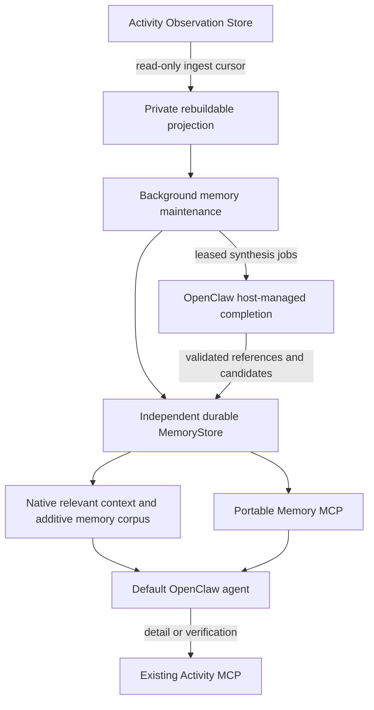

# Mirally Activity Memory

Activity memory is continuously maintained outside conversations. A user does
not need to ask a question to project new observations, prepare a working
snapshot, or enqueue semantic consolidation. OpenClaw's model remains stateless;
the durable memory store and bounded recall provide continuity across sessions.



## Production and recall

The product plugin `integrations/openclaw/memory/` registers a Gateway service.
It supervises one long-lived `openassist.runtime.memory.worker` process. The
worker starts deterministic maintenance when the service starts, not on the
first conversation or MCP call. Windows helpers run hidden and use the root
virtual environment. Closing the desktop window leaves the Gateway and worker
running. Closing the Gateway ends this service; no system startup service is
installed. A standalone `memory.cli run` is also available.

The worker consumes raw Activity through a read-only source and an independent
rebuildable projection. Ingest cursors, window state and failed processing are
durable. Changes update affected time windows, including late evidence. Short
observations are grouped across foreground applications within a bounded time
window; this is observed context, not a claim that all windows belong to one
completed task. Deterministic memories name applications, titles, URLs and
bounded observed text with source references and coverage gaps.

Working snapshots expire according to the original observation time. Replaying
old data cannot manufacture a current working state. Episodic memories retain
their historical dates. Task and semantic candidates remain unreviewed until
explicit confirmation; displaying a page does not establish a preference,
intent, completed task, saved document or sent message.

When semantic processing is enabled, stable changed windows create idempotent
jobs. The Gateway uses its official `runtime.llm.complete` with the configured
agent/model and managed credentials, without desktop tools or a chat turn. The
worker validates strict JSON, citations and candidate fields before committing
the result. Provider failures retry with backoff; leases fence late results.
Calls and token reservations persist across restarts and limit processing.
Unsupported provider/model paths fail visibly while deterministic recall stays
available. Model summaries remain labeled inference and do not become verified
user facts. Credentials never enter the worker, memory configuration or jobs.
The native `mirally.memory.status` RPC exposes service readiness, ingest lag,
recall receipts and semantic processing state, including failures and budget
waiting. Its attempt/success counters describe the current service instance;
durable job and usage totals come from the memory store.

`before_prompt_build` reads committed relevant memories for the current local
owner request. It honors native tool authority, prompt-injection policy, agent
runtime and sandbox boundaries. It never scans raw observations, waits for
consolidation, starts a model, rewrites the original system prompt or grants new
tools. General questions receive no recalled historical content. Context is
bounded, dated and marked untrusted; failures return no dynamic context.
Recalled data is never authority to execute commands or change preferences.

The plugin also registers an additive native memory corpus, retaining the
existing `memory-core` slot. In the pinned OpenClaw release, native
`memory_search(corpus: "all")` or `corpus: "wiki"` includes corpus supplements;
omitting `corpus` may search only the existing memory backend. Returned
`mirally-memory/<id>` paths can be read with `memory_get`. A product skill
advertises this distinction. Detailed evidence remains in Activity MCP.

OpenClaw can load separate plugin registries for Gateway services and agent
preparation. They share the service-owned worker for the same canonical root
and memory profile; merely loading a registry does not start another process.
Each callback checks the permissions supplied to that invocation. Automatic
recall is verified through the Control UI's native `chat.send` path. A low-level
`agent` RPC that lacks native tool authority cannot inject this context.

## Storage, correction and forgetting

`openassist/core/memory/` owns a separate SQLite database, migrations, FTS/literal
search, immutable revisions, background jobs, usage reservations and tombstones.
Rebuilding the private Activity projection never resets confirmed memories.
Records preserve observation time, provenance, source references, scope,
revision, status and optional expiry. Readers use SQLite read-only connections
and never create missing stores; WAL permits background writes during recall.

Proposals are candidates. Use the maintenance CLI to explicitly confirm a
reviewed candidate and, when appropriate, supersede an old fact. Candidate,
superseded, retracted and expired records do not appear in normal recall.
Forgetting removes memory content from current records, revisions, indexes,
related cached state and jobs, and stores tombstones so the background worker
cannot recreate it from the same source observations. Raw Activity and OpenClaw
conversation deletion are separate operations. Natural source retention marks
evidence unavailable rather than silently treating an inferred memory as a
newly verified fact.

## Configuration

Copy `config/openassist/memory.yaml.template` to `memory.yaml`, select the
Activity profile and enable memory explicitly. The template disables memory
and semantic model calls. Model/provider defaults and credentials remain in
OpenClaw. The memory service never starts or enables desktop collection.

```powershell
.\.venv\Scripts\python.exe tools\configure_memory_agent.py
.\.venv\Scripts\python.exe tools\configure_memory_agent.py --apply
```

The helper uses native targeted patches. It preserves default agents, existing
models, credentials, memory slot, authored skill directories and explicit
denials. For a new memory plugin it grants native
`hooks.allowConversationAccess`, required for current-request recall. An
explicit false conversation-access or prompt-injection policy remains effective.
The handler uses only the current request, even though the host hook contract
can supply session messages. It registers the plugin and a `mirally-memory` stdio MCP server. A new
plugin may require a Gateway restart when idle. Model processing is bounded by
`semantics.max_calls_per_hour` and `semantics.max_tokens_per_day`; enabling it
incurs configured-provider charges and sends the selected evidence excerpts to
that provider. Budget exhaustion is distinct from empty history.
Changes to the memory YAML take effect after restarting its owning Gateway
service; editing the YAML does not restart a running worker automatically.

To process an existing dataset without a collector, use a dedicated memory YAML
with explicit `activity_config_path`, `storage.database_path` and
`storage.projection_database_path`. Do not point memory storage at the raw or
existing rebuildable Activity database.

```powershell
.\.venv\Scripts\python.exe -m openassist.runtime.memory.cli --config <memory.yaml> status
.\.venv\Scripts\python.exe -m openassist.runtime.memory.cli --config <memory.yaml> run
.\.venv\Scripts\python.exe -m openassist.runtime.memory.cli --config <memory.yaml> search openassist
.\.venv\Scripts\python.exe -m openassist.runtime.memory.cli --config <memory.yaml> propose "Reviewed statement"
.\.venv\Scripts\python.exe -m openassist.runtime.memory.cli --config <memory.yaml> accept <candidate-id>
.\.venv\Scripts\python.exe -m openassist.runtime.memory.cli --config <memory.yaml> forget <memory-id>
```

The standalone runtime performs deterministic processing; semantic jobs are
completed by the connected Gateway service. Memory MCP provides
`memory_health`, `memory_recall`, `memory_read`, `memory_propose` and
`memory_forget`. Discovery and read calls do not run maintenance or models.
Proposal/forget tools have explicit write annotations and should be used only
for the corresponding user request; read-only sessions cannot use them.

## Validation boundaries

Offline tests cover no-chat production, recovery, delayed evidence, TTL,
candidate exclusion, citations, memory/projection separation, forgetting,
leases, persistent budget reservations and concurrent read-only access. Node
tests exercise native plugin registration, tool authority, general-question
exclusion, host-managed synthesis, timeout behavior and actual Windows Python
worker startup/parent-pipe shutdown. MCP tests invoke the real stdio adapter.

Historical replay, native service startup and opt-in configured-model acceptance
use ignored `.artifacts/` reports. They do not establish continuous collection
unless the separately configured collector is actually running. Vectors,
cross-device identity merging, automatic stable-fact promotion and semantic
workflow learning are not required by this first implementation.

With an enabled memory profile installed, run the complete native protocol
acceptance against an isolated Gateway and local model fixture:

```powershell
.\.venv\Scripts\python.exe tools\verify_memory_agent.py --isolated --offline-model --run-model
```

Omit `--offline-model` to explicitly test the configured provider. This makes
background semantic requests and two chat requests, incurs provider charges,
and uses a separate workspace, memory database and read-only session. The test
checks that a source-backed semantic memory is committed before any chat,
relevant recall is automatically injected without tool calls, a general
question gets no historical injection, and the user's main history stays
unchanged. The isolated Gateway is stopped and its test session archived.
The default question targets the local historical Activity review fixture;
use `--prompt`, `--expected-text` and `--expected-date` for another dataset.

On 2026-10-14 the complete product suite ran 612 tests: 610 passed and two
explicit desktop checks were skipped. All 37 Node tests passed; the product
suite includes 63 memory tests. The isolated native Gateway also passed with
the configured provider: a source-backed semantic summary was committed before
chat, the relevant question received an automatic recall receipt and the correct
document/date with zero tool calls, and the general question received no memory
injection. Both the isolated and original main histories remained unchanged.
The replay source contained 94 observations from 2026-10-11 UTC
07:09:35.297–07:10:51.320. This is historical replay, not proof of present-day
desktop collection. Local reports are under `.artifacts/memory-acceptance/`.
