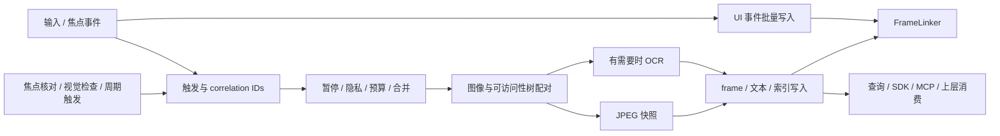
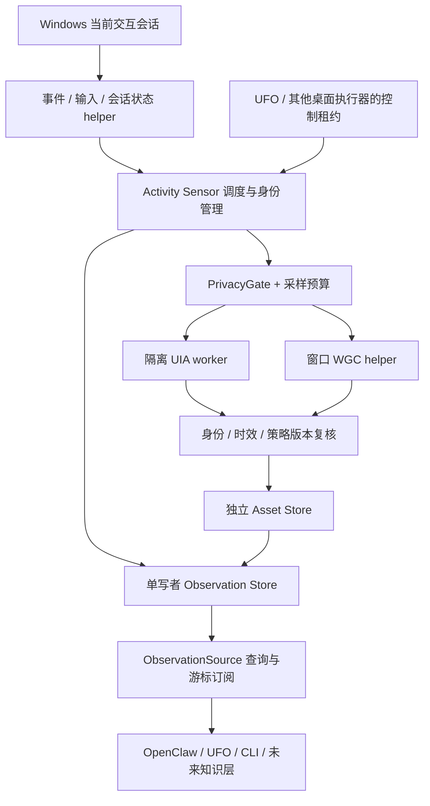

# Windows 活动观察数据层：Screenpipe 源码研究与 Mirally 方案

日期：2026-10-08。状态：**基础观察契约、窗口标题/浏览器 URL 和监控界面已实现；可选 HWND WGC + Windows 原生 OCR 内容层已接入，默认关闭**。本轮完成源码阅读并实现产品拥有的 Observation Store、策略门、资产发布、游标、CLI、前台只读适配器、输入元数据聚合、Raw Input helper、受限 UIA worker、HWND WGC helper、Windows OCR worker 和单实例控制；没有默认启动后台采集、运行 Screenpipe、调用模型或新增桌面实验。

启用 Activity Sensor 后，基础观察契约包含前台元数据、输入聚合和 UIA 结构，缺失源时显示 `degraded`。2026-10-08 已扩展为丰富内容默认配置：标题/URL、持续多显示器截图和 OCR、UIA 正文与属性、已提交输入文本变化和 Unicode 剪贴板。整体仍需显式启动，独立配置开关保留；音频未接入。最新实现、配置和测试以 [丰富内容采集](activity-rich-capture.md) 为准，对照见 [Activity 与 Screenpipe](activity-screenpipe-gap.md)。下文研究建议中的保守基线、阶段划分和默认配置是历史设计，不覆盖最新实现说明。

2026-10-11 原始采集契约修正：获准采集的文字及 UIA 声明范围内的树完整保存，不再按字符数、节点数、深度或 JSON 大小截断。下文 depth 6／nodes 180 等旧预算仅为历史研究建议；当前只有处理摘要和查询输出应用内容预算，采集读取失败或超时明确报告不可用。详情见 [新数据检查](activity-fresh-data-review.md#5-原始采集契约纠正与轨迹判断)。

Mirally 研究基线：主仓库 `04b2232`，分支 `feat/mirally-openclaw-desktop`；UFO 子模块 `a795552d976c4c019d7c2f778a0effb5cef7de6b`。Screenpipe 已克隆至本机 `tmp/screenpipe/`，研究快照为 `ac204c0b8e3499225f5d26bd4b4bef48ef818674`，提交时间 2026-10-06 17:40:49 UTC。以下源码结论都针对这个快照，不代表其历史版本或未来版本。

## 1. 建议采用的方向

建立一个独立的、当前 Windows 用户会话内的 **Activity Sensor**：持续记录低成本状态和输入元数据，按事件与预算补充 UIA、窗口图像，形成可查询、可重放的 Observation 数据。UFO、OpenClaw、以后可能增加的知识层都通过同一产品接口消费，不让采集器依赖某个智能体内核。

值得参考 Screenpipe 的是采集和存储工程：触发合并、图像与可访问性信息配对、失败与缺失的表达、事件关联、写入协调、保留与恢复。产品目标已明确为陪伴场景的丰富上下文，应尽量对齐其内容采集、检索和 agent 消费能力，不能把活动计数当作完整数据层。当前实现范围与完整目标见 [Screenpipe 对齐情况](activity-screenpipe-gap.md)；下文保留原研究方案中的设计建议，不把建议视为已落地。

数据层回答“观察到了什么”，上层回答“这意味着什么”。例如：

| 数据层可以提供的证据 | 不能直接作为事实的推断 |
| --- | --- |
| 某窗口在前台；该时段观察到键盘输入计数 | 用户在写报告、工作有效率、实际阅读了窗口内容 |
| 窗口暴露 Document / Edit 控件；有授权的文字或图像证据 | 用户正在编辑某项目；项目属于哪个公司 |
| 发生滚动；画面变化；UIA 不足 | 用户看视频、刷短视频、玩游戏 |
| UFO 桌面控制租约有效；发生了窗口变化 | 这些变化都是用户亲自做的，或者每个变化都由 UFO 导致 |
| 一段时间没有可用证据 | 用户什么都没做；任务已完成 |

第一版不生成 Task Graph、项目分类、承诺/待办或长期记忆，不调用视觉模型。以后知识层的结论要带 `observation_ids`、推断时间、规则/模型版本和不确定性，不能回写成原始事实。

## 2. 研究依据与已有能力

任务依据是本机参考提示 [重写 screenpipe 数据层](../tmp/重写screenpipe数据层.md)。结合两轮已完成探索：[Windows 本地行为线索](../tmp/windows-activity-exploration-2026-10-06.md)、[Windows 通用桌面感知](../tmp/windows-universal-desktop-exploration-2026-10-07.md)。这些 `tmp/` 文件被 Git 忽略，只在完成探索的机器上存在；本设计的关键结论在下文重述，不要求其他开发者拿到私人实验产物。

### 2.1 不能混淆的三类进展

| 部分 | 当前证据 | 对本方案的意义 |
| --- | --- | --- |
| 产品中的 UFO 观察 | 原生 Session 的任务截图、控件观察及产品隔离适配已经存在 | 是执行器内的按需观察，不是全天活动采集服务 |
| 产品的物理输入监测 | `RawPointerMonitor` 已监测物理鼠标移动，支持输入接管 | 可以参考注册方式；没有通用键盘、点击和滚动元数据采集协议 |
| 产品窗口身份/隔离 | 前端登记校验 PID 与进程启动时间，识别 Mirally 及 WebView2 子进程 | 可以复用自身窗口排除规则；被动观察不能靠隐藏窗口制造无干扰 |
| 产品桌面互斥 | UFO worker 用命名 mutex 互斥桌面任务 | 能防并行桌面执行，不能单独证明操作 actor |
| 前台事件实验 | 两分钟受控实验中两次切换回调约 31 ms；一次状态差异由轮询纠正 | 支持事件主导、轮询核对；不能承诺无漏报 |
| UIA 实验 | Office / Explorer / 设置结构丰富；微信、飞书和部分 Electron 窗口较贫乏 | 不能把“程序使用了 Chromium”视为完整可访问性支持 |
| UIA 超时实验 | 自建阻塞 provider 下，1.2 s worker 预算约 1.223 s 返回 | 进程树隔离有依据；长时间稳定性、所有 provider 尚未验证 |
| WGC 实验 | HWND 窗口捕获约 190–215 ms，目标被遮挡时仍不混入遮挡物 | 窗口捕获优于桌面截图裁剪；最小化时没有有效帧，不能自动退回桌面 |
| 视觉差分实验 | 32×32 MAE + dHash 漏掉小范围文字变化，能检测大变化 | 不能照搬这一精度作为去重标准，更不能用它判定用户行为 |
| 持久数据层 | 已有产品拥有的 Observation Store、订阅游标、资产状态、策略门和 agent lease 原语；尚未接入默认宿主 | Windows UIA/Raw Input/WGC/OCR 适配器已可独立运行，正式宿主生命周期仍待实现 |

两分钟原型做了 6 次 UIA 和 6 次截图，保留 4 次变化摘要、丢弃 2 次重复；没有保存原始图像。CPU 合计约 2.67% 单核，按本机 20 逻辑核总容量折算约 0.13%；父进程内存约 26.5 MB，采样 worker 进程树峰值约 55.1 MB，GPU 没有测量。**这些是短时间、受控窗口、单显示器结果，不是未来完整服务的资源承诺。** 锁屏/UAC 实际转换、多屏/高 DPI、RDP、真实游戏和 2–8 小时稳定性仍缺验证。

### 2.2 Screenpipe 快照与使用边界

源码入口以 [Screenpipe 仓库](https://github.com/screenpipe/screenpipe) 为准。本地使用用户指定的克隆工作流，远程入口为 `https://github.com/mediar-ai/screenpipe.git`；本文引用采用固定 commit 链接，便于复查。

这个快照的许可是 [Screenpipe Commercial License](https://github.com/screenpipe/screenpipe/blob/ac204c0b8e3499225f5d26bd4b4bef48ef818674/LICENSE.md)，不是当前版本的 MIT 许可；许可区分研究、限期评估与需要商业许可的使用，并对集成、分发和竞争产品规定限制。方案采用独立产品协议与 Windows 官方 API，不复制其源码或数据库迁移；如果后续要直接引入其实现，需要先确认相应许可，不能把“源码可读”理解为可直接商用。

## 3. Screenpipe 实际架构与值得读的部分

本次重点阅读的是 Rust 采集、a11y、图像、数据库和保留链路，抽查音频、语义投影和 MCP 边界；没有遍历全部 UI、云服务及每个测试，也没有编译运行它。下面描述的是源码行为与工程结构，不是本机性能实测。

### 3.1 仓库分层

| 区域 | 职责 | 与我们本轮的关系 |
| --- | --- | --- |
| `apps/screenpipe-app-tauri/` | 桌面 UI、设置、时间线、连接和工作流入口 | 参考开关、健康状态与生命周期；不用移植 UI |
| `crates/screenpipe-engine/` | 触发调度、焦点跟踪、采集编排、事件关联和保留 | 重点参考可靠性设计 |
| `crates/screenpipe-a11y/` | 输入/窗口事件、活动信号、可访问性树及平台实现 | 参考拆分；我们的输入与内容边界更窄 |
| `crates/screenpipe-capture/` | 可复用的树/图像配对、OCR 门控、树 worker | 重点参考证据一致性、预算和失败状态 |
| `crates/screenpipe-screen/` | WGC/其他平台捕获、图像比较、OCR、快照写入 | 参考 Windows 工程细节，不引入整套录屏 |
| `crates/screenpipe-db/`、`screenpipe-sqlite-coordinator/` | 数据模型、搜索、写队列、协调、健康检查及混合存储 | 重点参考单写者、恢复与数据寿命 |
| `crates/screenpipe-audio/` | 设备采集、VAD、分段、说话人、会议及本地/托管 STT | 本轮不接入；现有语音命令 API 与全天音频记录是两件事 |
| `crates/screenpipe-semantic/` | 有界树上的确定性语义投影与应用解析器 | 未来 enrichment 的参考，第一版不做应用语义分类 |
| `packages/` 中 SDK、MCP、CLI 等 | 给外部 agent 查询屏幕/音频及相关能力 | 稳定 ObservationSource 以后再加受限 MCP 查询 |

### 3.2 当前核心采集链路



事件触发不等于没有周期工作。源码中有低间隔调度、焦点核对、视觉检查和 idle capture；其中 `CaptureTrigger::Idle` 是一种周期捕获触发，不能直接翻译成“用户离开电脑”。不同触发还有优先级、合并、硬检查点和速率限制。[事件采集实现](https://github.com/screenpipe/screenpipe/blob/ac204c0b8e3499225f5d26bd4b4bef48ef818674/crates/screenpipe-engine/src/event_driven_capture.rs#L342)

其 `UiEvent` 能携带应用、窗口、URL、控件上下文，以及键、聚合文本、剪贴板等内容；配置默认值中 `capture_text` 和剪贴板内容为 true，原始 keystroke 为 false。因此它并不是一个天然只有输入计数的采集器。[事件定义](https://github.com/screenpipe/screenpipe/blob/ac204c0b8e3499225f5d26bd4b4bef48ef818674/crates/screenpipe-a11y/src/events.rs#L11)、[配置默认值](https://github.com/screenpipe/screenpipe/blob/ac204c0b8e3499225f5d26bd4b4bef48ef818674/crates/screenpipe-a11y/src/config.rs#L197)

### 3.3 具体参考点及 Mirally 的取舍

| 源码参考点 | 解决的问题 | 我们的采用方式 |
| --- | --- | --- |
| [Activity feed](https://github.com/screenpipe/screenpipe/blob/ac204c0b8e3499225f5d26bd4b4bef48ef818674/crates/screenpipe-a11y/src/activity_feed.rs) | 最近输入与活动计数独立于完整内容采集 | 单独维护低成本输入元数据，不要求 UIA、OCR 或文本监听运行 |
| [Windows a11y](https://github.com/screenpipe/screenpipe/blob/ac204c0b8e3499225f5d26bd4b4bef48ef818674/crates/screenpipe-a11y/src/platform/windows.rs) | 输入回调交接、滚动/文本聚合、hook 健康问题 | 回调只做有界元数据投递；优先 Raw Input，不记录字符、键码序列或剪贴板 |
| [触发调度](https://github.com/screenpipe/screenpipe/blob/ac204c0b8e3499225f5d26bd4b4bef48ef818674/crates/screenpipe-engine/src/event_driven_capture.rs#L557) | 高频事件合并，重要检查点不被后来的软触发吞掉 | 合并昂贵的证据请求；前台/会话状态事实不因图像去重而消失 |
| [配对捕获](https://github.com/screenpipe/screenpipe/blob/ac204c0b8e3499225f5d26bd4b4bef48ef818674/crates/screenpipe-capture/src/paired_capture.rs#L148) | 图像、树、焦点、时间、坐标和所属显示器的一致性 | 明确 capture group，前后复核身份；过期证据标记并拒绝作为当前前台内容 |
| [OCR 决策](https://github.com/screenpipe/screenpipe/blob/ac204c0b8e3499225f5d26bd4b4bef48ef818674/crates/screenpipe-capture/src/paired_capture.rs#L344) | UIA 非空却只有工具栏，主内容缺失 | 将 rich/thin/unavailable 作为证据质量；OCR 是未来可选补充，不据“有节点”宣称覆盖正文 |
| [OCR gate](https://github.com/screenpipe/screenpipe/blob/ac204c0b8e3499225f5d26bd4b4bef48ef818674/crates/screenpipe-capture/src/ocr_gate.rs) | 失败提取不应推进“已处理”图像基线 | 只有持久写入成功后才推进持久去重基线；采样基线与已保存基线分开 |
| [树 worker](https://github.com/screenpipe/screenpipe/blob/ac204c0b8e3499225f5d26bd4b4bef48ef818674/crates/screenpipe-capture/src/tree_walker_worker.rs#L25) | 树读取超时和 worker 数量上限 | 采用有限的进程 worker + Job Object；不把线程 timeout 说成终止 COM 调用 |
| [Windows WGC](https://github.com/screenpipe/screenpipe/blob/ac204c0b8e3499225f5d26bd4b4bef48ef818674/crates/screenpipe-screen/src/wgc_capture.rs) | 持久会话、按需求 GPU copy/readback、设备失效、尺寸变化和过期帧 | 学习按需读回与恢复原则；我们的捕获单位改为 HWND，禁用桌面 fallback |
| [Windows monitor](https://github.com/screenpipe/screenpipe/blob/ac204c0b8e3499225f5d26bd4b4bef48ef818674/crates/screenpipe-screen/src/monitor/windows.rs) | 每显示器会话缓存和失败 fallback | 不照搬其 monitor + xcap fallback；目标窗口无法捕获就返回不可用 |
| [Snapshot writer](https://github.com/screenpipe/screenpipe/blob/ac204c0b8e3499225f5d26bd4b4bef48ef818674/crates/screenpipe-screen/src/snapshot_writer.rs) | 离散 JPEG、编码开销、文件持久写入 | 独立 Asset Store、原子提交和短保留；避免连续视频 |
| [Frame comparison](https://github.com/screenpipe/screenpipe/blob/ac204c0b8e3499225f5d26bd4b4bef48ef818674/crates/screenpipe-screen/src/frame_comparison.rs) | 下采样、hash、比较成本 | 独立实现分块比较并测试小文本变化；视觉差异不进入用户行为分类 |
| [FrameLinker](https://github.com/screenpipe/screenpipe/blob/ac204c0b8e3499225f5d26bd4b4bef48ef818674/crates/screenpipe-engine/src/frame_linker.rs) | 事件与 frame 写入先后不定，多个触发关联一个 frame | 稳定 Observation ID + 因果引用，记录无证据原因；原始事实不靠事后改写获得含义 |
| [DB write queue](https://github.com/screenpipe/screenpipe/blob/ac204c0b8e3499225f5d26bd4b4bef48ef818674/crates/screenpipe-db/src/write_queue.rs)、[SQLite coordinator](https://github.com/screenpipe/screenpipe/blob/ac204c0b8e3499225f5d26bd4b4bef48ef818674/crates/screenpipe-sqlite-coordinator/src/lib.rs) | 批次提交、统一写入与 checkpoint 协调、故障隔离 | 所有修改经过一个 DB writer，提交后再发布；迁移和清理也参与协调 |
| [事件/frame 迁移](https://github.com/screenpipe/screenpipe/blob/ac204c0b8e3499225f5d26bd4b4bef48ef818674/crates/screenpipe-db/src/migrations/20260220000000_event_driven_capture.sql) | frame 的截图、树、文本来源和全文索引 | 参考证据分层，不复制表；我们不默认建立私人内容全文索引 |
| [Storage](https://github.com/screenpipe/screenpipe/blob/ac204c0b8e3499225f5d26bd4b4bef48ef818674/crates/screenpipe-db/src/storage/mod.rs)、[Retention](https://github.com/screenpipe/screenpipe/blob/ac204c0b8e3499225f5d26bd4b4bef48ef818674/crates/screenpipe-engine/src/retention.rs) | SQLite 与混合载荷存储、不同保留模式、清理水位和恢复 | 第一版 SQLite + 独立文件已足够；必须从第一版具备删除、过期与恢复协议 |

需要特别区别：这个快照的树 worker 是有存活线程上限的 timeout/retire 机制，卡住的线程可能仍然存活；WGC 实现则调用 `CreateForMonitor`，并非我们的 `CreateForWindow` 方案。Screenpipe 的 Windows OCR 路径是本轮实现的参考；Mirally 现在使用自己的 HWND helper、独立 OCR worker 和产品 Observation schema，不复制 Screenpipe 代码。[Windows OCR 调用](https://github.com/screenpipe/screenpipe/blob/ac204c0b8e3499225f5d26bd4b4bef48ef818674/crates/screenpipe-capture/src/paired_capture.rs#L548)

Screenpipe 也有应用专用辅助逻辑与 [语义解析器](https://github.com/screenpipe/screenpipe/blob/ac204c0b8e3499225f5d26bd4b4bef48ef818674/crates/screenpipe-semantic/src/lib.rs)。通用 OS 采集能减少逐应用适配，但不能自动消除文档、网页、聊天等语义差异。

## 4. 产品架构与代码组织

### 4.1 服务边界



Sensor 是独立后台进程，运行在普通权限的当前用户交互会话，不作为 Session 0 系统服务，也不随每次 UFO 任务启动。它不导入 UFO、Galaxy、LLM、Tk 或 OpenClaw 发行包；Gateway 重启与 Sensor 生命周期分离。

技术建议是沿用产品的 Python 控制/协议/SQLite 层，加少量独立编写的 Windows native helper。WGC 使用 C++/Windows SDK；UIA 首版可以沿用隔离 Python + COM 的已验证思路，再根据冷启动和资源测量决定是否原生化。没有依据现在引入一整套 Rust 服务或重写产品语言栈。

首先做请求级窗口捕获，复用 native 进程和 D3D device，但不默认保持所有窗口的持续 capture session。以后若测量证明需要短期缓存会话，必须关闭被排除、锁屏、最小化或超时的会话；按需 GPU copy/readback，限制持有帧和缓存总量，不能因采样频率低就假设帧回调成本低。

### 4.2 已实现与待接入目录

```text
openassist/
  core/activity/
    models.py           # Observation、质量、actor、身份和版本
    contracts.py        # ObservationSource、查询、游标与错误
    policy.py           # 采样决策、归因规则；不直接调用 Win32
    store.py            # SQLite 访问与迁移，单写者和 replay
    assets.py           # 资产状态、引用和保留协议
  platform/activity/
    events.py           # WinEvent / WTS / power / foreground reconcile
    identity.py         # process/window/session/monitor 身份
    input_metadata.py   # Raw Input 聚合，不保留按键内容
    uia_worker.py       # COM/MTA + 有预算遍历
    native/             # HWND-only WGC helper 的独立实现与构建
    wgc_capture.py      # helper 生命周期、deadline、signature gate
    ocr.py              # Windows.Media.Ocr worker adapter
    ocr_worker.py       # WinRT bitmap decode + lines/words extraction
  runtime/activity/
    service.py          # 生命周期、队列、scheduler、健康检查
    config.py           # activity.yaml，独立配置校验
    ipc.py              # 当前用户管道、认证、消息限额
    cli.py              # run/status/query/tail/pause/resume/stop/doctor/monitor
    agent_activity.py   # 桌面执行租约桥接
config/openassist/activity.yaml.template  # 已实现模板，默认关闭
tests/test_activity_*.py
tests/windows_activity/ # 受控 provider / 图像 / 输入测试入口
```

当前已建立协议、策略、SQLite writer、输入文本投影、配置、Sensor、合并调度、CLI、单实例控制及 Activity Monitor。Windows 适配包含前台快照、Raw Input/剪贴板通知、隔离 UIA 正文、窗口/多显示器 WGC、Windows 原生 OCR 和序号校验剪贴板读取。内容策略通过后才读取正文和图像；启用模板默认保留变化图片并清理过期/超配额资产。WTS/WinEvent 生命周期和默认宿主启动尚未接入。

### 4.3 与现有代码的连接

| 现有模块 | 可以利用 | 必须避免的误用 |
| --- | --- | --- |
| `platform/raw_pointer.py` | Raw Input 消息窗、设备过滤经验 | 当前只监测鼠标移动，不能宣称已经具备键盘/手势事实流 |
| `platform/frontend_registry.py` | PID/start time 校验、自身进程家族排除 | 不使用截图时 hide/restore 来观察用户；保持前台和窗口状态 |
| `platform/window_session.py` | DPI、前台、矩形、显示器等 API 包装经验 | 不直接复用包含窗口置顶、隐藏、焦点操作的 UI 会话对象 |
| `platform/desktop_lock.py` | 检测产品桌面执行冲突 | mutex 占用是控制提示，不是可靠 actor 事件 |
| `runtime/ufo/worker.py`、`controls.py` | 任务/动作边界，执行器身份、取消和实际控制范围 | task-local 进度 callback 不能充当持久 Observation Bus |
| `runtime/ufo/observation.py` | 自身窗口过滤与任务观察的经验 | 不把 monkeypatch 的 UFO 观察循环延长为全天采集 |
| `core/execution.py` | task ID、revision、桌面控制及服务协议概念 | 不强迫采集生命周期绑定一次 ExecutionRequest |
| `openclaw_host.py` | Windows 无窗口子进程与后台管理经验 | 关闭 Control UI 或重启 Gateway 不等于关闭所有独立服务 |
| `core/conversation.py` | `ConversationStore`，仅供历史独立入口会话参考 | 不把每会话 JSON 或 OpenClaw 会话库当作活动数据库 |

UFO 子模块保持只读。租约接入和 ObservationSource 消费只改产品适配层；OpenClaw 侧用产品拥有的 integration，不编辑 `node_modules/` 或发行包。

## 5. 事实协议、身份与时间

### 5.1 Observation 的稳定语义

当前实现采用 `schema_version = 2`，JSON 可序列化协议；v2 增加 OCR summary，旧 v1 SQLite 会在启动时自动补列。所有 ID 是不携带标题/路径的随机 opaque ID；排序不依赖 ID，而依赖 `ingest_seq`。

| 字段组 | 建议字段 | 语义 |
| --- | --- | --- |
| 主键/来源 | `observation_id`、`schema_version`、`kind`、`source_id`、`source_epoch`、`source_seq`、`ingest_seq` | source epoch 每次采集进程重启更新；来源重投按 epoch + seq 幂等 |
| 时间 | `observed_at_utc_ms`、`received_at_utc_ms`、`monotonic_ns`、`boot_id`、`clock_epoch`、`time_quality` | 原始事件时间和入库时间分开；单调时间只在约定 epoch 内比较 |
| 范围 | `session_instance_id`、`process_instance_id`、`window_instance_id`、`app_id` | 不强迫上层理解 HWND；无法确认身份时可为空并标注质量 |
| 控制归因 | `actor`、`actor_basis`、`control_owner`、可选 `agent_task_id` / `agent_session_id` | actor 与桌面控制者分开；不拿 agent 租约解释所有物理输入 |
| 隐私 | `policy_version`、`collection_level`、`privacy_status` | 记录实际获准的级别；被排除内容不写入身份和内容字段 |
| 因果/配对 | `caused_by`、`capture_group_id`、`capture_started_at`、`capture_finished_at` | snapshot 可以由多个同窗口触发导致，不把延迟证据冒充事件当时状态 |
| 元数据/证据 | `payload`、`uia_summary`、`visual_summary`、`asset_refs` | 有界、分级；窗口标题和 URL 默认开启，UIA 正文和原始输入仍未接入 |
| 质量 | `quality`、`missing_reasons`、`truncated`、`identity_confidence` | 区分成功、无权限、预算未采集、超时、过期、故障 |

建议 kinds：`foreground_changed`、`window_state_changed`、`session_state_changed`、`input_batch`、`context_snapshot`、`agent_control_changed`、`collector_status`、`collection_gap`、`clock_changed`。`foreground_changed` 是立即记录的事实；`context_snapshot` 是稍后采集的证据，两者不能合成一条会被覆盖的“当前上下文”。

原始 Observation 在其保留期内不修改。去重、因果引用、纠正和 enrichment 通过新记录或独立关联表达；隐私删除、保留清理是明确的物理删除例外。业务状态从事实投影，不能直接修改旧事实成为新结论。

### 5.2 一个不含内容的例子

下面是拟定协议示例，不是从用户桌面导出的数据。示例 ID 为可读占位，正式实现使用 opaque ID。

```json
{
  "schema_version": 2,
  "observation_id": "obs-example-2",
  "kind": "context_snapshot",
  "source_id": "windows-desktop",
  "source_epoch": "collector-example",
  "source_seq": 42,
  "ingest_seq": 105,
  "observed_at_utc_ms": 1791367200000,
  "received_at_utc_ms": 1791367200300,
  "monotonic_ns": 73000000000,
  "boot_id": "boot-example",
  "clock_epoch": 1,
  "time_quality": "sampled",
  "session_instance_id": "session-example",
  "process_instance_id": "process-example",
  "window_instance_id": "window-example",
  "app_id": "example-editor",
  "actor": "UNKNOWN",
  "actor_basis": "foreground_only",
  "control_owner": "unclaimed",
  "policy_version": 3,
  "collection_level": "structure",
  "privacy_status": "allowed",
  "caused_by": ["obs-example-1"],
  "capture_group_id": "capture-example",
  "capture_started_at": 1791367200000,
  "capture_finished_at": 1791367200250,
  "payload": {"trigger": "foreground_settled"},
  "uia_summary": {
    "status": "ok",
    "coverage": "structure_only",
    "node_count": 18,
    "role_counts": {"Document": 1, "Edit": 2, "Button": 5},
    "truncated": false
  },
  "visual_summary": {"status": "disabled_by_policy"},
  "ocr_summary": {"status": "disabled_by_policy", "text": "", "lines": []},
  "asset_refs": [],
  "quality": "partial",
  "missing_reasons": ["pixels_not_authorized"],
  "truncated": false,
  "identity_confidence": "verified_process_start"
}
```

### 5.3 身份不能只用 PID / HWND

进程实例用 boot identity + PID + 进程 creation time 区分，再映射为 opaque ID。进程路径只用于本机 app 归一化/策略，不默认写入包含用户名的全路径；UWP 宿主、浏览器多进程等需要单独的 `app_id`，不能只拿 renderer 名称当应用身份。

窗口实例用进程实例 + HWND + generation 区分，监听生命周期并在每次任务前复核。HWND 是 collector 内部定位句柄，不是公共引用。丢失生命周期事件时，相同 HWND 也不能证明连续性；标注 best-effort，必要时创建新 window instance。服务重启后进程可基于已验证启动时间重新关联，窗口默认开启新 generation，不能声称跨重启窗口身份绝对稳定。

Session identity 包含当前 Windows 交互 session 与 logon identity，关联本机用户但不在公共结果里暴露 SID。显示器记录稳定设备标识、物理像素坐标、DPI 与配置 epoch；热插拔/分辨率变化结束旧采样坐标域。跨屏窗口的图片坐标与 UIA 屏幕坐标必须通过实际捕获尺寸/窗口内容边界映射，不能只乘一个 DPI 比例。

### 5.4 时间、休眠与缺口

使用 UTC 表示墙钟时间，QPC 等单调计时衡量内部延迟，保存锚点和 boot/collector epoch。窗口事件自带 tick 的映射要处理回绕和时间不确定性；系统改时、睡眠/恢复、新登录与采集重启生成边界记录。

不得把锁屏、休眠或采集停止期间的最后一个前台窗口延展成持续活动。前台区间投影遇到边界或 gap 就终止，恢复时重新观察。查询按时间查看事实，订阅按入库序号重放，两者不同；晚到事件及墙钟回拨不能破坏游标顺序。

## 6. 事件、输入与 actor

### 6.1 低成本状态观察

WinEvent hook 捕捉前台、窗口最小化/恢复与必要的生命周期事件；回调线程有独立 message loop，只投递轻量 token，不做 UIA、图像读回、数据库写入或进程全量查询。主调度器用 1 s 前台核对补漏，用低频按需进程核对维护身份。[SetWinEventHook 官方说明](https://learn.microsoft.com/en-us/windows/win32/api/winuser/nf-winuser-setwineventhook)

WTS 监听 lock/unlock/session 变化，电源通知监听 sleep/resume；采样前检查 input desktop，无法确认 Default 桌面或无访问权限时停止 UIA/图像。会话状态为 `active / idle / locked / secure_desktop / unknown`，collector 状态为 `running / paused / degraded / stopped`，两组状态分别维护。

`GetLastInputInfo` 只用于当前会话的“最近 OS 输入”，包括程序注入的可能性，不能证明物理用户活动，也不能拿它校准丢失的真实用户输入。[GetLastInputInfo 官方说明](https://learn.microsoft.com/en-us/windows/win32/api/winuser/nf-winuser-getlastinputinfo)

### 6.2 输入元数据，避免内容监听

优先在独立 helper 进程注册 Raw Input 的鼠标和键盘，统计短时间 bin 内的 keyboard count、click count、scroll count / direction、motion presence，以及 burst 起止与 quiet duration。精确坐标、字符、按键序列、剪贴板和输入内容不持久化；处理原始消息所需的临时字段不进入日志、队列 payload 或数据库。方向/计数也由隐私级别控制。

不用 `RIDEV_NOLEGACY` 抑制用户输入，不请求占用鼠标；先保持观察器不改变产品输入行为。Windows 同进程每个 Raw Input device class 只有一个注册目标，因此不能和现有 UI 的注册竞争；独立 helper 进程避免这一冲突。[RegisterRawInputDevices 官方说明](https://learn.microsoft.com/en-us/windows/win32/api/winuser/nf-winuser-registerrawinputdevices)

Raw Input 设备信息是较强的输入来源证据，不是万能的人类身份认证。RDP、远程控制、驱动模拟和设备异常的归因边界需要实测；未知输入路径标成 unavailable/UNKNOWN，不伪造零输入。手势与 typing pause 都是时间聚合，不是内容解释。

### 6.3 桌面控制租约从第一批实现

由产品执行器在获得桌面控制后发布 `begin / heartbeat / end`：执行器 PID + start time、task/session ID、revision、lease ID、有效期。暂停、人工接管、取消和异常退出对应租约状态变化；动作 dispatch 的可选元数据另发，不发送用户任务正文。Sensor 验证当前用户、进程身份和租约存活，不接受任意客户端自报 PID。

| actor | 可接受的依据 | 必须保留的限制 |
| --- | --- | --- |
| `USER` | 已验证设备来源的物理输入元数据，没有已知混合来源冲突 | 只归因该输入，不自动把整个前台区间标为用户操作 |
| `AGENT` | 已认证执行器动作标记，或已知桌面租约范围内的操作证据 | 租约只能说明控制范围；不证明所有视觉变化都是 agent 引起 |
| `SYSTEM` | 明确的系统会话/电源状态事件 | 不把无法解释的窗口变化都归为 SYSTEM |
| `BACKGROUND` | 明确来自非前台来源的状态/内容更新 | 没有输入证据的动画不等于已知后台行为 |
| `UNKNOWN` | 只有焦点/画面、来源不明，或用户与 agent 同时活动 | 这是正常的保守状态，知识层不能强行折算成 USER |

每条记录还包含 `control_owner`。例如租约有效时出现物理输入，可以保留输入来源证据，但把关联 snapshot 的 actor 设为 UNKNOWN 并注明 mixed ownership。默认 agent 控制期间暂停高成本用户内容采集，只记录必要的控制/会话事实；agent 执行日志继续走原有任务链路。

租约丢失或 Sensor 离线不能卡住桌面执行器。接入调用有短预算；失联时保守表示归因不可用。worker 崩溃要通过 heartbeat expiry + PID/start time 校验释放租约；过期不意味着已经证明桌面回到用户操作。只读检查 mutex 可以辅助发现已有桌面执行，但不能替代租约协议。

## 7. 调度、UIA 与图像证据

### 7.1 合并请求，不合并事实

前台变化立即写 Observation，然后为稳定后的同一 window instance 请求证据。Click、scroll stop、typing pause、resume、heartbeat 可以合并到一次 capture group，保留全部 `caused_by`。不同窗口 generation、不同 policy version 或控制归因区间不能合并。

UIA、图像及 OCR 各有独立队列/预算，证据作业有 deadline，迟到结果不能阻止新前台状态更新。事件队列中的连续 pointer motion 可以聚合；前台/lock/control 边界有优先队列。队列溢出仍可能丢事实，必须生成 gap 和计数，不能因为有队列就承诺 exactly-once 的 OS 观察。

下表是待校准的初始建议，不是已经测得的最优参数：

| 参数 | 初始建议 | 用途 |
| --- | --- | --- |
| foreground reconcile | 1 s | 补漏与状态验证 |
| foreground settle | 250 ms | 跳过瞬间窗口，不丢切换事实 |
| click settle / scroll quiet | 250 / 600 ms | 避免读取交互过程中的瞬时布局 |
| typing quiet | 1500 ms | 连续输入后再请求证据，不保存所输入文字 |
| active heartbeat | 45 s | 静态窗口也有新鲜度标记；idle/locked 时不截图 |
| idle threshold | 120 s | 仅作为输入空闲信号；不推断用户是否仍在阅读 |
| snapshot min interval | 2 s | 稳定窗口下的昂贵请求下限 |
| screenshot token bucket | 每分钟 6 次，burst 2 | 预算限制；manual 也不能绕过隐私门 |
| UIA | depth 6、nodes 180、worker deadline 1200 ms | 有界结构读取，截断标记必填 |
| WGC request deadline | 1500 ms | 无帧/设备异常及时返回 |
| pending snapshot jobs | 当前窗口 1 个 + 待执行 1 个 | 新焦点取消旧请求，避免线程/进程风暴 |

持续输入时延后深度 UIA，减少目标程序 provider 压力；最长延后后可只采更便宜的状态，不能硬逼应用提供树。高频游戏、动画或视频不以逐帧变化触发持久图像，也不默认后台轮询所有窗口。

### 7.2 UIA：结构优先，有界且可失败

在隔离 worker 内初始化 COM MTA，从目标 HWND 使用有预算的 TreeWalker；每步检查 depth、nodes、deadline、visibility 与属性级许可。不先调用一次无边界的全量 descendants 再过滤。正常模式只取控件类型计数、有限结构、模式可用性和必要几何；`Name / Value / Text / Selection / AutomationId` 都可能含内容，默认不批量读取或保存，只有明确属性白名单才能打开。

标注 `rich / thin / unavailable` 时要说明判断范围。只有 Window + Pane 属于 thin；仅有 Document 节点不代表正文可读。单条 UIA 属性调用也可能卡住，内部 deadline 不是硬超时；外部 supervisor 的 Job Object 才终止本次采集进程树。worker 数量有上限、超时后有限 backoff，连续失败对该 app 开熔断，仍记录前台事实。[UIA 线程安排官方建议](https://learn.microsoft.com/en-us/windows/win32/winauto/uiauto-threading)

终止客户端能保护 collector，不保证目标应用的 provider 已经停止工作，也不消除所有 UI 卡顿。因此仍要在活跃输入期减载、控制调用量，验收关注用户应用响应而不只关注采集进程 CPU。

### 7.3 WGC：只捕获目标窗口

使用 `IGraphicsCaptureItemInterop::CreateForWindow` 创建目标；在同一个捕获请求中携带已验证 window instance、policy version、actor 范围和采样时间。[CreateForWindow 官方接口](https://learn.microsoft.com/en-us/windows/win32/api/windows.graphics.capture.interop/nf-windows-graphics-capture-interop-igraphicscaptureiteminterop-createforwindow)

不通过桌面截图裁剪 fallback。最小化、protected/DRM、权限不足、会话切换、窗口关闭、设备 reset、无有效帧等情况返回明确原因；`PrintWindow` 返回 true 或非空 bitmap 也不等于可用内容。判断帧尺寸、时间和所属目标，不把上一帧当新帧。

UIA 与图片不是 OS 原子快照：记录各自时间，采集前后检查真实前台、process start/window generation、输入桌面、权限版本及 geometry epoch。发生切换就保留原切换事实，拒绝这组内容的持久化；返回 `stale_target`，必要时给新窗口重排任务。禁止新 policy 已撤销时保存旧 worker 返回的内容。

按目标捕获使遮挡的 Mirally 窗口不应进入底层应用图像，但必须验证具体系统/驱动组合；自身目标、自己的 WebView2/worker 直接排除。被动观察不隐藏/恢复前端、不激活目标、不改变焦点。

### 7.4 去重和后续 enrichment

先用精确比较/hash 判断真正相同图像，再用保留宽高比的较高分辨率分块差分评估变化；针对少量文本、滚动、插入光标、视频和尺寸变化建立合成测试。允许配置持久保存敏感区域的前提下，才讨论局部变化证据；不能宣称 hash 阈值能精确识别内容更新。

每次 UIA/图像采样仍有新的 Observation 和时间标记，即使图像复用旧 asset。区分 `unchanged`、`near_duplicate`、`not_sampled`、`unavailable`；近似去重是节省资产的判断，不能覆盖输入/焦点事实。去重范围限定为窗口实例 + collection/privacy scope，不能跨应用、账户或不同授权策略共享内容指纹。

OCR 作为可选内容记录的一部分消费获准且未过期的窗口图片，失败返回明确状态，不阻塞前台/输入事实。当前使用隔离的 `Windows.Media.Ocr` worker，保存识别文本、行/词边界框和语言；远程 OCR/vision 仍需要单独上传授权、配置与耗时预算。OCR 的识别文本仍是提取结果，有错误率；视觉模型“在做什么”的判断属于 inference。图像已过期时返回 source unavailable，不隐式重新截图或调用模型。

## 8. 隐私、安全和数据寿命

### 8.1 PrivacyGate 在昂贵读取之前

每次作业先检查采集启用/暂停、当前会话/桌面、应用/窗口/显示器规则、Mirally 自身、actor、采集级别和 policy version；读回与提交时再次检查。排除策略的必要标题匹配只在本机临时执行，不能为“先脱敏”而先收集整棵私人树或全屏截图。

建议提供三个独立级别：

| 级别 | 允许内容 | 初始默认 |
| --- | --- | --- |
| `metadata` | 获准应用身份、窗口标题/URL、前台边界、粗粒度输入计数 | 标题/URL 默认开启，可分别关闭 |
| `structure` | UIA 类型/模式/有界几何摘要，仍无正文 | 启用 Sensor 时的模板默认级别 |
| `content` | 选定窗口像素、许可属性的文字及未来 OCR | 明确授权；图像落盘另设开关 |

服务整体仍默认 `enabled: false`，不自行启动后台采集。最新模板启用后，窗口标题、URL、UIA Name/Value/Text、截图、输入文本和剪贴板默认采集；音频未接入。开关、排除、暂停和保留机制用于可控采集及资源管理。

排除的窗口不保存标题、URL、进程路径、app ID 或这些字段的 hash。可保存粗粒度 `suppressed_by_policy` 状态和健康计数；不暴露可反推敏感窗口的逐次详细日志。private browsing 无可靠统一 Windows 标志，识别启发式要保守，不能把名称规则说成完整保证；不确定时允许 metadata、拒绝内容，或者用户直接排除整个浏览器。

`IsPassword` 或 PII 移除不足以保证截图安全，邮件、聊天和文档常没有密码标志。系统日志、异常信息、health、CLI 默认输出都使用相同字段许可；尤其防止 worker stderr 打印属性、图像、请求正文或含用户名的路径。

### 8.2 本机访问边界

数据默认放在 `%LOCALAPPDATA%\Mirally\activity\`，限定当前用户 ACL，支持显式设置本机存储卷。数据库和资产不放进仓库、`agents.yaml` 或 UFO 配置目录；不上传，不绑定公开 HTTP/SQL 端口。

当前用户的 named pipe 使用明确 ACL、连接身份校验、消息长度与超时限制，禁止任意路径/SQL 请求。ObservationSource 根据 consumer scope 限制时间范围、actor 和内容级别；Asset 只能通过 asset ID 解析到受控根目录，校验路径与 reparse point，不能开放任意文件读取。

ACL 不等于磁盘加密。第一版如果仍是普通 SQLite/JPEG，应如实说明：文件权限保护，不承诺抗本机恶意软件或离线磁盘读取。加密资产、DPAPI 管理密钥以及数据库加密是单独方案；不能仅把 token 用 DPAPI 保存就宣称数据库已加密。

### 8.3 独立保留策略

原始图像建议默认不落盘；用户开启后初始保留 24 h，Observation 初始保留 14 d，未来知识层另定寿命。这些是建议默认，支持缩短和按应用删除；知识层必须说明引用的原始证据可能过期。

Asset 的状态保留 tombstone：`pending / ready / deleting / expired / missing`。Observation 引用过期图像时返回 expired，不跳转到另一张近似图，不制造无效本地路径。去重共享资产的到期策略显式计算，不能无限延长老图像寿命；授权撤销时终止相关共享与缓存。

暂停需要实际确认：撤销采样 generation，取消/终止内容 worker，拒绝迟到提交，释放图像缓存；确认后界面才显示已暂停。已有数据的删除是另一个操作。退出停止采集，不以“窗口不见了”表示服务已停。

## 9. 存储、发布和消费接口

### 9.1 最小数据模型

| 表 | 第一版责任 | 关键约束 |
| --- | --- | --- |
| `observations` | 有界事实 JSON、版本、时间、范围、actor、质量 | `ingest_seq` 单调主键；Observation ID 唯一；source + epoch + seq 唯一 |
| `assets` | 相对路径、大小、校验、scope、状态、到期时间 | asset ID 唯一；ready 才允许返回内容；不存图像 base64 |
| `process_instances` | opaque ID、内部 PID/start time/boot、获准 app 信息 | PID 重用不能复用实例；私人路径不默认落盘 |
| `window_instances` | opaque ID、process、HWND/generation、生命周期和置信度 | HWND 为内部字段；事件缺口降低身份连续性置信度 |
| `collector_state` | epoch、配置/schema version、健康、恢复状态 | 不保存最近私人正文；不拿 mutable state 替代历史事实 |
| `source_cursors` | consumer ID、acked ingest seq、过滤 scope/version | 只在 consumer 完成持久处理后前移；不跨 scope 误用 |

可增加独立 `observation_links` 存放因果/去重关联，及 `observation_enrichments` 存放 OCR 等异步结果；不要提前加入 tasks/projects/vector/knowledge 表。给时间、app + 时间、actor + 时间和来源唯一键建索引；payload 大小硬上限，重树/图片移到 asset。`ingest_seq` 使用不会因保留删除而复用的分配方式，例如 SQLite `INTEGER PRIMARY KEY AUTOINCREMENT`；数据库重建同时更换 store generation。

第一版使用本机 SQLite WAL、foreign keys、短事务、`synchronous=FULL`，一个 DB writer 拥有写连接；读连接独立，长查询有分页和 deadline，不挡写入。启用时检查实际 SQLite runtime 与配置，稳定性验证后再讨论降低同步成本；不把 Screenpipe 的特定运行时版本阈值机械移到 Python。第一版不支持网络盘数据库。

写入队列初始上限建议 4096 个轻量事件并另设字节上限；每批不超过 100 条或 100 ms 窗口，忙锁重试有总预算。cleanup、cursor ack、迁移、checkpoint 都经过同一写协调。数据库失败就进入 `storage_blocked`，停止新内容采集，保留有限优先元数据并向用户显示故障；恢复后写 gap。内存队列不是断电日志，不能承诺队列里的事件不会丢。

### 9.2 资产与数据库不能假装一个原子事务

建议提交顺序：

1. 在内容写入门内复核目标身份、policy version 和 generation，分配 asset ID，登记 pending；获准内容写到资产根下临时文件，完成 flush 和校验。helper 只通过有界内存 IPC 返回图像，不自行写资产。
2. 再次校验后，同卷原子 rename 到最终文件；权限撤销与写入提交经过同一协调边界，撤销后不允许新写入开始。
3. 事务内标记 ready，写 Observation 与引用；COMMIT 成功后才发布事件、更新持久去重基线。
4. 崩溃恢复扫描 pending、ready 和有宽限期的孤儿：校验、标为 missing 或清理，不能仅看文件存在就宣告成功。

数据库/文件系统之间仍可能有 crash window；明确以第 3 步为已发布结果。取消或拒绝提交时清理临时内容；暂停回执等待已开始的写入结束或取消，并清理未发布内容。资产写入失败可提交无图像的 partial Observation。不要把不可用资产引用当作 ready 发布。

清理反向走可恢复协议：先登记 deleting，再删除已验证路径，最后保留 expired tombstone；失败重试且不推进对应清理水位。共享引用不允许删错其他策略域的资产。保留清理可以删除 Observation，但订阅者应得到 low watermark / gap，而不是静默跳过。

### 9.3 Observation Bus 是提交后的重放接口

第一版不需要消息中间件：SQLite 中已提交的事实就是持久日志，进程内/IPC 通知只唤醒 reader。通知丢失后仍按 `ingest_seq` 补读；支持 at-least-once 消费，consumer 用 Observation ID 幂等。不要把 task callback 或无持久广播频道作为唯一事实来源。

以下是已由 `ObservationStore` 实现、未来 IPC/MCP 适配层应保持的公共接口：

```text
query(time_range, app_ids?, actors?, kinds?, scope, page_token, limit)
get_recent(window_seconds, scope, limit)
get(observation_id, scope)
subscribe(after_cursor, scope) -> committed observations / gap / status
ack(consumer_id, cursor, scope_version)
resolve_asset(asset_id, scope) -> available / expired / denied / missing
health() -> component status, watermark, gaps, backlog, resource metrics
```

`query` 返回 observation + page token + coverage/gaps；不以“查到 0 条”暗示那段时间没有活动。`subscribe` 的 cursor 包含 store generation 与 seq，数据库重建返回 cursor invalid，保留淘汰返回 gap；不拿 UTC 时间当游标。scope 改变重新建立对应 cursor，防止旧窄过滤游标漏掉新授权范围。

上层不读取 sqlite 文件、不传 HWND、不知道 WGC/pywinauto。默认 `get_recent` 给少量 metadata/structure，图像需单独权限和预算；未来 MCP 先提供只读 query/recent/health，图片读取另设权限，不提供任意 SQL 或默认整个屏幕历史。MCP 只是协议适配，不把 agent 查询行为反向触发未授权采集。

## 10. 生命周期、故障与可观测性

### 10.1 启动与控制

由产品宿主在配置允许时启动/复用每用户每交互 session 的单例 Sensor，用原生 mutex + PID/start time 校验避免重复服务。后台进程启动不弹终端；提供明确的运行/暂停指示和状态入口。可独立诊断，不要求先导入 UFO 或连接模型。

CLI 为 `python -m openassist.runtime.activity.cli`，提供 `run / status / query / tail / pause / resume / stop / doctor / monitor`。其中 `monitor --test` 会使用 `.artifacts/activity-monitor/` 下的隔离数据库启动 loopback 诊断界面；界面轮询状态、指标和事件游标，默认隐藏 OCR 文本与资产路径，显式 reveal 后才返回内容。正式 CLI 和 HTTP API 都默认脱敏，查询内容时按 scope 显式授权。Monitor 暴露 `GET /api/health`、`/api/status`、`/api/metrics`、`/api/events?after=`、`/api/events/{id}` 和 `GET /api/assets/{id}`，以及受 token 保护的 `POST /api/control/pause|resume|stop`；只监听 `127.0.0.1`，不提供任意 SQL 或跨机器访问。

`monitor --test` 现在默认完整采集内容并保留截图，`--metadata-only` 才只验证元数据和 UIA 结构；旧 `--content/--persist-images` 保留兼容，不改变正式 `activity.yaml`。监控默认隐藏所有正文，勾选「显示内容」查看，采集授权与查看开关分离。

关闭 Control UI 不自动等于停止 Sensor，Gateway 重启也不重置 Observation DB；具体随产品退出还是持续后台运行由设置明确控制，初始采用用户主动开启、可显式停止。开机自启后置，暂停状态持久化，重启不能擅自恢复内容采集。

### 10.2 故障策略

| 故障 | 处理 | 上层看到的事实 |
| --- | --- | --- |
| UIA COM timeout / app 持续卡顿 | kill 本次 worker Job、有限重建、按 app backoff | UIA unavailable/timeout；焦点事实继续 |
| WGC 无帧 / 设备移除 / 关闭窗口 | 丢弃缓存、有限重建，不退回桌面 | capture unavailable；不返回旧图 |
| foreground 在采集中切换 | 拒绝旧内容提交，为新窗口重排 | 原边界保留，snapshot stale |
| 事件队列溢出 | 优先边界、有界聚合、计数与核对 | gap，不能推导精确时长 |
| DB busy / 磁盘满 / IO error | 有界重试、停止内容写入、有限缓存 | storage blocked 与恢复 gap |
| 资产文件丢失 | 标 missing，受控修复/清理 | metadata 仍可查，资产不可用 |
| helper 崩溃 / pipe 失联 | 身份核对、有界重启和熔断 | component degraded，不靠 PID 数证明健康 |
| lock / secure desktop / suspend | 取消内容任务，结束活动区间，清空像素缓存 | 明确状态边界，恢复后新观察 |
| 租约方崩溃或归因冲突 | lease expiry + 身份校验；保守 UNKNOWN | control owner 与 actor 质量分别说明 |
| 配置/权限变化 | 原子增加 policy version，拒绝旧 generation 结果 | 新策略生效时间，迟到内容不持久化 |
| 服务恢复 | 检查 schema、资产状态、writer、游标和时钟 | restart/gap，而不是假连续历史 |

worker 最大并发初始为一个 UIA + 一个 WGC，native event helper 常驻；不因 timeout 无限生成进程。进程树资源统计包括 `.venv` redirector 后的真实解释器，沿用前轮 Job Object 经验，不能只测 `Popen` 返回的根 PID。

健康信息至少包含：组件可用性、最后事件/核对/成功采样/提交时间、阶段延迟、backlog、coalesced/dropped、timeout/backoff、asset bytes、DB/WAL 大小、当前 policy/collection level、actor lease 状态，以及采集器与所有 helper 的 CPU/RSS/handles/GPU 测量可用性。

“没有活动”与“采集器没有收到数据”分开；“进程活着”与“写入推进”分开。诊断日志不含私人 payload，允许用 Observation ID/capture group ID 关联故障；UI 可以展示“UIA 暂不可用，正在保留窗口状态”，不长期显示笼统的等待。

## 11. 配置与资源预算

使用独立 `config/openassist/activity.yaml.template`。不改语音和 UFO 配置，不将任何开发者服务商或凭据写入模板。完整启用时，三类基础观察能力应同时打开；旧配置缺失能力时服务会进入 `degraded` 并保留缺口状态。下面是可用配置接口的最小结构：

```yaml
enabled: false
collection:
  default_level: structure
  window_titles: false
  browser_urls: false
  input_content: false
  clipboard: false
  audio: false
input:
  enabled: true
  quiet_ms: 1500
  max_burst_ms: 10000
ui_structure:
  enabled: true
  max_depth: 6
  max_nodes: 180
  timeout_ms: 1200
visual:
  enabled: false            # 窗口像素读取的独立许可
  persist_images: false    # 像素可读不等于允许落盘
  max_per_minute: 6
  burst: 2
  timeout_ms: 1500
  max_dimension: 1920
  ocr_enabled: true
  ocr_timeout_ms: 2500
  languages: [zh-CN, en-US]
  desktop_fallback: false
actor:
  pause_content_during_agent_control: true
  include_unknown_in_user_knowledge: false
privacy:
  exclude_self: true
  deny_content_on_unknown_desktop: true
  rules: []                # 按 app / window / monitor 授权或排除
storage:
  directory: null          # 默认当前用户 LocalAppData
  observation_retention_days: 14
  image_retention_hours: 24
  image_quota_mib: 1024
  min_free_space_mib: 2048
```

同名字段在未来实现时应校验：不允许配置 desktop fallback 为 true；不支持的输入/音频选项拒绝开启，不接受假开关。raw image quota、低磁盘阈值、metadata quota 和总目录上限都要有边界；达到图片上限停止新图像持久化，但不把它伪装成没活动。

内容层还需要构建一次 native helper。仓库不提交二进制，Windows 开发机可运行：

```powershell
.\tools\build-activity-wgc.ps1
$env:OPENASSIST_WGC_HELPER = "$PWD\tools\bin\desktop_wgc.exe"
```

以上 YAML 是历史保守基线；当前完整默认配置以 `config/openassist/activity.yaml.template` 为准：`default_level: content`，正文、剪贴板、持续图像与图片持久化默认 true，UIA deadline 为 5000 ms。WGC 在 `scope: monitors` 下显式捕获多显示器，在 `foreground` 下仅捕获前台；没有失败 fallback。

存储量先按公式估算，再由 soak test 校准。例如八小时、每分钟最多 6 次，稳态预算约 2880 次图像采样，外加少量 burst 边界。假设经过合并实际有 2740 次证据机会，30% 保存新图像、平均 200 KiB，图像约 160.5 MiB；若 8500 条元数据平均 5 KiB，则约 41.5 MiB，不含索引/WAL。**这些全是假设，既不是 Screenpipe benchmark，也不是本产品测量。** 大窗口图片可能显著更大，所以必须同时有次数与字节配额。

第一版不通过扫描私人浏览器数据库、Recent、聊天历史或文件内容填满历史空白。通用 Sensor 只知道运行期间获准观察；历史 source 以后单独授权接入，统一 source ID/cursor，同时标注 provenance 和覆盖范围。

## 12. 我们与 Screenpipe 差在哪里

最新实现差距以 [Activity 与 Screenpipe 的对齐情况](activity-screenpipe-gap.md) 为准。以下表格保留研究开始时的基线；“Mirally 当前”列应理解为 2026-10-07 开始实现前的状态，不是最新能力声明。这里的“Screenpipe 有”指所读快照中的实现/接口存在，不表示所有平台表现一致。

| 能力 | Screenpipe 快照 | Mirally 当前 | 本方案第一版 |
| --- | --- | --- | --- |
| 连续前台/输入/窗口事件 | 独立采集链路、事件聚合 | 产品有局部输入接管；完整事件流仅实验 | 实现有界事件与元数据时间线 |
| 稳定身份与时间边界 | 有焦点/窗口上下文与关联工程 | 缺统一持久 process/window/session identity | 明确实例、epoch、clock/gap |
| UIA + 图像配对 | 可复用 capture 模块、质量/OCR 决策 | UFO 任务观察 + 分开的临时实验 | 独立、带预算和一致性校验的窗口证据 |
| Windows 捕获 | monitor WGC 会话、按需读回、fallback | 原生任务截图；HWND WGC 临时验证 | HWND-only，无法捕获就失败，不捕全桌面 |
| 输入文字/剪贴板/丰富上下文 | 事件模型和默认设置支持部分内容 | 本轮不采集 | 保持计数/活动元数据；内容需要另立方案 |
| OCR 与可搜索正文 | UIA/薄树 fallback、Windows 原生 OCR、FTS | 已有独立 Windows OCR worker；尚无 FTS/MCP 查询 | 当前记录提取文本和边界框，检索与索引另行授权 |
| 音频/会议/STT/说话人 | 专门的设备与转录工程 | 语音 Provider 是命令识别方向 | 全天音频不在范围内 |
| 数据库可靠性 | 写队列、协调、验证/恢复、迁移和混合存储能力 | 任务日志/会话存储，非观察数据库 | 单写者 SQLite + 资产协议 + 恢复验证 |
| 数据寿命 | 多种保留模式、分批清理与水位 | 缺独立采集资产管理 | Observation / asset 分开保留、删除、过期 |
| 检索、SDK、MCP、时间线 UI | 已有相关模块与产品入口 | 现有 agent UI 不展示全天观察历史 | 先 CLI + ObservationSource；受限 MCP 后置 |
| 语义和应用特例 | 有确定性解析器及应用专用逻辑 | 没有用户行为知识层 | 保持事实；语义层另立，引用证据 |
| actor / agent 活动隔离 | 不能仅凭本次阅读认定覆盖我们的 UFO 控制语义 | 产品有桌面锁，无统一事实流租约 | 利用 worker 控制边界建立租约，不冒充物理因果证明 |
| 长期实用性 | 大量工程与故障测试，平台适配广 | 短时单机实验，未做服务 soak | 承认工程缺口，分阶段验收 |

我们最大的差距首先是**产品级可靠采集与存储**：服务生命周期、权限撤销、状态缺口、资产恢复、可重放消费和长期资源表现都还没建立。其次是**内容覆盖与检索**：微信/飞书等薄 UIA 的细分行为，需要授权像素/OCR/更上层语义，仅凭窗口与计数做不到。

相应的取舍也明确：第一版可能很好地回答“我在哪些获准应用间切换、有哪些输入活动、哪里发生了观察缺口”，却不能完整回答“今天写了什么、和谁聊了什么、哪些工作没做完”。后者需要内容授权、对话/任务来源及知识推断，不是给 Sensor 加几个窗口事件就能保证。

## 13. 实现依赖与交付验收

采集边界和 actor 在内容持久化之前完成。下面 M0-M5 表示实现依赖和当前状态，不是分阶段发布的约定；后续按完整目标一次交付可运行的采集、存储、查询、监控和测试闭环，不以单个工作项完成冒充整个数据层完成。

| 工作项 | 交付物 | 完成条件 |
| --- | --- | --- |
| M0 协议与 store（已完成） | Schema v2、ObservationSource、SQLite writer、cursor、资产恢复与专项测试 | 合成事实可查询/重放，重复投递幂等，资产和 retention 状态明确；v1 数据库可自动迁移 |
| M1 低成本服务（部分完成） | foreground poll、PrivacyGate 基础、CLI/health、单例和无终端入口 | 当前可独立运行；WinEvent/WTS message pump、默认宿主启动仍待接入 |
| M2 输入和 actor（已接入基础链路） | 输入元数据聚合、隔离 Raw Input helper、gesture/burst、agent lease | 启用配置会启动独立 helper；只发送计数批次，不发送键码、字符、坐标或设备信息 |
| M3 UIA 证据（已接入基础链路） | 独立 worker、结构属性白名单、预算、质量和超时结果 | 前台变化后生成 `context_snapshot`；超时/不可用保留前台事实并标记缺口；app backoff 仍待补 |
| M4 窗口像素与 OCR（基础闭环已接入） | 独立 HWND WGC、signature gate、Windows 原生 OCR、可选资产状态/清理 | 无桌面 fallback；内容策略先于 capture；图片默认不落盘；失败不阻塞元数据 |
| M5 稳定性与产品入口 | 分时长 soak、设置/状态/暂停、开发说明 | 达到覆盖矩阵，报告资源与丢失边界；默认关闭和停止确认可验证 |
| 后续独立范围 | OCR 结果检索/FTS、只读 MCP、知识层或历史 source | 重新定义权限、资源、用途及验证，不把当前 OCR 提取误当作语义结论 |

不宜在缺少基准的情况下承诺固定几天完成。M0–M2 可以先带来可用元数据事实；M3/M4 的 Windows provider 与驱动矩阵是主要不确定性。先跑完整闭环再优化语言、吞吐和压缩，避免把注意力提前放在向量数据库或应用分类模型上。

## 14. 验收设计

### 14.1 离线与隔离测试

| 类别 | 必须覆盖的场景 |
| --- | --- |
| 协议/身份 | Schema round-trip，PID/HWND reuse，未知启动时间，epoch 重启，部分生命周期缺失 |
| 时间 | UTC 回拨、时区/DST 展示、tick 回绕、sleep/resume、lock gap，不把空白投影为活动 |
| 提交/订阅 | source 重投、通知丢失后 replay、consumer 处理后 ack、过期 cursor、scope 改变、数据库重建 |
| 资产/恢复 | 文件准备/rename/DB commit 各点中断，pending/missing/orphan，共享去重与 retention，删除失败重试 |
| 采样 | 事件 storm、重要边界优先、同窗口合并、不同 generation 不合并、budget 未采不是 unchanged |
| 隐私 | 排除窗口不调用 UIA/WGC；日志无内容；pause/策略撤销使迟到作业无法持久化；无全屏 fallback |
| actor | 租约认证/超时/PID reuse，输入与 agent 混合，collector 离线，不能凭 mutex 把全部活动标 AGENT |
| 故障 | DB busy/full、helper 断管/崩溃、COM timeout，资源上限/backoff，不吞掉错误假装成功 |
| 图像 | 小文本、光标闪烁、滚动、动画、静态画面、resize、过期帧，各自误差与丢弃原因 |

这些实现测试应放根目录 `tests/`，默认使用合成事件、临时配置/数据库，不读本机凭据、不调用模型、不操作私人应用。修改 UFO 桥接初始化时仍验证真实导入，但保持无真实任务执行。

### 14.2 Windows 受控验证

先 10–20 分钟功能验证，再 2 小时，最后 8 小时。GUI fixture 顺序运行，数据全部自建，不让多套测试窗口相互干扰。首先复用之前的 Win32 provider/遮挡/文本变化设计，完善新的服务验证，而不是把前轮短时报告视为本服务已经通过。

必须覆盖普通/最小化/关闭窗口、锁屏/解锁、UAC input desktop、睡眠/恢复、用户切换、DPI 100/150/200%、多屏/热插拔、窗口跨屏、WGC reset/无帧、提升权限应用及 RDP。不可用环境在报告里明确未测；自建无边框窗口不能替代真实游戏/独占全屏。

分别测事件延迟、UIA/WGC 延迟、提交/订阅延迟、实际漏报/核对纠正、资源与用户应用交互延迟。统计整个 Sensor/helper 进程树及系统 GPU，记录分母、机器规格、采样率和采集级别；不能拿本机 0.13% 总核容量直接与另一台机器的 5% 比较。

初始性能目标可设：基础 metadata 平均 CPU 低于本机总容量 1%；主服务 RSS 不超过 150 MiB；worker/cache 有明确限额；8 小时 handles/进程数不持续单向增长。**这是待验收目标，不是能力声明。** 像素模式另报 CPU/GPU/写入量；如达不到先降低并说明采样预算，而不是只排除峰值。

### 14.3 产品验收场景

1. 用户在合成文档、网页与应用间切换：时间线记录实际焦点边界，薄 UIA 如实显示，不出现虚构行为。
2. 页面静止但有用户输入：保留输入元数据，图片去重不删除活动事实；动画无人输入也不被标成用户工作。
3. UFO 接管桌面后执行合成任务：用户活动视图不把 agent 的操作记为用户；用户接管时出现新的控制边界。
4. 采样中切换窗口、暂停或新增排除规则：旧图像/树无法迟到落盘，状态确认与实际服务一致。
5. 杀掉 helper/Sensor、模拟写入失败后恢复：上层看见 gap / degraded，不出现无限等待、旧帧或假连续区间。
6. 资产到期、用户删除、consumer 离线后重连：metadata/引用状态/游标有清楚结果，不能偷偷再截图补回证据。

第一轮验收结束后再决定：哪些应用值得允许正文、是否需要 OCR 结果检索/只读 MCP，以及知识层首先解决哪一种真实用户问题。

## 15. 本轮交付与剩余研究

本轮交付：本机忽略目录中的 Screenpipe 源码快照、本设计及文档导航入口；产品代码新增版本化 Observation Store、单写者 SQLite、资产原子发布/恢复、游标订阅、隐私策略、agent 控制租约、前台只读源、Raw Input helper、输入元数据聚合、隔离 UIA worker、HWND-only WGC helper、Windows 原生 OCR worker、CLI 和配置模板。没有复制 Screenpipe 实现，没有默认持续采集或生成私人数据集，UFO 子模块不变；WinRT OCR 依赖已加入产品 requirements。

下一步还需要把现有前台源接到真正的 WinEvent/WTS message pump，并由 OpenClaw/UFO worker 发布真实租约；目前 CLI 可以独立诊断和运行，但产品默认宿主不会自动启动它。还要用新服务测量 Raw Input/锁屏/RDP 等未验证路径，并补 UIA app backoff、OCR text-region gate、FTS/只读查询和 WGC 矩阵。UIA 小内容变化和 Windows 捕获矩阵是实测风险；长期语义识别和知识质量是另一层任务，不能由这份采集方案代为承诺。

这份文档是初步方案。开发中出现更简单可靠的实现或更好的产品需求，可以覆盖模块划分和参数；但事实/推断分离、采集前权限、失败/缺口可见、用户与 agent 活动边界以及可恢复消费需要保持明确，并同步更新说明与验收。
