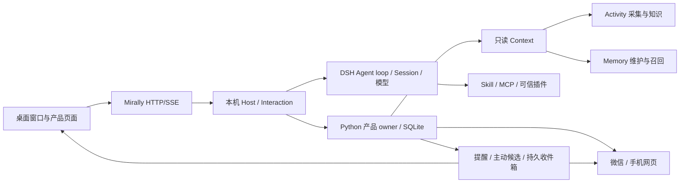

# Mirally 系统概览

更新：2026-10-31，Asia/Shanghai。状态：现行。本文描述默认入口的实际结构；未实现方向和取舍理由见[产品方向](../product/vision.md)与[产品思考记录](../product/product-notes.md)。

Mirally 拥有产品状态、交互规则和能力边界；同仓 `kernel/dsh/` 提供会话、模型循环、工具执行与原生能力；`frontend/control-ui/` 以固定的上游界面源码为视觉与组件基础，由 Mirally 维护自有页面。默认入口不启动 OpenClaw Gateway。

## 运行结构



产品进程由 `python -m mirally` 启动：`mirally/framework_host.py` 解析 home、工具链和端口，检查构建并启动 `kernel/dsh/packages/mirally/mirally-product/start.mjs`，再打开 WebView2 窗口。浏览器模式只跳过原生窗口，仍连接同一 Host。

## 模块与数据归属

| 位置 | 职责 |
| --- | --- |
| `mirally/framework_host.py` | Node 宿主、工具链/home/端口解析、启动参数；调用桌面壳或浏览器 |
| `mirally/framework_shell.py` | WebView2 窗口、原生裁剪、托盘、伙伴与退出 |
| `mirally/framework/service.py` | 设置、逻辑会话与原生 Session 引用、命令回执、偏好、日历/提醒、投递、主动候选、摘要入口 |
| `mirally/framework/channels.py` | 微信安装身份、本人绑定、会话路由、收发去重与回执 |
| `mirally/framework/calendar.py` | 日程、提醒和定时执行的产品事实 |
| `mirally/framework/model_connections.py` | 命名连接、模型目录、对话/后台路由与引用保护 |
| `mirally/framework/capabilities.py` | 文件授权根、工作区写入和网页开关 |
| `mirally/framework/notebook.py` | [记事本](notebook.md)的记录、目录、修订与查询 |
| `mirally/framework/context.py` | 按需只读组合记忆、活动和来源缺口；查询不启动采集 |
| `mirally/framework_workers.py` | Activity/Memory 子进程和语义任务生命周期 |
| `mirally/framework/*.py` | 材料、附件、桌面观察、摘要等明确接口 |
| `kernel/dsh/packages/mirally/mirally-product/` | 本机鉴权 Host、Session/模型适配、原生工具覆盖、微信协议、手机服务、日历和记事工具 |
| `kernel/dsh/packages/mirally/mirally-extensions/` | Skill、脚本、MCP 与可信插件的生命周期 |
| `frontend/control-ui/` | Lit 壳、原对话/外观组件与 `pages/mirally/` 自有页面 |
| `mirally/core/activity`、`runtime/activity` | 观察存储、知识投影、采集器、CLI 与历史浏览器 |
| `mirally/core/memory`、`runtime/memory` | 持久记忆、投影、维护、召回与 CLI |
| `mirally/runtime/ufo` | 旧桌面执行适配；默认产品不加载，UFO 子模块源码已移除 |

持久状态各有唯一 owner：

| 数据 | 位置 |
| --- | --- |
| 产品设置、会话元数据、命令、偏好、日历/提醒、记事、投递、渠道状态 | `<home>/framework/product.sqlite3`，schema 12 |
| 模型对话与工具事实 | DSH 原生 Session；产品只保存引用和业务状态 |
| Activity 原始观察与资产 | `<home>/data/activity/observations.sqlite3`、`assets/` |
| Activity 知识投影 | `<home>/data/activity/knowledge.sqlite3` |
| 持久记忆 | `<home>/memory/memory.sqlite3`、`activity-projection.sqlite3` |
| 会话成果与材料 | 由原生附件/成果目录管理，按逻辑会话鉴权 |
| Skill/MCP/插件配置 | 产品设置中的显式配置 |

产品数据默认位于 `%LOCALAPPDATA%/Mirally/framework`；`MIRALLY_HOME` 或 `--home` 可覆盖。不同 home 之间不共享数据库、凭据和会话。

## 启动与准备

Windows x64、Python 3.10+、Node 24+（含 npm）和 Microsoft Edge WebView2 Runtime。Node 可用 `MIRALLY_NODE` 或 `--node` 显式指定。

```powershell
py -3.10 -m venv .venv
.\.venv\Scripts\python.exe -m pip install -r requirements-framework.txt
.\.venv\Scripts\python.exe tools\setup_framework.py
.\run.ps1
```

`tools/setup_framework.py` 按内核锁文件安装并构建 DSH，再按前端独立锁文件构建 `frontend/control-ui/dist/`。迁移到新机器需重建 `.venv`、两套 `node_modules`、内核构建产物和前端 `dist/`，不能复制开发机路径作为默认配置。

常用参数：

| 参数 | 作用 |
| --- | --- |
| `--browser` | 在默认浏览器打开产品页面，不创建原生窗口 |
| `--headless` | 只运行本机 Host，不打开窗口或浏览器 |
| `--home <目录>` | 使用隔离产品数据目录 |
| `--port <端口>` | 指定本机 Host 端口；默认自动选择 |
| `--test-mode` | 使用确定性模型做隔离测试，必须同时指定独立 `--home`，绝非生产回退 |

安装、模型配置和日常操作以[项目 README](../../README.md)为准；前端来源与独立构建见[前端](frontend.md)。

## 框架 worker 的 JSON-lines 入站契约

`python -m mirally.framework --root <仓库> --home <产品数据目录>` 是产品 worker：Node 宿主通过 stdin/stdout 的 JSON-lines 驱动它，调度、审批和模型循环都在宿主持有。本节只描述**既有**入站行为，供调用方对接和回归测试使用；实现见 `mirally/framework/__main__.py` 与 `mirally/framework/service.py`。

- **入站**：stdin 逐行读取，上限 1 MiB（1 048 576 字节，含换行符）。超长行或没有以 `\n` 结尾的最后一行按 `INVALID_REQUEST` 拒绝，不执行任何方法。
- **请求**：`{"id": <字符串或整数>, "method": "<路由名>", "params": {...}}`。`id` 必须是字符串或整数；布尔、浮点、null、数组、对象都按 `INVALID_REQUEST` 拒绝。`params` 缺省为空对象，非对象按 `INVALID_REQUEST` 拒绝。
- **出站**：每条被读取的请求行对应 stdout 上恰好一行 UTF-8 JSON；stdout 只承载协议，stderr 只用于诊断。成功为 `{"id", "result"}`，失败为 `{"id", "error": {"code", "message"}}`；stdin EOF 后 worker 退出码为 0。
- **错误回执分四类**（`code` 固定，`message` 为简短说明）：

  | 类别 | `code` | 含义 |
  | --- | --- | --- |
  | 传输/结构错误 | `INVALID_REQUEST` | 非 JSON、非对象、`id` 类型不合法、`method`/`params` 类型不合法、超长或未换行 |
  | 路由与参数错误 | `METHOD_NOT_FOUND`、`INVALID_PARAMS` | 未知路由；缺参、类型不符或校验失败 |
  | 业务状态错误 | `CONFLICT`、`NOT_FOUND`、`FORBIDDEN`、`SCHEMA_VERSION`、`CHANNEL_UNCONFIGURED` | 产品状态不允许该操作；`message` 可直接展示给用户 |
  | 未预期错误 | `INTERNAL_ERROR` | 任何未被映射为 `FrameworkError` 的异常 |

  `INVALID_REQUEST`、`METHOD_NOT_FOUND`、`INVALID_PARAMS`、`CONFLICT`、`NOT_FOUND`、`FORBIDDEN`、`SCHEMA_VERSION` 来自 worker 自身的校验与路由；`CHANNEL_UNCONFIGURED` 等语义错误由具体模块抛出，沿用同一条回执通道。
- **`INTERNAL_ERROR` 不回显请求**：回执固定为 `{"error": {"code": "INTERNAL_ERROR", "message": "product operation failed"}}`，`id` 照常回填，便于调用方配对；异常类型只写到 stderr（`framework RPC failed: <ExceptionName>`）。请求内容、参数和凭据不会出现在回执或 stderr 中。
- **`worker_lock` 单实例**：worker 启动取得 `<home>/framework/worker.lock` 的排他锁（Windows `msvcrt.locking`，其他平台 `fcntl.flock`）。同一 home 上的第二个 worker 在启动阶段失败退出、非零退出码、stdout 无输出，并在 stderr 说明原因；不同 home 互不影响。这样活动、投递和会话状态不会被两个 owner 同时改写。

回归测试 `tests/test_framework_worker_protocol.py` 以子进程方式启动真实 worker，按本契约逐条覆盖上面的行、`id`、四类回执、不回显和单实例行为；它只观察协议，不替换实现。

## 默认行为

| 能力 | 默认 | 说明 |
| --- | --- | --- |
| 对话、历史、停止与重启恢复 | 开 | DSH Session 是唯一 transcript |
| 持久记忆 | 开 | 本地规则整理可运行；语义整理默认关闭 |
| 后台模型与一般主动联系 | 关 | 开启后才产生后台摘要、语义整理和主动候选 |
| 电脑活动采集 | 关 | 启用前需确认采集范围；暂停与停止分别处理 |
| 网页搜索/正文读取 | 关 | 开启后发送查询或 URL 到所选服务，可能产生费用 |
| 工作区文字写入 | 关 | 开启后仍需本次提交明确选择保存文件 |
| 会话动作审批 | 逐次确认 | 可为单个会话临时自动批准，或在设置中持续信任 |
| 关闭主窗口 | 隐藏到托盘 | 有可用托盘时隐藏并继续维护；无托盘时退出。可改为关闭即退出 |

模型没有默认服务商或密钥。用户需在「设置 → 模型连接」填写基础地址、协议、模型和凭据；连接和模型的能力声明需要自行核实。具体语义见[模型](models.md)。

## 会话、作业与权限

- 一个逻辑会话绑定当前 DSH Session；停止调用原生取消，不更换 Session。会话可重命名、固定、归档/恢复和分叉；归档会话拒绝新输入。详见[会话与作业](conversations.md)。
- 普通会话可直接使用 DSH 原生工具：PowerShell、受管理后台进程、文件读写、子代理、计划、提问、todo/goal 和工作流。Mirally 另提供命令、进程、独立浏览器和桌面观察等产品工具。
- 动作默认逐次审批，审批绑定当前会话、回合和完整动作内容。临时授权在停止、归档或宿主重启后失效；全局持续信任只覆盖经 Mirally ActionGate 的动作，不授予管理员权限。DSH 原生沙箱与审批预设是另一组执行机制，不能把 `never` 解释成自动批准。
- 文件读取默认只包含 home 内工作区；可在设置中授权最多 20 个只读目录。列表最多 200 项、单文件 8 MiB；文字搜索最多 1000 个文件/目录、16 MiB、50 个命中；工作区文字写入需全局开关和本次保存许可，内容最多 1 MiB。完整边界见[能力矩阵](../reference/capabilities.md)。
- 微信、手机网页和桌面共用同一逻辑会话与 DSH 历史；渠道不复制聊天事实，也不另建模型路由。见[消息渠道](channels.md)。

## 扩展

Skill、MCP 和可信插件通过显式配置接入同一 DSH 会话与工具管线；脚本执行单独确认并按内容指纹复核。扩展变更会使后续会话能力变化，停用时撤销注册与在途调用。完整契约见[扩展接口](extensions.md)。

## 已退役实现

当前只提供 Mirally/DSH 启动链路。旧 OpenClaw 启动器、插件集成、旧配置导入和旧档案浏览已移除；历史实现通过 Git 提交 `2eeb778a` 追溯，不在现行代码中保留兼容回退。源码清理不读取、覆盖或删除本机已有的私有配置、凭据和数据。

## 验证

验证命令、已覆盖范围和未覆盖边界见[验证](../reference/validation.md)。当前仍没有已签名安装包，也没有在全新 Windows 机器上完成安装演练。
