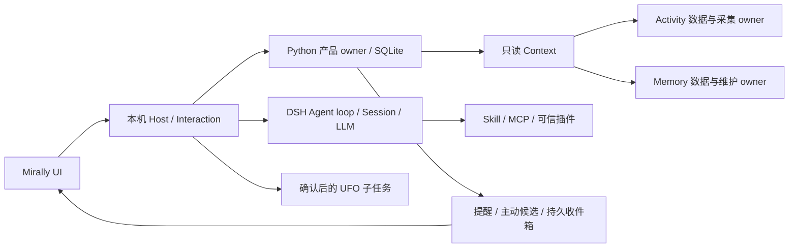

# Mirally 框架第一版

本分支默认运行自有 Mirally 框架。DSH 是同仓可修改的执行内核，OpenClaw 不参与这条运行链。此版交付可运行的核心产品闭环；长期愿景中的所有场景和成熟度仍需逐步实现。

## 准备与启动

Windows x64，Python 3.10+，Node 22.19+（22.x）或 24+，Microsoft Edge WebView2 Runtime。工具路径从仓库、环境和 PATH 解析；Node 可以通过 `MIRALLY_NODE` 或启动参数 `--node` 指定。

```powershell
py -3.10 -m venv .venv
.\.venv\Scripts\python.exe -m pip install -r requirements-framework.txt
.\.venv\Scripts\python.exe tools\setup_framework.py
.\run.ps1
```

安装脚本按内核 `packageManager` 取得精确 pnpm 版本，按锁文件安装，再从源码构建。首次准备需要网络和较多磁盘空间；依赖和构建结果不提交。内核 Windows 原生包已随源码纳入；重建原生包的额外工具见内核说明。迁移到其他机器需重建 `.venv`、`node_modules` 和构建产物，不能复制开发机安装路径作为默认配置。

数据默认放在 `%LOCALAPPDATA%/Mirally/framework`，可用 `MIRALLY_HOME` 或 `--home` 覆盖。首次到「设置」填写自己的服务基础地址、API 格式、模型 ID 和凭据；没有默认服务商密钥或可用的生产假模型。支持 OpenAI Chat Completions、Responses、Anthropic Messages 的原生适配，实际兼容性取决于所选服务。API Key 留空保留已有值，不写入浏览器存储。

`run.ps1 --browser` 在浏览器打开自有 UI；`--headless` 只运行本机宿主。桌面模式关闭窗口会隐藏到托盘并继续维护提醒与已开启的工作；从托盘或设置页「退出 Mirally」关闭宿主。托盘不可用时关闭窗口会退出。退出、休眠或设备关机期间无法实时投递，重新启动会检查仍有效的提醒。

## 各模块如何协作



- `mirally/framework_host.py` 管理 Node 宿主、桌面窗口与托盘，解析工具链和产品 home。`kernel/dsh/packages/mirally/mirally-product/` 是可直接修改的本机 Host、原生会话适配和模型桥；它加载明确的内核组合，未挂载上游通用 shell 工具。
- `mirally/framework/service.py` 拥有设置、逻辑 Conversation 与原生 Session 引用、命令回执、来源版本、明确偏好、提醒、主动候选、投递与已读状态。产品 schema 当前为 2，可从早期开发 schema 1 原地升级，拒绝未来版本。
- DSH Session 是唯一 transcript。产品库只保存引用、代次和命令内容哈希。停止或撤回来源会冻结旧代次；后续用户输入创建新的原生 Session，历史仍通过代次引用读取。启动恢复不会盲目重放旧输入、脚本或桌面动作。
- `mirally/framework/context.py` 按需只读组合记忆、活动、偏好和来源缺口。`mirally/framework_workers.py` 监督获准的 Activity 子进程和 Memory 维护 owner；查询不启动采集。后台语义任务通过本机模型桥调用同一原生模型适配。
- `mirally/framework_ui/` 提供对话、记忆与纠正、活动状态、提醒、收件箱、桌面任务、扩展和设置。界面通过本机鉴权 HTTP/RPC 和 SSE 使用上述 owner，不另存模型历史。

边界使用有名操作和 JSON 数据，Python worker 采用带 ID 的 JSONL 请求/回执；HTTP 仅公开白名单。原生扩展在同一 Cordis 生命周期中组合。无需引入第二个模型主循环或通用事件总线。

## 默认行为、主动联系与执行

活动采集、后台模型和一般主动联系默认关闭，持久记忆默认开启。本地记忆维护可以运行，语义整理需要开启后台模型；当前固定预算为每小时 4 次、每日 24,000 tokens、单次最多 1,500 输出 tokens。后台模型请求可随设置变化撤销，提交前复核当前授权和 owner。撤回任何记忆、活动或观测来源时，第一版保守暂停全部后台语义整理，状态显示 `source_blocked`，重新授权后恢复；偏好撤回不阻断不使用偏好的整理。保留原有证据清理、稳定窗口和完成回执约束，未保证所有历史积压自动整理。

主动联系同时要求后台模型和一般主动联系开关。产品 owner 先持久保留一次模型检查的租约，每四小时最多一次；有未读主动消息或缺少可用依据时不检查。模型可以选择保持安静，调用最多 512 输出 tokens，没有工具权限。候选提交时复核租约、设置、勿扰和来源版本；过期或撤回的内容丢弃。此预算独立于语义整理，最多约 6 次检查/日。普通提醒使用本机确定性定时和原子入箱，无需模型。

第一版投递渠道是持久本机收件箱与实时 UI 更新；未实现邮件、手机推送或系统通知。主动联系是有限的可选检查策略，尚未形成成熟的长期社交与陪伴策略。伙伴视图提供紧凑交互；语音、跨设备和多模态伴随体验继续设计。

普通对话不会启动 UFO。桌面任务从「桌面任务」页明确填写目标并确认，需要视觉模型和可选 UFO 依赖。宿主启动只读 `UFO/` 内核的既有 worker，模型请求经本机桥进入当前原生适配，每次观察、模型请求和工具动作都复核授权，敏感动作和补充问题回到 UI。停止向 worker 撤权并等待结果；无最终回执的退出保留 `unknown`，不会自动重试。动作回执保存在 home 的 `actions/`。

UFO 准备：按 [UFO 适配说明](../mirally/ARCHITECTURE.md) 和既有子模块依赖准备环境，保留产品策略 `config/mirally/ufo/`。此轮只验证了隔离协议和原有导入/初始化回归，没有执行真实桌面动作或调用真实外部模型，不将该边界当作已验收的桌面效果。

## 扩展接口与兼容范围

配置在「扩展」页显式应用并持久保存；改变扩展会撤销旧会话代次，依赖冲突与激活错误可查看。插件代码是受信任的本地代码，拥有宿主权限，不是操作系统沙箱。MCP 服务配置的 `readOnly:true` 是用户对该服务的信任声明；不能仅凭工具名称推断只读。

Skill 目录示例：

```json
{"id":"local-skills","type":"skill","path":"./my-skills"}
```

支持 `SKILL.md` 元信息、按需正文与目录资源；不承诺所有其他宿主的专有字段与行为。脚本独立加入 `bundle.config.scripts` 白名单，必须位于已配置 Skill 根目录，解释器为 Python 或 Node；每次在 UI 明确确认，命令 ID 去重，运行前复核路径和内容指纹，超时、输出和取消有界。修改脚本后需审阅并重新配置其 `sha256`，未审阅的变更不能在重启后自动生效。

```json
{"id":"utilities","type":"bundle","config":{"apiVersion":1,"skills":["./my-skills"],"scripts":[{"id":"export","path":"./my-skills/helper/export.py","interpreter":"python"}]}}
```

MCP 支持 stdio 与 Streamable HTTP，同一受监督连接提供 tools、resources、resource templates 和 prompts，包含取消、重连和停用语义。模型可使用获准只读工具；可能写入的工具通过「扩展」页明确确认调用，复用原生工具执行管线。资源和提示模板可以按 URI/名称读取，模板不会自动应用为系统指令。

```json
{"id":"my-mcp","type":"mcp","config":{"serverName":"local","transport":"stdio","command":"python","args":["./my_server.py"],"readOnly":true}}
```

`command:"python"` 使用仓库 `.venv`；`node` 使用宿主 Node。相对路径以仓库为基准，明确选择外部目录也可使用绝对路径，迁移机器后需重新绑定。

插件示例 `{"id":"my-plugin","type":"plugin","path":"./my-plugin.mjs","config":{"apiVersion":1}}`。模块可导出 `mirally={apiVersion:1}` 与原生 Cordis 插件；不兼容版本拒绝激活，配置 `dependsOn` 声明其他扩展依赖。插件通过 `ctx.mirallyProduct`、`ctx.tools`、`ctx.skills` 等现有服务接入，外部效果必须遵循产品 guard、停止和回执契约。OpenClaw 插件不能不经适配直接加载。版本与关闭行为的完整约束见[扩展设计](framework-extensions.md)。

## 数据切换与回退

默认不会扫描或导入现有机器的 OpenClaw 私有配置。旧入口仍为 `run.ps1 --openclaw`，旧维护分支已推送到 `2eeb778a`。迁移必须先停止旧 Gateway、采集和 Memory 维护；使用明确导出的独立 JSON 配置，不跟随 include 或解析隐藏环境凭据。

```powershell
.\.venv\Scripts\python.exe -m mirally.framework.migration --home "新的空数据目录" --memory-profile "显式旧 memory.yaml" --activity-profile "显式旧 activity.yaml" --openclaw-config "独立配置导出.json" --legacy-history "旧会话目录"
# 审核预览，停止旧 owner 后添加：
# --apply --confirm-stopped
```

目标必须不存在或为空，拒绝覆盖与链接/目录联接。SQLite backup 包含已提交 WAL；截图资产复制并核对哈希，源前后指纹一致才原子发布。旧会话只建立只读索引，不伪造 DSH transcript。运行状态与旧会话索引在设置页查看。新 home 内生成迁移清单，凭据保存在新产品库中，不输出到预览或普通 HTTP。

```powershell
.\.venv\Scripts\python.exe -m mirally.framework.migration --home "新数据目录" --rollback
.\run.ps1 --openclaw
```

回退前先退出新宿主。回退暂停新 home 的采集与模型后台，保留全部新数据和全部旧来源；不会把新会话自动转换回 OpenClaw。不要让两个入口同时采集或维护同一来源。

详细结果见 [第一版验收记录](framework-v1-validation.md)。

## 验证与未覆盖项

```powershell
.\.venv\Scripts\python.exe -m unittest discover -s tests -v
node --test tests/test_*.mjs integrations/openclaw/*.test.mjs kernel/dsh/packages/mirally/mirally-product/tests/*.test.mjs kernel/dsh/packages/mirally/mirally-extensions/tests/*.test.mjs
.\.venv\Scripts\python.exe tools/verify_framework.py
```

最后一项启动真实构建内核、原生 PiAI 适配与回环合成服务，验证会话、工具、停止、重启、Skill、实际脚本产物、真实 MCP 协议、原生插件和主动入箱；不访问外部 API。`--test-mode` 则必须指定独立 `--home`，只用于确定性 UI 测试，绝非生产失败回退。浏览器验收工具 `tools/verify_framework_browser.mjs` 需可用的 Playwright Core 和本机 Edge，可通过 `MIRALLY_PLAYWRIGHT` 指定测试依赖模块。

这不是已签名安装包，也没有在全新 Windows 机器上完成安装演练。真实供应商差异、UFO 端到端桌面效果、长时间运行成本与陪伴品质仍需后续实测。扩展兼容范围以这些实际实现与验证为准，不将全部上游能力视为本产品自动具备。
