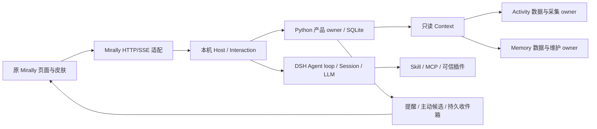

# Mirally 框架第一版

本分支默认运行自有 Mirally 框架，前端沿用原布局习惯、视觉、主题和产品交互，导航与页面内容围绕 Mirally 自有能力组织。固定 OpenClaw Control UI `2026.9.6` 源码纳入 `frontend/control-ui/` 作为组件与界面基础，Mirally 自行维护内容页并接入 HTTP/SSE；页面映射见[前端内容与导航](mirally-frontend.md)。DSH 是同仓可修改的执行内核，承担唯一 Session/Agent/模型主链；默认入口不启动 OpenClaw Gateway。长期愿景中的所有场景和成熟度仍需逐步实现。

## 准备与启动

Windows x64，Python 3.10+，Node 24+（含 npm），Microsoft Edge WebView2 Runtime。工具路径从仓库、环境和 PATH 解析；Node 可以通过 `MIRALLY_NODE` 或启动参数 `--node` 指定。

```powershell
py -3.10 -m venv .venv
.\.venv\Scripts\python.exe -m pip install -r requirements-framework.txt
.\.venv\Scripts\python.exe tools\setup_framework.py
.\run.ps1
```

安装脚本按内核 `packageManager` 取得精确 pnpm 版本，按内核锁文件安装并构建 DSH；再在 `frontend/control-ui/` 按独立 npm 锁文件执行 `npm ci --ignore-scripts`，构建原前端源码。前端以 Node 24+ 为准备基线，工具自动发现到较旧 Node 不代表前端安装要求已满足。首次准备需要网络和较多磁盘空间；依赖和构建结果不提交。内核 Windows 原生包已随源码纳入；重建原生包的额外工具见内核说明。迁移到其他机器需重建 `.venv`、两套 `node_modules`、DSH 构建产物与 `frontend/control-ui/dist/`，不能复制开发机安装路径作为默认配置。

只重建前端时，在仓库根目录执行：

```powershell
npm --prefix frontend/control-ui ci --ignore-scripts --no-audit --no-fund
npm --prefix frontend/control-ui run verify:source
npm --prefix frontend/control-ui run build
```

构建先在临时目录完成，检查浏览器模块不含未打包的裸 import，再发布到 `dist/`。`.mirally-build.json` 标记完整构建成功；失败保留上次成功输出并返回错误，缺少成功构建时宿主明确提示准备步骤。来源、许可证、固定提交与集成接缝见 [前端来源说明](../frontend/control-ui/UPSTREAM.md)。

数据默认放在 `%LOCALAPPDATA%/Mirally/framework`，可用 `MIRALLY_HOME` 或 `--home` 覆盖。首次到原「设置 → 模型」填写自己的服务基础地址、API 格式、模型 ID 和凭据；没有默认服务商密钥或可用的生产假模型。支持 OpenAI Chat Completions、Responses、Anthropic Messages 的原生适配，实际兼容性取决于所选服务。API Key 留空保留已有值，不写入浏览器存储。

模型连接页可先保存服务地址、协议和凭据，再从服务读取模型列表并选择添加，或手动添加模型；第一个模型成为该连接的默认模型。一个连接中的模型共享其服务和凭据，各自保存视觉、推理、上下文窗口和生成参数；声明的能力需要使用者核实。可为对话和后台整理/主动联系分别分配默认连接，并在桌面会话输入框选择该会话使用的模型或跟随默认；微信继续使用其所绑定会话的选择。消息接纳时固定所选连接与模型，运行中的配置受保护；改变默认路由或会话选择不改写已接纳的消息。已被用途或会话引用的连接、模型不能直接删除；更换服务来源不暗中复用旧密钥。服务探测和固定短文字测试均需用户明确发起，空配置不自动采用预设。DeepSeek Flash 的视觉、推理与工具续轮实测范围见[连接与能力验证](deepseek-compatibility.md)。

`run.ps1 --browser` 在浏览器打开产品页面；`--headless` 只运行本机宿主。「设置 → 通用 → 关闭主窗口时」可选隐藏到系统托盘或退出 Mirally，默认隐藏到可用托盘并继续维护提醒与已开启的工作。单击托盘图标恢复原窗口和伙伴形态，右键提供退出；托盘不可用时关闭会退出。从托盘或设置页明确「退出 Mirally」会停止窗口、自己连接的宿主和后台，包含复用已有宿主的情形；关闭浏览器标签页不等于停止宿主。退出、休眠或设备关机期间无法实时投递，重新启动会检查仍有效的提醒。

默认桌面入口复用原 Mirally 开屏、窗口交互、海獭/飞狐与三形态伙伴，并直接承载原页面和皮肤；[体验迁移对照](framework-experience-migration.md) 记录源码复用、后端接缝、操作方式与实际页面验收项目。桌面截图仍需明确拖动专用手柄、检查预览后发送；浏览器模式不能调用本机窗口截图、置顶或移动。

## 各模块如何协作

### 工作与手机入口

当前手机使用以微信为主，无需自建云服务器、域名、端口映射或打开网页。电脑主动连接微信平台；“菜单”、工作查询/接续、历史回看、脚本审阅/批准/停止、日志与通知开关均可直接在微信文字通道使用。下面手机网页为可选扩展，网络准备仅适用于网页，不是微信前置条件。

桌面侧栏“工作”进入 `/tasks`，新增持久工作、JSON/日志观察、精确审批后的后台 Python 运行、取消、日志及小型成果下载。原准备页、材料、草稿和会话保留，提交可建立关联工作。手机接入位于“设置 → 消息渠道”，独立页面支持工作、正文会话管理、消息和可设置首页/导航。异地手机访问需配置私人 HTTPS 转发，服务仍只监听回环；未配置时仅可在电脑预览。

数据库当前 schema 7，原地升级 1–6；`framework/work.py` 拥有工作与执行事实，Node 组合具名入口和唯一 DSH。受信脚本以当前用户权限执行，路径范围不是操作系统沙箱。功能、准备步骤及限制见[手机工作使用说明](mobile-work-guide.md)。微信/手机模型工具继续受限，脚本动作走本人精确审批，不开放通用远程工具链。



- `mirally/framework_host.py` 管理 Node 宿主、桌面窗口与托盘，解析工具链和产品 home。`kernel/dsh/packages/mirally/mirally-product/` 是可直接修改的本机 Host、原生会话适配和模型桥；它加载明确的内核组合，未挂载上游通用 shell 工具。
- `mirally/framework/service.py` 拥有设置、逻辑 Conversation 与原生 Session 引用、命令回执、来源版本、明确偏好、提醒、主动候选、投递与已读状态。产品 schema 当前为 7，可从早期 schema 1–6 原地升级，拒绝未来版本；会话标题/固定/归档及模型选择带元数据版本，不改 transcript。微信收发状态由独立 `framework/channels.py` 管理。
- DSH Session 是唯一 transcript。产品库只保存引用、代次和命令内容哈希。停止或撤回来源会冻结旧代次；后续用户输入创建新的原生 Session，历史仍通过代次引用读取。启动恢复不会盲目重放旧输入、脚本或桌面动作。
- `mirally/framework/context.py` 按需只读组合记忆、活动、偏好和来源缺口。`mirally/framework_workers.py` 监督获准的 Activity 子进程和 Memory 维护 owner；查询不启动采集。后台语义任务通过本机模型桥调用同一原生模型适配。
- `frontend/control-ui/ui/src/` 复用原 Lit 壳、对话和外观组件，`pages/mirally/` 维护自有内容页与产品 API；`mirally/assets/control-ui-*` 继续提供既有 Mirally 皮肤、工作和伙伴交互。`ui/src/app/mirally-client.ts` 注入原客户端工厂，将已实现操作映射到本机鉴权 HTTP/RPC 与 SSE。`mirally/framework_ui/legacy-native-bridge.js` 适配活动/记忆、材料成果等产品消息，`mirally-product/src/presentation.mjs` 提供原皮肤资源。`mirally/framework_ui/app.js` 的简化页面不再是默认前端。
- 原 Context 与组件仍管理页面草稿和状态；DSH Session 保留唯一聊天事实。未映射的旧宿主操作明确返回尚未支持，页面存在不代表对应 OpenClaw 后台能力已经接通。原 Gateway service worker 不参与新宿主的缓存与生命周期。

边界使用有名操作和 JSON 数据，Python worker 采用带 ID 的 JSONL 请求/回执；HTTP 仅公开白名单。原生扩展在同一 Cordis 生命周期中组合。无需引入第二个模型主循环或通用事件总线。

原会话菜单提供重命名、固定、归档/恢复。活跃工作先停止再归档，归档拒绝新输入；并发版本冲突保留用户改名草稿。历史材料和工具结果从所有原生代次恢复，附件下载只接受实际属于该逻辑会话的引用。设置 → 关于可分页查看旧档案，不能在只读档案上继续执行。

设置 → 通用可授权最多 20 个只读文件夹，默认只读取 home 内工作区；列表最多 200 项、单文件 8 MiB，文字搜索最多 1000 个文件/目录、16 MiB、50 个命中。工作区文字写入默认关闭，开启后仍需本次工作选择保存文件；不能写入其他授权目录，覆盖需先读并提供匹配指纹。成果文件与工作区写入是两个明确接口，工作区文件不会伪装为会话成果。

网页研究默认关闭。开启并选定已配置的 DeepSeek 官方连接后，模型可使用搜索与正文工具，查询/URL 发送到该服务并可能产生费用；单次响应最多 2 MiB，正文最多 60000 字符。模型调用原生工具，服务实现通过独立 search/fetch 接口组合；其他网页服务可用 MCP/插件适配。这里没有通用终端、浏览器自动操作或任意本机文件权限。

## 微信文字私聊（第一版）

打开设置 → 消息渠道 → 微信，点击连接并用本人手机微信扫码。若微信要求验证码，在当前页面输入；扫码后仍需在本机选择已有会话或新会话并确认绑定。二维码在本机编码，不依赖远程图片或电脑微信窗口。成功后微信和桌面共用同一逻辑会话与 DSH transcript，微信切换会话不改变桌面当前页面。

微信授权页可能显示 OpenClaw。当前公开协议仅提供固定通道入口与观测用 `bot_agent`，未提供可用的授权页显示名参数；Mirally 请求的观测标识是 `Mirally/0.1.0`，不改变平台授权文案。此名称不表示产品重新运行 OpenClaw Gateway，来源见[官方协议](https://github.com/Tencent/openclaw-weixin/blob/874637a0dbc24050f72d1385add4fc6170a2d726/docs/protocol_zh_CN.md)。

微信中支持 `/help`、`/status`、`/new`、`/sessions`、`/use 编号` 与 `/stop`。会话列表显示可复制的 12 位短编号，存在歧义时拒绝切换；`/stop` 直接停止所选会话的当前回复。每个含微信输入的活动会话只接受一个命令，忙时明确提示稍后发送，防止排队消息改变当前工具权限。

首版支持本人文字私聊与明确的产品只读工具（上下文、偏好/提醒列表和已授权文件查询）。模型不能通过微信修改偏好、建提醒、写文件、运行脚本、调用任意 MCP/插件或操作桌面；会话切换和停止是已配对本人的明确控制操作。微信接入不自动打开活动采集、网页、命令行或 UFO。

暂停连接保留绑定与历史，重新连接恢复收消息；解绑撤销旧身份、清除本机微信凭据和待发队列，保留 Mirally 会话。Windows token 与会话发送令牌使用当前用户 DPAPI，不发给浏览器；复制 home 到另一 Windows 用户/机器后无法解密时，仅微信显示需要重新登录，不阻断普通聊天。当前账号凭据与临时二维码不应提交仓库。

连接由桌面主动 HTTPS 长轮询，无需开放本机公网端口。关闭到托盘可以继续收发，退出、关机和睡眠时不能执行。仅明确关联的助手正文经持久队列回发，过滤思考与原始工具信息；长回复顺序分段，部分失败后停止余下段落。接口接受与手机实收/已读分开，未知发送不自动重发。平台窗口/凭据失效时查看桌面结果，再向微信发新文字或重新登录。

持久渠道入站及发送投影用于去重与恢复，不是第二份可继续执行的聊天历史。重启不重放旧模型输入；首版仅核对最多 200 条排队/未知记录，无法核实或已有失败回执时保留状态，不承诺自动整理全部历史积压。图片、语音、文件收发、QQ、任意终端及桌面接管仍是后续能力；工作状态源及精确审批的 Python 运行见上方手机工作说明。

协议客户端依据固定腾讯官方版本独立实现，未加载 OpenClaw Gateway/SDK，来源与限制见[渠道说明](../kernel/dsh/packages/mirally/mirally-product/src/channels/README.md)。当前用户已完成真实账号扫码与一次文字往返；这不代表所有账号、全部消息格式或长期主动发送均已通过。可运行以下离线链路：

```powershell
.\.venv\Scripts\python.exe tools/verify_framework_weixin.py --report .artifacts/framework-weixin.json
node --test tests/test_framework_weixin_api.mjs tests/test_framework_weixin_channel.mjs tests/test_framework_weixin_scope.mjs tests/test_framework_weixin_ui.mjs
```

`MIRALLY_TEST_WEIXIN_URL` 仅在显式隔离 `--test-mode` 中允许字面回环 HTTP fixture；不接受公开 RPC 提供服务地址，生产只连接官方 HTTPS 域。

## 默认行为、主动联系与执行

活动采集、后台模型和一般主动联系默认关闭，持久记忆默认开启。本地记忆维护可以运行，语义整理需要开启后台模型；可在设置中配置预算，默认每小时 4 次、每日 24,000 tokens、单次最多 1,500 输出 tokens。后台模型请求可随设置变化撤销，提交前复核当前授权和 owner。撤回任何记忆、活动或观测来源时，第一版保守暂停全部后台语义整理，状态显示 `source_blocked`，重新授权后恢复；偏好撤回不阻断不使用偏好的整理。保留原有证据清理、稳定窗口和完成回执约束，未保证所有历史积压自动整理。

主动联系同时要求后台模型和一般主动联系开关。产品 owner 先持久保留一次模型检查的租约，每四小时最多一次；有未读主动消息或缺少可用依据时不检查。模型可以选择保持安静，调用最多 512 输出 tokens，没有工具权限。候选提交时复核租约、设置、勿扰和来源版本；过期或撤回的内容丢弃。此预算独立于语义整理，最多约 6 次检查/日。普通提醒使用本机确定性定时和原子入箱，无需模型。

第一版投递渠道是持久本机收件箱与实时 UI 更新；未实现邮件、手机推送或系统通知。主动联系是有限的可选检查策略，尚未形成成熟的长期社交与陪伴策略。伙伴视图已迁移原三形态、海獭/飞狐与工作交接，支持明确提供的文档和图片；完整语音、跨设备和长期陪伴体验继续设计。

本阶段暂不接入 UFO。新默认宿主不加载 UFO 执行器、提供相关模型工具或开放桌面任务入口；`UFO/` 与既有维护适配保留供参考。后续按 Mirally 自有执行接口考虑更贴合 Windows 的能力，不把 UFO 的会话、模型链和控制界面带入产品框架。已有桌宠、窗口裁剪、菜单、拖动与用户明确触发的截图继续由 Mirally 自身平台适配负责。

## 扩展接口与兼容范围

Mirally 扩展接口支持显式应用并持久保存配置；改变扩展会撤销旧会话代次，并返回依赖冲突与激活错误。原前端插件管理页面与 DSH 扩展接口的契约不同，页面的可用操作以已映射接口为准，不能因保留旧页面就视为兼容全部 OpenClaw 管理功能。插件代码是受信任的本地代码，拥有宿主权限，不是操作系统沙箱。MCP 服务配置的 `readOnly:true` 是用户对该服务的信任声明；不能仅凭工具名称推断只读。

Skill 目录示例：

```json
{"id":"local-skills","type":"skill","path":"./my-skills"}
```

支持 `SKILL.md` 元信息、按需正文与目录资源；不承诺所有其他宿主的专有字段与行为。脚本独立加入 `bundle.config.scripts` 白名单，必须位于已配置 Skill 根目录，解释器为 Python 或 Node；每次在 UI 明确确认，命令 ID 去重，运行前复核路径和内容指纹，超时、输出和取消有界。修改脚本后需审阅并重新配置其 `sha256`，未审阅的变更不能在重启后自动生效。

```json
{"id":"utilities","type":"bundle","config":{"apiVersion":1,"skills":["./my-skills"],"scripts":[{"id":"export","path":"./my-skills/helper/export.py","interpreter":"python"}]}}
```

MCP 支持 stdio 与 Streamable HTTP，同一受监督连接提供 tools、resources、resource templates 和 prompts，包含取消、重连和停用语义。模型可使用获准只读工具；可能写入的工具通过「扩展」页明确确认调用，复用原生工具执行管线。资源和提示模板可以按 URI/名称读取，模板不会自动应用为系统指令。

```json
{"id":"my-mcp","type":"mcp","config":{"serverName":"local","transport":"stdio","command":"python","args":["./my_server.py"],"readOnly":true}}
```

`command:"python"` 使用仓库 `.venv`；`node` 使用宿主 Node。相对路径以仓库为基准，明确选择外部目录也可使用绝对路径，迁移机器后需重新绑定。

插件示例 `{"id":"my-plugin","type":"plugin","path":"./my-plugin.mjs","config":{"apiVersion":1}}`。模块可导出 `mirally={apiVersion:1}` 与原生 Cordis 插件；不兼容版本拒绝激活，配置 `dependsOn` 声明其他扩展依赖。插件通过 `ctx.mirallyProduct`、`ctx.tools`、`ctx.skills` 等现有服务接入，外部效果必须遵循产品 guard、停止和回执契约。OpenClaw 插件不能不经适配直接加载。版本与关闭行为的完整约束见[扩展设计](framework-extensions.md)。

## 数据切换与回退

默认不会扫描或导入现有机器的 OpenClaw 私有配置。旧入口仍为 `run.ps1 --openclaw`，历史分支已推送到 `2eeb778a`，迁移验收后冻结为回退参考，后续只维护新框架，见[维护切换](framework-migration-closure.md)。迁移必须先停止旧 Gateway、采集和 Memory 维护；使用明确导出的独立 JSON 配置，不跟随 include 或解析隐藏环境凭据。

```powershell
.\.venv\Scripts\python.exe -m mirally.framework.migration --home "新的空数据目录" --memory-profile "显式旧 memory.yaml" --activity-profile "显式旧 activity.yaml" --openclaw-config "独立配置导出.json" --legacy-history "旧会话目录"
# 审核预览，停止旧 owner 后添加：
# --apply --confirm-stopped
```

目标必须不存在或为空，拒绝覆盖与链接/目录联接。SQLite backup 包含已提交 WAL；截图资产复制并核对哈希，源前后指纹一致才原子发布。旧会话复制到新 home 的 `framework/legacy-sessions/`，索引保留来源与内容指纹，不伪造 DSH transcript。设置 → 关于提供分页只读查看；早期索引可以明确复制归档，之后读取不再依赖原目录。新 home 内生成迁移清单，凭据保存在新产品库中，不输出到预览或普通 HTTP。

```powershell
.\.venv\Scripts\python.exe -m mirally.framework.migration --home "新数据目录" --rollback
.\run.ps1 --openclaw
```

回退前先退出新宿主。回退暂停新 home 的采集与模型后台，保留全部新数据和全部旧来源；不会把新会话自动转换回 OpenClaw。不要让两个入口同时采集或维护同一来源。

详细结果见 [第一版验收记录](framework-v1-validation.md)。

## 验证与未覆盖项

```powershell
.\.venv\Scripts\python.exe -m unittest discover -s tests -v
node --test tests/test_*.mjs integrations/openclaw/*.test.mjs kernel/dsh/packages/mirally/mirally-product/tests/*.test.mjs kernel/dsh/packages/mirally/mirally-extensions/tests/*.test.mjs
.\.venv\Scripts\python.exe tools/verify_framework.py
```

最后一项启动真实构建内核、原生 PiAI 适配与回环合成服务，验证会话、工具、停止、重启、Skill、实际脚本产物、真实 MCP 协议、原生插件和主动入箱；不访问外部 API。`--test-mode` 则必须指定独立 `--home`，只用于确定性 UI 测试，绝非生产失败回退。浏览器验收需可用的 Playwright Core 和本机 Edge，可通过 `MIRALLY_PLAYWRIGHT` 指定测试依赖模块；`tools/verify_framework_browser.mjs` 与 `verify_framework_experience.mjs` 已改为核对保留的原组件和真实客户端；`verify_framework.py --browser-files` 补充真实工具文件与工作重试。当前结果见[验收记录](framework-v1-validation.md)，此前简化 UI 的结果单独保留为历史。

这不是已签名安装包，也没有在全新 Windows 机器上完成安装演练。真实供应商差异、长时间运行成本与陪伴品质仍需后续实测。扩展兼容范围以这些实际实现与验证为准，不将全部上游能力视为本产品自动具备。
