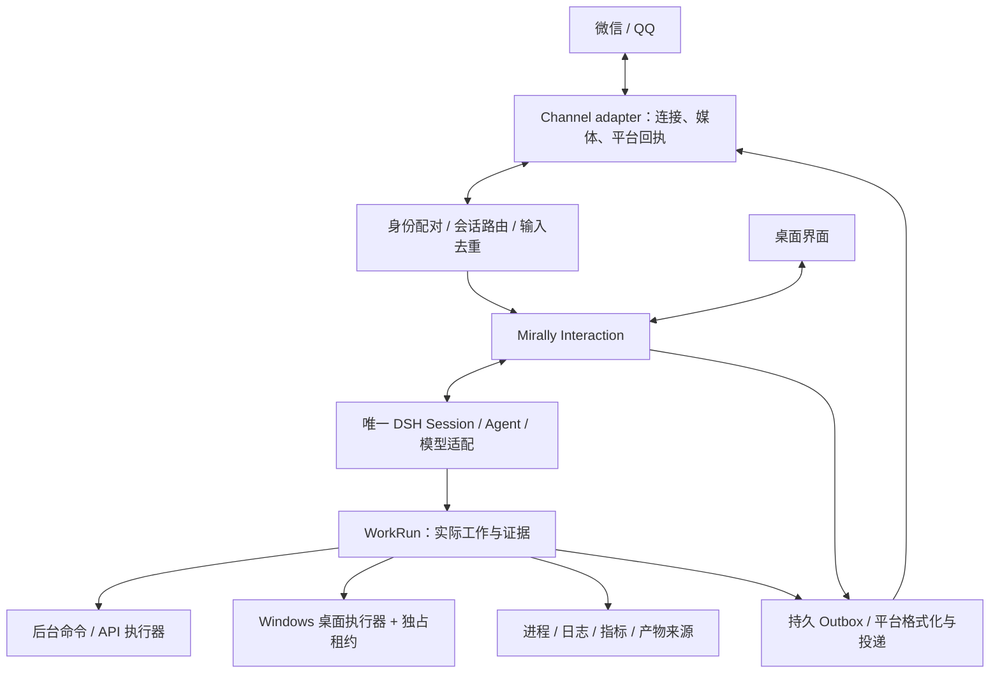

# 跨端消息与执行 MVP 提案

更新：2026-10-26，Asia/Shanghai（+08:00）。微信文字私聊第一阶段已按第 9 节实现，通过离线链路、界面与当前用户账号的一次真实文字往返验收；其余内容仍为设计提案。当前产品能力以 [framework-v1](framework-v1.md) 为准。

## 1. 产品目标与取舍

用户希望通过微信、QQ 与 Mirally 多端交流，在手机上继续桌面会话、查询实验进度、提交命令，并可选择让 Mirally 占用 Windows 桌面完成操作。两种执行模式是本轮讨论方向，具体默认授权与接管体验尚待实现和验收。

建议将功能分成三块：消息渠道、可查询的实际工作、可选桌面接管。前两块即可形成有价值的 MVP；桌面接管补足只有 GUI 的应用，不成为查询实验状态的前提。微信和 QQ 都纳入 MVP 范围，工程上先以微信验证闭环，再复用接口接 QQ。

沿用一个 Mirally 产品 owner、一条 DSH 会话主链及同一套模型路由。渠道适配不另建 Agent、记忆库或聊天记录；现有工作页、会话与成果组件承担多端状态展示。UFO 本阶段仍是只读参考，讨论接管功能不等于恢复旧执行链。

## 2. 消息渠道的可行路径

以下为 2026-10-26 的一手资料核对，平台权限仍须在目标账号实测。文档存在不代表目标账号已经获准，也没有本轮真实账号验收结果。

| 接入 | 已核实事实 | 建议 |
| --- | --- | --- |
| 个人微信 ClawBot / iLink | 腾讯官方仓库提供扫码、消息和媒体、长轮询及后端协议；当前插件声明 direct 会话。官方现成插件依赖 OpenClaw SDK | 首选候选。独立实现 Mirally 渠道适配，评估在 MIT 许可下复用固定版本 transport 源码，保留来源与许可证；不引回 OpenClaw Gateway |
| QQ 官方机器人 | 当前官方文档提供用户私聊、私聊流式消息、WebSocket 与主动发送规则；认证、权限、频控和拒收有区别 | 同一 Channel 接口的第二个适配，先做本人私聊。Bot 身份不等于普通个人 QQ 账号 |
| 企业微信智能机器人 | 官方教程提供 API 模式与出站 WebSocket 长连接，无公网回调也可接入 | 作为可选渠道，不把企业微信当作个人微信的等价替代 |
| 公众号 / 微信客服 | 属于不同账号、事件与服务窗口体系 | 有相应账号和需求时另作 adapter，不混入个人微信登录流程 |
| 社区个人号桥接 | 依赖各项目支持的客户端、协议与运维方式 | 有明确缺口再评估，不作为默认产品依赖；不根据社区宣传承诺账号稳定性 |

微信来源：[腾讯官方 README](https://github.com/Tencent/openclaw-weixin/blob/main/README.zh_CN.md)、[官方后端协议](https://github.com/Tencent/openclaw-weixin/blob/main/docs/protocol_zh_CN.md)。腾讯自身也提供[手机微信向电脑发送任务的产品接入教程](https://cloud.tencent.com/document/product/1831/137450)，证明该方向已有实际产品路径；这不代替 Mirally 的账号与协议验证。

QQ 来源：[当前消息概览](https://bot.q.qq.com/wiki/develop/api-v2/server-inter/message/overview.html)、[私聊发送](https://bot.q.qq.com/wiki/develop/api-v2/autogen/api/v2_users_user_openid_messages.post.html)、[私聊流式](https://bot.q.qq.com/wiki/develop/api-v2/autogen/api/v2_users_user_openid_stream_messages.post.html)、[WebSocket](https://bot.q.qq.com/wiki/develop/api-v2/dev-prepare/event-emit/websocket.html)。旧文档的历史停用公告与现行站点不一致时，不能据此断言当前所有主动消息或长连接不可用；实施时锁定当前契约并以目标账号验证。

企微来源：[腾讯官方长连接接入教程](https://intl.cloud.tencent.com/zh/document/product/1316/84454)、[企微官方长连接文档](https://developer.work.weixin.qq.com/document/path/101463)。

### 网络与推送

- 微信优先桌面主动 HTTPS 长轮询；QQ 在账号允许时主动建立官方长连接。常见家庭网络下优先不新增公网入口、云端 Agent 或中转服务。
- 必须使用 Webhook 的账号或后续多设备离线收件需求，再增加小型 relay。它负责验证平台请求、路由和限时暂存，不持有本机全权限 token、不直接执行动作；设备连接须认证和防重放，平台验证与设备身份验证分别执行。relay 通常可看到平台消息正文，不因出站连接就声称端到端保密。
- 本机 `/api/rpc` 保持回环与现有鉴权边界；不通过端口映射将整个控制面开放给手机或公网。
- 微信回复保留 account/peer 对应的 `context_token`。官方协议明确客户端行为不代表完整服务端契约；没有核实到可依赖的固定 token TTL 或无限主动发送保证。QQ 按账号实际权限、频控、用户关系及拒收处理。
- 收到任务后尽快返回接收状态与工作 ID；进度按阶段或摘要发送，不逐 token 刷屏。完成/失败消息持久排队，窗口失效时保留桌面收件箱与待查询结果，用户下一次交互后按平台允许补发。实际投递前复核当前接收身份、route、来源和发送范围，撤回内容不因队列重试外发。平台接受、手机实收、用户已读分开记录。
- 没有 relay 时，电脑离线不能保证及时回复“设备离线”。界面说明连接方式；重连后的历史输入按时间和用途筛选，过期控制操作须重新发起。电脑关机/睡眠时不承诺执行或即时通知。

## 3. 在现有框架中增加哪些职责

这些职责可在现有 Node Host 与 Python 产品服务中分模块实现，首版无需工作流平台、通用事件总线或新的插件宿主。

| 模块 / 最小接口 | 权威状态与边界 |
| --- | --- |
| Channel：`receive / send / capabilities / reconcile` | 拥有连接、平台身份、媒体引用和收发游标；声明私聊、流式、附件、确认交互、推送窗口等能力，不把平台能力写死在 Agent prompt 中 |
| Pairing / Route：`pair / revoke / resolve` | 本机本人、设备、机器人安装、平台稳定 sender/thread 与逻辑 conversation 的绑定；MVP 单 owner、单桌面、本人私聊 |
| ActionGrant / Approval：`prepare / approve / revoke / check` | 绑定 principal、device、真实 command/run、动作摘要与 hash、路径/程序范围、模式、有效期和一次性使用状态；模型与引用消息不签发授权 |
| WorkRun：`start / status / cancel / reconcile` | 实际运行身份、授权引用、执行器、阶段、日志游标、产物、心跳与终态证据；后台工作独立于一次回复存在 |
| Outbox：`enqueue / dispatch / reconcile` | 保存 DSH 消息/工作结果/产物引用、具体目标 route、有限重试与平台回执，不复制第二套聊天记录 |

入站事件以 provider + installation + event ID 去重并绑定内容摘要；没有稳定事件 ID 的适配必须声明去重限制。来源游标只能在消息已持久接纳或明确忽略后推进，避免断电丢输入。出站使用稳定投递 ID；丢回执时核对，不能保证平台全链路 exactly once。

### 多端会话

平台身份映射到 Mirally 的逻辑 Conversation，而非直接固定某个 DSH Session；沿用既有 generation 与历史引用。首次配对显式选择新会话或已有会话，后续可切换；同一用户的微信与 QQ 身份也须各自绑定，不能按昵称合并。

桌面和手机可接续同一会话、查看同一工作。手机切换会话不强制改变桌面当前页面；完整历史按需读取，避免把桌面所有对话自动推送到 IM。MVP 每会话一个活动推理命令，后续输入明确排队或作为停止/纠正，桌面前台执行额外受设备独占约束。普通进度查询独立于长时间工作，不必等待原运行结束。

停止回复、撤销未执行计划、终止实际实验是不同操作。控制请求走已鉴权的高优先级产品路径；不能排在等待取消的任务后，也不能仅靠模型理解 `/stop`。已完成的外部效果不因停止而回滚。

## 4. 两种执行模式

| | 普通模式（默认建议） | 桌面接管模式（可选） |
| --- | --- | --- |
| 能力 | 项目文件、结构化查询、API、获准后台程序/命令 | 在普通能力上增加 UIA、必要截图、前台窗口和键鼠动作 |
| 对用户工作的影响 | 托管后台任务，避免抢焦点与输入；仍显示资源占用 | 在限定时段占用当前交互桌面，显示接管状态、目标和停止入口 |
| 适用 | 查实验、读日志、运行脚本、生成结果、调用服务 | 操作只有 GUI 的程序、设置应用、导出界面内成果 |
| 接纳条件 | 本人配对、工作范围和执行授权有效 | 再检查目标桌面可用、有效接管授权和唯一桌面租约 |
| 自动降级 | 缺少程序或范围时返回具体缺口 | 锁屏、UAC、输入冲突、窗口身份变化、观测过期时暂停或交还；不悄悄扩大权限 |

模式描述可用能力和资源占用，不等于安全等级。CLI 同样可以删除文件、联网、启动 UI 自动化或终止其他进程。普通模式不注册键鼠工具，但如果开放同用户权限的任意 shell，就不能技术性保证“代码绝不控制桌面”。

因此首版命令执行建议采用用户批准的任务定义：程序路径、参数 schema、工作目录、环境、超时、输出范围与文件指纹；复用已有脚本审批思路，不只按命令名称或一条字符串做白名单。需要任意终端时应显式标注较广的可信代码权限；真正隔离需验证受限令牌/独立受限账户与交互桌面隔离，或使用 VM 等额外环境，不能用模式开关冒充沙箱。普通独立进程只提供生命周期与故障边界，不自动阻止同用户代码操作桌面。

### Windows 执行路线与 UFO 的借鉴范围

执行优先级建议为：应用 API / CLI / COM → 浏览器结构化自动化 → Windows UIA / Win32 → 视觉定位与坐标动作。具体能力选择以当前模式、目标与授权为准，API 可用不代表任意越权调用已获准。

UFO² 的 [GUI–API 混合动作](https://microsoft.github.io/UFO/ufo2/core_features/hybrid_actions/)与 [AppAgent](https://github.com/microsoft/UFO/blob/main/documents/docs/ufo2/app_agent/overview.md)可借鉴控件发现、应用命令适配、观测—动作—核验循环；[Playwright locator](https://playwright.dev/docs/locators)适合可结构化访问的网页。以上是方案选择的依据，不能据官方介绍推断 Mirally 已获得同等成功率。

建议首版建设 Mirally 自己的小型 Windows executor，使用需要的 Windows 自动化库，复用已验证的平台代码；它向唯一 DSH 推理链提供有界观察与动作。UFO 的 HostAgent/AppAgent、记忆、调度与 Galaxy 不整体带入。现存 `mirally/runtime/ufo/` 可作为协议、取消与核验的参考，不能因为旧适配仍在就直接恢复产品入口。后续确需 UFO 子任务后端时单独评估，它仍须实现相同执行契约。

接管最低条件：

- 设备只有一个活动前台接管租约，含 run ID、授权范围、截止时间和 fencing token。所有受控前台动作经单一原生 action dispatcher 串行准入，执行前检查租约与撤销状态；换租约前确认旧 worker 和在途提交已停止/排空，否则保持 blocked。Windows 输入 API 本身不识别 token，已经提交给系统的输入不能保证撤回，不能仅凭 worker 自查声称消除所有竞态。
- 本机显示清晰状态，提供可配置、冲突检查后的紧急停止快捷键与托盘停止；远程本人也能停止。用户真实输入可暂停后续动作并交还，不能用屏蔽用户输入来维持独占。暂停不是已经发出动作的撤回保证。
- 观测携带 window/process 身份、截图/UIA snapshot ID、时间、屏幕坐标/DPI，动作引用本次有效观测并核验结果；窗口跳转或坐标失效先重新观察。
- 锁屏、退出登录、RDP 切换或 UAC 安全桌面进入受阻状态；不承诺解锁或绕过提权。Windows 对高完整性 UI 有明确的[安全边界](https://learn.microsoft.com/en-us/windows/win32/winauto/uiauto-securityoverview)。
- 桌面截图按任务需要、可见窗口范围和授权获取，不把持续 Activity 采集开关直接当作远程截图/发送授权。视觉模型须单独验证控件定位与任务效果，图片问答通过不代表 GUI 执行通过。

## 5. 让“实验进度”有依据

这里的实验是可查询工作的一种来源，不在核心中写死为唯一场景。首版支持两种接入：Mirally 托管启动的 run；以及用户明确登记、仅观察的已有进程/项目。登记不默认取得停止或重启外部实验的权限。

最小证据包括：稳定实验/工作 ID、项目与目标目录、进程标识及启动时间、结构化状态文件、日志尾部/游标、指标、检查点和产物。先支持简单的 `status.json` / JSONL / 日志约定；以后可增加训练框架、调度器或实验服务 adapter，不把所有数据塞进 Memory。

返回 `observed_at`、来源、当前阶段、可证实的完成量、最近有效输出和缺口。只有具备业务分母时才给百分比；仅有存活进程不能判断完成度，日志长时间无变化也不自动等于失败。模型负责解释证据，退出结果或明确业务完成信号决定终态。

示例（虚构的期望交互，不是实测结果）：

> 用户：昨晚那个实验怎么样？
>
> Mirally：实验 E-17 的进程仍在运行。15:30 的状态文件显示 42/100 epochs，最近一次检查点是 epoch 40。日志 15:32 仍有更新；目前没有可靠的剩余时间估计。需要查看指标或调整通知吗？

连续状态监测使用本机逻辑，不持续让模型看屏幕。失败、阶段变化、产物生成时形成事件，需要时再摘要并投递。外部调度器或远端机器状态必须来自相应来源，不能凭本机 Activity 猜测。

## 6. 授权、工作生命周期与恢复

配对确认由桌面 owner 完成，绑定平台稳定 ID，不依赖昵称、群角色、转发作者或模型判断。群聊首版不开放远程执行；凭据留在本机受保护存储，浏览器只看到脱敏状态。平台验签/有效连接只证明消息来自平台，不等于每个 sender 都是 owner。

已授权范围内的查询不反复确认。明确发起且落在已批准任务范围内的操作，可按该任务授权执行；范围外、破坏性、外发或新接管请求，生成带具体对象与效果的审批。手机回复绑定待执行动作与一次性凭证；过期或动作内容改变后失效。支持点击审批的渠道用按钮，不支持时用短期操作编号/确认码；MVP 不把普通聊天“好的”解析为全局授权。

建议 WorkRun 最小状态为 `queued / awaiting_approval / running / blocked / cancelling / succeeded / failed / cancelled / unknown`。记录真实进程身份、步骤或日志引用、产物和结果核验；不要把 queued、启动成功、模型说完成当成实际完成。

- 已托管后台工作可在模型本轮回复完成后继续；聊天断网不等于取消。撤销授权、取消 run 与明确退出的行为须各自定义并展示。
- 已有外部实验只能观察，除非额外授权控制。Mirally 启动的长任务明确选择宿主退出时终止，或由独立 supervisor 托管继续；首版不凭裸 `Popen` 承诺跨退出恢复。UI 关闭到托盘保持现有语义。
- 停止只能影响本产品确实拥有的进程树或授权任务；结合 PID 和启动身份核对，不按复用 PID 杀进程。拒绝/无法停止时保留事实。
- 重启先核对进程、日志、产物、动作回执和平台投递，再决定状态。写操作、启动实验、GUI 点击与未知投递不能盲目重放；未知结果显示 `unknown`，不伪造失败或成功。

## 7. 对当前实现的具体影响

| 现有接缝 | 复用与需要补齐的部分 |
| --- | --- |
| `mirally-product/src/index.mjs` 的 `send / history / cancel` | 所有渠道进入同一产品准入；抽出可复用 Interaction 服务，渠道不能绕过此边界直接调用 agent enqueue |
| `framework/service.py` 的 Conversation、generation、command 回执 | 保留唯一 transcript 引用与去重；新增身份/route、grant/approval、run/outbox 的独立模块及版本迁移，避免继续扩大单个 service 文件 |
| 当前 `activeCommands / requestPolicies` 的 Session 级存储 | 远程权限绑定实际被模型消费的 command/run，避免排队的下一条消息改变当前动作权限；不能只添加 sender 字段 |
| `guard.check(effect, confirmed)` | 布尔确认不足以作为远程权限；由受信产品路径核验持久审批与当前范围，模型参数不能直接提供可信 `confirmed:true` |
| SSE `broadcast` | 继续用于本机界面；外部渠道按本人、route、会话和产物授权选择消息，不把全局 SSE 直接广播到 IM |
| 现有 delivery claim/ack 与 inbox | 复用持久投递思想；补普通回复的 outbox 和 provider 回执，不把只支持 inbox 的字段改名就称已支持微信/QQ |
| `mirally-extensions/src/script.mjs` | 可复用已配置脚本的确认、指纹、输出限制及取消思路；需要实际验证再升级为长任务 runner |

跨 Node/Python 新接口使用共享 schema、版本和运行时校验，覆盖 origin、principal、command/run、grant、期限与错误语义；先为本轮真实接口建设契约，不提前设计全部设备云平台。

## 8. 分阶段交付与验收

1. **渠道闭环**：微信本人扫码配对、文字收发、已有/新会话选择、历史接续、确定性停止、脱敏连接状态；接入一个只读工作来源。QQ 复用相同边界，验证目标账号私聊、长连接和主动发送资格。两渠道分别显示实际支持矩阵。
2. **普通模式闭环**：持久 run、获准程序/任务定义、手机精确审批、进度/日志/产物、取消和重启对账。完成通知支持允许窗口内发送、窗口失效后保留可查询结果；能够查询登记的外部实验，不能误杀或盲目重跑。
3. **桌面接管试用**：先覆盖少量明确 Windows 任务，验证 UIA/API 优先、必要视觉回退、独占租约、本机抢回、锁屏/UAC受阻、结果核验与远程停止。多应用通用自主操作按实际成功率逐步开放。

共同故障用例：重复/乱序输入、同 ID 内容冲突、未知 sender、跨账号会话引用、伪造/过期审批、平台限流/拒收、token失效、出站回执丢失、设备睡眠、重连后过期命令、宿主崩溃、PID复用、日志截断、用户抢回与迟到动作。先用回环合成服务及独立 home 验证，再在明确授权下逐渠道、逐 Windows 任务真实验收。

未定事项：目标微信账号能否使用当前入口、QQ bot主体与认证、实际推送窗口和附件权限、首批实验状态格式、首批 GUI 任务、长任务退出策略，以及何时确实需要 relay。无需在讨论阶段让用户注册服务或输入凭据。

## 9. 微信先行的最小交付建议

本节细化微信先行的实施顺序，用户已授权实施；首批本人文字私聊、选择/接续已有或新会话、停止回复、重连和解除绑定已落地，当前用户已完成扫码及一次真实文字往返。图片/文件、实验来源、远程命令与桌面接管随后分别验收。

1. Node 产品宿主增加独立 `channels/weixin` transport，固定官方参考版本与许可证，落实二维码、长轮询、发送及 token/连接生命周期。先用本机合成服务验证，不直接安装依赖 OpenClaw SDK 的整包。
2. Python 产品层分模块维护安装身份、本人配对、route、入站去重和 outbox；会话绑定指向逻辑 Conversation。抽出共同 Interaction 准入供桌面与微信使用，不让渠道拿本机全权限 token 或直连 Agent。
3. 先落实按实际 command 绑定的远程工具范围，再接入输入。当前偏好写入、提醒创建也会使用 query guard，`allow_file_write:false` 不足以提供只读保证；最终工具执行边界须校验明确允许集合，插件/MCP也不自动继承桌面权限。首版每会话一个活动命令，停止走独立控制路径。
4. 沿用设置组件增加微信连接页，展示扫码、本人确认、目标会话、连接/失效状态与解绑。仅向当前已授权 route 发送该 command 的助手正文，聚合/分段而非转发全局 SSE；不自动外发 reasoning、原始工具参数及其他会话内容。
5. 回环合成服务和实际 DSH 验证重复输入、断网/重启、并发权限、停止、长回复与未知投递；最后目标账号扫码真实验收。解绑撤销旧身份并取消对应未发送消息，保留会话历史。真实账号资格、收发及重连通过前，不把离线测试称为接入完成。

相关：[主框架](personal-agent-framework.md)、[扩展接口](framework-extensions.md)、[产品记录](product-notes.md)。
