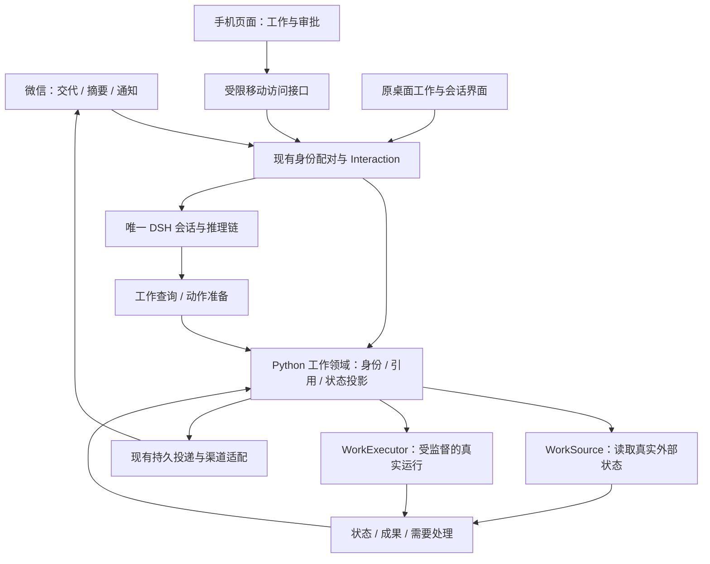

# 手机控制电脑工作的产品方案

调研：2026-10-26，Asia/Shanghai（+08:00）。状态：设计提案，未实现。用户已提出可以保留独立“工作”功能，希望手机主要了解和控制各项工作；这不表示本文的界面、联网及执行方案已经逐项确认。微信目前仍以 [第一版实际边界](framework-v1.md#微信文字私聊第一版) 为准。

## 1. 推荐结论

将“工作”作为手机端的主要入口：它表示用户托付给 Mirally、希望持续了解或推进的一件事。用户交代目标即可创建，也可从原会话或正在运行的实验加入关注；不要求另填项目管理表。会话负责讨论，实际运行负责执行事实，工作将它们与材料、结果组织起来。

手机默认回答四个问题：现在怎样、需要我做什么、我还能怎样指挥、结果在哪里。微信负责随手交代和重要通知；移动页面负责概览、审阅与具体操作。电脑继续拥有工作、数据和唯一 DSH 推理链。

这更新 [跨端 MVP 第 10 节](messaging-execution-mvp.md#10-会话承接工作与手机页面待评估) 的上一轮建议：不再以手机会话浏览器作为唯一主要入口，但保留“不增加手工维护负担”和“不复制聊天历史”的原则。普通聊天、生活陪伴与记忆仍独立存在，不把 Mirally 全部功能改造成工作管理器。

## 2. 现有产品怎样做

以下仅记录查阅到的官方文档所描述的行为；账号资格、支持系统及发布范围可能变化。可借鉴点是本方案的推断，不能视作 Mirally 已有能力或所有产品的共同实现。

| 官方实践 | 实际方式 | 对本产品的启发 |
| --- | --- | --- |
| [Codex on mobile](https://learn.chatgpt.com/docs/mobile) | 手机选择云环境或连接的电脑，启动、跟进、补充指令、审批并审阅响应、文件、diff 和测试结果 | 手机围绕交代、指导、确认、验收组织，不必成为小终端；明确工作实际运行在哪里 |
| [Claude Code Remote Control](https://code.claude.com/docs/en/remote-control) | 手机/浏览器接续本机 Session，保留本机文件、工具及执行环境，跨端同步；通过出站 HTTPS 连接，不要求开放本机入站端口 | 同一工作跨端连续，手机关闭不等于电脑任务结束；本机 owner 可以保留 |
| [Claude Cowork Dispatch](https://support.claude.com/en/articles/13947068-assign-tasks-from-anywhere-in-claude-cowork) | 持续交代入口分派实际工作，结果和需要确认的事项返回手机；电脑需保持唤醒且应用运行。当前文档注明既有用户有限 beta，不能当作面向所有新用户的可用入口 | 自然语言交代、少量关键介入、交付成果；无需照搬其多宿主分派体系 |
| [VS Code sessions](https://code.visualstudio.com/docs/agents/concepts/sessions) 与 [Remote Control](https://code.visualstudio.com/docs/agents/run/remote-agent-sessions#remote-control-copilot-harness-sessions) | 工作单元与其中的聊天区分；现有本机 Copilot session 可由 GitHub.com/Mobile 监看、补充和审批，与云 agent 是不同模式 | 工作容器与聊天记录分责；完整对话按需查看，状态与阻塞事项先呈现。Mirally 无需继承 GitHub 仓库限制 |
| [Cursor mobile](https://cursor.com/docs/cloud-agent/mobile) | 手机集中跟进 agent、补充要求和审阅结果；其 Remote Control 使用云端 agent loop 和本机工具 | 可借鉴移动端的信息组织，不照搬云端主链；云端任务与用户电脑任务不可混称 |
| [Power Automate 运行监控](https://learn.microsoft.com/en-us/power-automate/desktop-flows/monitor-desktop-flow-runs) | 每次运行具有状态、队列、时间和日志；流程定义与运行实例分开 | 重试保留旧记录；程序退出与用户目标完成分开核验 |
| [Home Assistant 通知](https://companion.home-assistant.io/docs/notifications/actionable-notifications/) | 用有限具体动作或链接处理事件；动作绑定运行身份，考虑并发和过期 | 通知说清发生什么、需要什么处理，并直达同一事项；不能把别的平台按钮能力承诺给微信 |

联网方面，[Tailscale Serve](https://tailscale.com/docs/features/tailscale-serve) 展示了“业务留在本机，私有 HTTPS 接入本机服务”的路线；[Home Assistant](https://www.home-assistant.io/docs/configuration/remote/) 则提供私有网络与可选托管远程访问的选择。这些不要求再建设云端工作引擎。

## 3. 用户只需理解一件“工作”

### 自然产生，不要求维护清单

- “把这批数据处理成报告，完成后告诉我”：创建有目标的工作，在范围明确和动作获准后执行。
- “把这个实验加入关注”：关联现有目录、日志或服务；默认只观察，不假称它由 Mirally 启动。
- 在原工作准备页提交：复用目标、材料、输出选择与草稿，生成工作并延续原会话。
- 普通聊天中提出想法不自动建工作；一次性问询也不自动变成常驻监测。用户可明确加入关注、停止关注、结束或归档。

默认自动取标题、摘要与已知材料。只在无法确定目标、范围或影响时补问，不先要求负责人、期限、优先级、项目层级或工作流。

### 信息与状态的归属

| 对象 | 最小职责 | 关系与边界 |
| --- | --- | --- |
| Work | 稳定身份、标题/目标、目标电脑、主会话引用、来源与资源范围、完成依据、通知设置、关注/结束/归档意图 | 首版默认一个主会话，可有多个来源和多次运行；不保存另一份聊天正文，也不把完整个人画像塞进工作 |
| Conversation | 用户补充、材料、讨论和模型输出，沿用既有 generation/DSH 历史 | 继续唯一 transcript；普通会话无需 Work，已有会话可关联，不强制拆分历史 |
| Run | 一次真实执行尝试、执行器、授权引用、真实进程/远端运行身份、阶段、时间、日志及结果引用、取消和核对状态 | 只有真实后台执行等需要时创建；重试是新 Run，手机查询不是新 Run，模型每次 turn 也不是 Run |
| 来源与观察 | 已有实验、日志、服务和产物的定位、范围、观测时间/游标与证据 | 可以持续观察外部工作；无控制权时不出现停止、重跑按钮，不将 PID 单独当作稳定运行身份 |
| Grant / Approval | 本人、设备、工作/运行、具体动作及影响、参数/文件指纹、有效期和一次性回执 | 创建工作不是永久全权授权；模型文字、引用消息和“继续”不自动授予任意新效果 |

工作的关注/结束意图由用户操作拥有；“正在运行、待确认、受阻、最近失败”尽量从 Run、审批与观察事实投影，不维护与实际执行互相漂移的第二份状态。运行成功、产物存在和目标验收分别表达；重复/持续工作的一次运行完成不自动关闭整个工作。

工作可以从其他会话被引用，但首版不建立通用多对多项目系统。继续该工作默认回主会话，新的输入携带明确 Work 身份；不能仅因为主会话讨论过其他材料就放大本次工作范围。

## 4. 手机与微信的具体体验

### 手机首页：先看要处理的事情

默认按“需要我处理 → 进行中 → 最近完成”组织，支持查看全部工作。单电脑 MVP 不放只有一个选项的电脑选择器，顶部直接显示电脑在线情况与最后联系时间。

每项只需要标题、当前阶段或最新变化、可靠更新时间和一个适合当前状态的入口。例如“等待你确认输出位置”“正在验证结果”“训练 42/100 轮，30 秒前观测”。没有真实分母就不用百分比。

详情顺序是当前状态和下一步操作、最新变化/结果、需要时展开的日志与历史运行，以及关联讨论。可用“继续交代”沿原会话补充要求；需要浏览完整历史时再打开对话，不要求先翻聊天找工作。

只展示执行器实际支持的操作。普通程序未提供安全暂停机制时不放通用暂停按钮；“重试”说明将新建一次运行并检查已有外部效果。结束关注、归档、停止回复和停止真实程序具有各自语义。

### 微信：低负担地交代与处理

- “我的工作怎么样了”：返回有明确身份和更新时间的简短列表，优先列等待用户、异常和发生变化的项。
- “实验 A 现在怎样”：直接定位工作，返回事实摘要；有歧义时给少量明确选项。
- “这份报告把第二部分再改一下”：在当前明确选定的工作内继续；目标不确定时不猜测修改别的工作。
- 完成、异常或需要确认时：只发关键变化与结果/待处理事项，提供可用时的详情入口；进度不逐 token 或每条日志刷屏。

微信原生接入仍受 [腾讯公开协议](https://github.com/Tencent/openclaw-weixin/blob/874637a0dbc24050f72d1385add4fc6170a2d726/docs/protocol_zh_CN.md) 限制，不能许诺自定义原生任务页或按钮。早期可用文字列表、稳定短编号/有时效的编号选择和具体动作确认码；复杂参数及影响审阅交给移动页面。动作确认绑定真实 Work/Run、内容摘要与有效期，不能将一句通用“确认”应用到任意待批任务。

页面选中的工作、微信当前工作和桌面正在浏览的会话分别保存呈现状态。打开某个详情链接只浏览；要改变微信后续消息的目标时明确“在微信继续这项工作”，避免点击旧通知后误路由。

### 状态必须诚实

| 情况 | 呈现与行为 |
| --- | --- |
| 手机断开，电脑在线 | 电脑已获准的工作继续；重连按版本补状态，不重发已接纳动作 |
| 电脑离线或睡眠 | 标记最后联系/观测时间，不把离线等同任务失败，也不把缓存显示成实时 |
| 发出取消 | 先显示取消请求已送达/处理中；执行器核实后才显示已停止 |
| 宿主重启 | 查询仍存在的真实运行或产物，不能自动重跑不确定效果；无法确认则显示待核对 |
| 审批过期或工作已变化 | 返回失效原因和当前状态，不执行旧动作；重复点按复用回执 |
| 电脑离线时请求新动作 | MVP 明确未执行，不默默无限期排队；未来预约需单独指定过期时间和恢复行为 |

主窗口关闭到托盘可以继续；明确退出 Mirally 的当前契约包含宿主与后台收尾。新增执行器必须定义并提示对活动 Run 的影响，不能为了远程功能暗中留下退出后无人管理的进程。

## 5. 一条执行主链，两个有限扩展接口

- WorkSource 负责 `inspect` 及可选订阅：返回带观测时间、来源版本、覆盖/缺口与指标的状态，不自行执行动作。日志、进程/服务、实验框架都能提供适配。
- WorkExecutor 负责 `prepare/start/inspect/cancel/reconcile`，声明真实支持的控制能力；明确作用范围、程序参数和输出。CLI/API 与后续 Windows 桌面执行器分别实现，不在 Work 核心写死。
- 业务写入经 Python owner，Node Host 监督实际运行和生命周期；DSH 继续唯一推理链，Skill/MCP/插件贡献来源或执行适配时仍经过相同边界。不先新增插件宿主、任务云或通用事件总线。
- 长脚本启动返回运行身份后，本轮回复可以结束；运行不占住 DSH 会话等待进程退出。进度查询和取消走产品控制面，不排在忙碌的模型 turn 后。需要持续自主推理的任务另验收，不用普通脚本后台运行冒充已实现完整自主任务调度。
- 既有成果仍按 Conversation 归属并鉴权，新增 Work/Run 关联引用；不搬走原成果或复制文件、历史库。移动接口按工作返回有限投影与实际附件引用，不直接开放全部宿主 RPC、任意 shell 或所有扩展。

## 6. 连接方式与产品成本

当前微信长轮询可先承载工作查询和有限明确控制，继续无需 Mirally 公网入口。移动页面独立需要到达电脑：不能把本机回环 URL 发给手机就称远程页面已完成。

建议业务接口与连接方式分开：个人验收优先选明确配置的私人网络/HTTPS 转发；产品化异地访问采用可选轻量 relay，电脑主动建立连接。relay 负责配对、连接与有限转发，不运行第二个 Agent，不持有模型密钥或本机全权限 token。

手机有独立可撤销身份和访问范围，页面链接不是永久凭据。身份绑定与传输认证分别验证；需要离线查看的最近状态若保存到服务端，必须说明内容、时间与保留方式。没有验证端到端加密时不能声称 relay 看不到内容。首版单 owner、单电脑，不提前建设跨设备调度和云端任务仓库。

## 7. 当前能复用什么，尚缺什么

当前 [工作页](../mirally/assets/control-ui-work.js) 是会话上的工作准备与发送表单，能复用工作起点、材料、草稿和输出方式；没有持久 Work、外部实验监测或后台 Run。现有成果桥按 Conversation 读取，不能直接改成只按 Run 查询而丢失旧成果。

可复用现有逻辑会话/代际、原生历史、命令去重、来源版本与撤回、脚本指纹/参数/超时/取消、材料成果、微信配对/outbox 及原响应式组件。实际缺口包括工作领域、运行监督与冷启动核对、外部状态适配、精确远程动作授权，以及手机页面/配对/联网。现有脚本能力不等于持久后台 runner，当前微信只读工具也尚不能启动它。

## 8. 推荐 MVP 与验收

1. **工作与观察闭环**：可从现有工作页/会话创建工作或加入关注，微信列出、选择和查询；先支持一个明确格式的日志/状态来源，回答带更新时间与依据。手机草图验证信息组织，正式移动页的访问方式单独验收。
2. **最小控制闭环**：一种获准后台脚本，启动、明确审批、阶段/日志/成果、取消、失败与重试记录、重启核对；手机页可查看并处理同一工作。微信保留文字操作作为页面不可用时的有限入口。
3. **完整远程使用**：固定一种经过配对验证的异地连接，补结果媒体及完成/异常通知；平台发送窗口失效保留可查结果。状态与控制闭环未完整通过前不称手机控制电脑 MVP 已完成。

首版不引入项目/子任务层级、通用工作流编辑器、多电脑调度、任意 shell 或桌面接管。后续桌面执行器可声明需要前台独占、本机抢回与锁屏条件，沿用原接口；[微软会话限制](https://learn.microsoft.com/en-us/power-automate/desktop-flows/run-unattended-desktop-flows)说明 attended/unattended 有真实 Windows 约束，不能把键鼠能力包装成随时后台可用。

核心验收是“手机交代 → 正确电脑与范围 → 真实执行/观察 → 需要时手机确认 → 看到结果并继续”，并验证重复动作、过期/串错审批、外部进程身份变化、日志截断、重启后未知效果、手机断网、电脑离线、取消回执丢失和来源撤回。模拟界面不作为真实链路验收。
