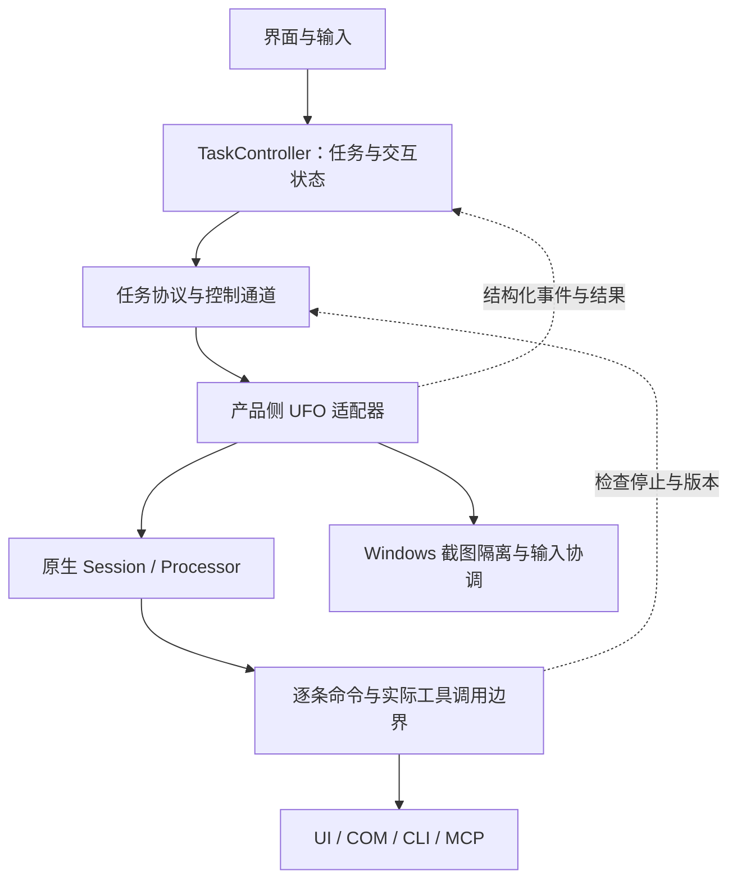

# UFO 原生执行链路补齐方案

状态：第一轮已实施，2026-10-04。本文同时保留设计目标、当前实现映射和后续限制；不是所有真实桌面组合的保证。开发过程中可以用经过验证的更好方案替换具体实现，调整时同步说明控制语义和验收结果。

第一轮目标：统一最小执行器协议，让停止、暂停/接管、用户输入协调、截图与控件隔离、上下文、进度和结果真正作用于默认 UFO 原生链路。

**OpenClaw 接入暂不纳入本轮。** 先用真实 UFO 需求确定接口，保留清晰的适配边界；不预建另一套执行器、远程连接协议或插件框架。语音录音入口、更多 MCP 服务和 Skill 管理也排在这轮之后。

当前实现依据见 [UFO 接入详解](ufo-integration.md#当前接入范围与限制)，UFO 内部链路见 [架构与源码导读](ufo-architecture.md)。开发继续遵守 [AGENTS.md](../AGENTS.md)：`UFO/` 为只读子模块，产品适配、测试和配置在主仓库维护。

本轮已经落地：`core/execution.py` 最小协议；`runtime/ufo/adapter.py` 原生入口；`controls.py` 的模型/工具等待预算、动作准入、补充和重新观察；`observation.py` 的窗口/控件过滤与截图握手；`events.py` 的结构化事件和结果分类；以及 `tests/test_ufo_native_execution.py` 中 11 个隔离原生链路场景。真实窗口像素验证使用 `tools/verify_desktop_isolation.py`，需在专用 Windows 桌面手动运行。

## 本轮范围与优先级

| 优先级 | 工作项 | 本轮交付标准 |
| --- | --- | --- |
| P0 | 停止与动作门禁 | 执行器接受停止后不再启动新的受控动作；模型迟到响应、批次剩余动作和排队工具不能绕过检查 |
| P0 | 暂停、接管与输入协调 | 执行器确认到达安全边界后才显示已暂停/可接管；用户编辑期间不启动新的鼠标键盘动作；恢复后重新观察 |
| P0 | 观察隔离 | 原生桌面/窗口截图及其回退路径不包含 Mirally；窗口和控件观察排除自身；异常后正确恢复窗口状态 |
| P1 | 上下文与补充 | 必要历史、被引用的正文、当前要求和补充进入真实 prompt；补充改变要求后废弃旧动作与旧确认 |
| P1 | 进度与结果 | 展示实际阶段和等待原因；返回业务答案、已验证产物、失败/未完成原因，不以函数返回代替任务完成 |
| P1 | 等待与恢复 | 初始化、模型、工具分别记录耗时并共享等待预算；超时后明确是否仍有操作在途，避免重复执行 |
| 配套 | 小规模接口整理 | 默认与测试执行器走同一协议；核心不直接调用 UFO，不依赖界面文案模块；兼容适配集中维护 |

P0/P1 是验收优先级。开发时先补最小结构化事件和诊断，以便证明门禁确实生效；不必等待所有进度界面做好后再修停止。

## 最小执行器协议

产品层负责用户会话、任务控制意图、交互记录和展示；UFO 负责原生 Session、HostAgent/AppAgent、观察、规划和工具执行；适配器负责两者之间的翻译及控制点接入。



先用一个 `core/execution.py` 定义必要数据类型和协议，不拆成独立 SDK。建议包含：

| 类型 | 最小内容与约束 |
| --- | --- |
| `TaskRequest` | 产品任务/会话 ID、原始请求、明确的当前要求、选定上下文、附件/正文引用、上下文版本、配置 profile 引用 |
| `ExecutorCapabilities` | 取消、暂停、接管、补充、观察隔离等能力的支持程度及生效边界；不能只给一个总开关 |
| `RunEvent` | 任务/运行 ID、递增序号、时间、事件类型和负载；事件覆盖阶段、交互、补充回执、动作状态与结果 |
| `InteractionRequest` | 追问/确认 ID、所属运行与版本、目标动作或问题、有效期/失效条件 |
| `ControlReceipt` | 控制请求 ID，以及不支持、已接收、已生效、失败等结果；接收和生效分开 |
| `TaskResult` | 终态、业务答案、产物引用、已完成部分、未完成原因、验证依据及诊断引用 |

接口可以从 `Executor.describe()`、`Executor.start(request) -> RunHandle` 开始。句柄提供事件消费、控制请求和交互回复；具体采用回调还是异步事件流，以现有线程/Tk 架构下实现最简单且可测试的方案为准。

公共类型不包含 `HostAgent`、UFO `Context`、UIA 控件对象、Tk 回调或依赖某个线程实现的控制对象。桌面隔离、动作门禁等服务通过适配器构造时注入；公共任务数据与平台服务分开。假执行器和 UFO 执行器必须使用同一份协议，取消当前“默认路径只接少量参数、测试路径接全部回调”的分叉。

终态由适配器统一归并，只产生一份权威结果。如果同时保留完成事件和等待返回值，它们必须引用同一份结果，不能各自判定成功。阶段事件可以用初始化、观察、模型等待、执行、验证等公共名称，但不要求将来所有执行器都照着 UFO 的阶段循环运行。

能力声明按当前配置与实际接入情况生成。未验证的暂停或补充不能显示成完整能力；不支持的控制需要明确反馈。界面展示依赖这些声明，不能仅因存在按钮就承诺执行器支持。

## 停止、暂停与人工接管的语义

### 停止以动作准入为边界

界面点击停止后先显示“正在停止”。控制通道接受请求时关闭新的动作准入，并给出回执；只有在途执行与清理状态已经确认后，才显示“已停止”。已经发生的系统操作不承诺撤销。

至少接入以下检查点：

1. 原生步骤开始前，检查停止、暂停和用户输入状态。
2. 模型调用返回后，检查是否已停止，以及生成该响应的上下文/观察版本是否仍有效。
3. 每条命令执行前再次检查；一批命令中的后续命令不能沿用批次入口的一次批准。
4. 工具从线程池队列转为实际执行时再检查。仅入队不算已启动，不能用入队时间规避停止约束。
5. 结果进入下一步规划或下一次工具调用前，检查控制版本并处理迟到结果。

停止与动作准入在同一同步域内排序，记录动作真正获准开始的时刻与版本，避免“检查通过 → 收到停止 → 仍用旧批准开始执行”的竞态。不要在持有产品状态锁时等待 UI、模型或整个阻塞工具调用，否则停止本身也可能被堵住。

门禁必须覆盖所有已启用的原生动作，包括窗口切换、鼠标键盘、Office COM、CLI 和外部 MCP。对观察命令也要分类：某些读取会切换焦点或激活窗口，不能只凭 `data_collection` 名称认定它不会影响桌面。

第一处候选接入点是 Session 实例的 `context.command_dispatcher`，再向 `CommandRouter / Computer` 的实际调用边界延伸。逐条校验时保留原生命令顺序、`call_id`、失败后跳过剩余命令的规则和批次总期限，不能简单拆批后改变这些语义。

“动作”的粒度需要明确：一个工具可能内部执行多个系统操作。若要保证这些内部操作也能在接管后停止，就需要在更细的边界接入门禁、拆分操作，或限制该工具的使用范围。不能把“拦截下一次 MCP 调用”写成“立即中断所有键鼠行为”。第一轮验收须列出实际覆盖的工具与尚不可中断的调用。

### 暂停确认与恢复

暂停按 `请求暂停 → 等待在途操作安全结束 → 已暂停` 处理。模型等待可以继续，但返回的旧决策不得越过门禁。人工接管还要求释放桌面输入控制权，不能仅改变界面状态。

恢复后必须重新观察并重新规划，废弃暂停前未执行的动作列表、旧控件标签和旧确认。继续原有 Session 时要检查并清理其待执行状态；若采用受控重建步骤的方式，应保留有效上下文，并避免重复已经完成的外部动作。具体选用哪种方式由原生链路集成测试确定。

特别注意，当前原生 `AppAgentProcessor.resume()` 用于继续已确认的待执行批次，会跳过数据采集和模型推理。它不能直接充当产品“接管后继续”的实现；版本变化后要使 `pending_actions`、`confirmation_decision` 等旧状态失效，并进入新的观察/规划路径。

暂停、接管和编辑状态属于控制通道，不能被普通工具错误包装后交给模型重试。适配器需验证取消/重新规划信号能够穿过 UFO 的异常处理层到达正确处理点。

### 超时不等于停止

当前 `Computer._run_action()` 在线程池中调用工具，外层 `wait_for` 超时并不能证明执行线程已经退出。适配器必须分别追踪等待结果和实际在途操作。

如果工具仍可能操作桌面，界面应保留“等待当前操作结束”的状态，不能宣布安全接管，也不能启动重试或冲突任务。终止等待、线程退出和外部效果确认是不同的事件；迟到结果要记录，但不能让已取消任务继续规划。

这也约束清理顺序：仍在使用临时兼容替换或截图隔离的工作线程退出前，不能因外层协程返回就恢复补丁、恢复截图窗口或释放原生任务锁。需要追踪实际 worker 的完成信号，避免只追踪已被取消的外层等待对象。

第一轮先保持单个原生任务串行执行。若实测阻塞调用导致无法给出所需停止/恢复边界，可在主仓库增加最小 UFO worker 进程隔离；这是解决具体阻塞问题的手段，不是提前建设多内核平台。结束 worker 也不代表已发给远端或系统的动作被撤销，仍需保留结果不确定的说明。

## 用户输入、补充与上下文版本

沿用产品现有控制版本思想，但由默认适配器实际消费。建议区分上下文版本与观察版本，至少保证任何可能影响计划的变化都会使旧决策失效。

| 事件 | 必须发生的变化 |
| --- | --- |
| 用户开始编辑 | 关闭新的桌面动作准入；当前动作未结束时先等待，之后才让输入框取得焦点 |
| 用户接管或改变桌面 | 旧观察失效；再次执行前重新获取截图、控件和焦点信息 |
| 收到新的任务补充 | 上下文版本递增；旧待执行计划和旧敏感动作确认失效 |
| 模型返回旧版本决策 | 丢弃其待执行动作，进入重新观察/规划；不能只往内存追加补充后继续原动作 |
| 补充进入新请求 | 按具体补充 ID 和版本发送采用回执，而非把当前所有排队补充一起标记已采用 |

例如：模型正在按版本 7 规划，用户提交了版本 8 的“不要发送，只保存草稿”。版本 7 返回的发送动作必须被拦截；包含版本 8 的新请求实际提交给模型后，才能显示该补充已纳入上下文。

“已纳入上下文”表示内容进入本次真实请求，不承诺模型已经正确遵循。回执应区分收到、已纳入某个请求、未使用或被后续要求取代；取消时尚未提交的补充不能变成已采用。按消息 ID 确认，也能避免补充 A 被取出后、补充 B 刚到达时错误确认 B。

确认应绑定运行、上下文/观察版本和具体动作内容。旧任务确认、接管前确认以及参数已经变化的确认都不能复用；失效后如仍需敏感动作，应基于新观察重新请求确认。

### 传递必要历史，保留被引用正文

`TaskRequest` 中区分当前请求、必要历史、正文/附件引用和补充。普通聊天生成的待填文本必须能以原文进入执行器；不能只传“用户曾让助手写了一段文字”的摘要。

首批验收使用固定场景：先生成一段测试文字，再请求“把它填到测试网页里”。检查真实 Host/App 请求能够取得这段原文，并且网页最终内容与选定文字一致。

上下文需要有预算和来源。优先保留当前任务直接引用的内容，其余历史再摘要；正文过大时提供可读取的受控引用，或向用户澄清，不能静默截断后当作完整内容执行。历史授权、旧确认和过去的模型指令不自动成为当前任务的有效授权。

## 截图与控件隔离

隔离必须接在真实观察边界，而非仅在任务开始时隐藏一次界面。

| 观察路径 | 接入要求 |
| --- | --- |
| 桌面截图 | 截图前在 UI 线程完成捕获排除或隐藏握手；成功后才采集，采集结束可靠恢复 |
| 应用窗口截图 | 同样经过隔离；窗口截图失败回退桌面截图时保持隔离，不能中途恢复 |
| 回合/子任务/Session 收尾截图 | 同样受隔离和停止策略约束，不能只包装正常 App 数据采集；非必要收尾截图不得拖住停止 |
| 桌面窗口枚举 | 根据产品注册的进程/窗口身份过滤主窗、浮窗和产品对话框，不靠标题匹配 |
| 应用控件和 UI 树 | 拒绝选中自身窗口，并覆盖原生实际使用的各控件/树观察入口 |
| 截图标注与控件编号 | 基于过滤后的结果构建映射，不能在 prompt 中删几行却留下可执行的自身窗口 ID |

安装过滤时同步处理已有窗口缓存，覆盖 `refresh_app_windows=False` 复用旧列表的路径；选窗执行前再检查目标身份，防止陈旧 ID 绕过观察过滤。必要时在产品作用域内包装底层 photographer 的采集入口，以覆盖正常采集之外的路径。

优先复用 `WindowSession.capture_begin()/capture_end()`，但需要确认所有产品顶层窗口都被覆盖。若捕获排除失败，回退隐藏并等待画面合成；隔离握手失败时中止该次观察，不继续发送可能包含自身的截图。

恢复必须幂等，并考虑嵌套/并发采集：不能因第一个采集完成就提前恢复仍被另一个采集使用的窗口。可按当前串行模型先禁止重入，或实现计数，测试所选方式。采集异常、取消和 UI 超时均须回收隔离状态。

恢复应遵循用户当下的窗口意图：原来已最小化的窗口不能被意外弹出，用户已切走的焦点不能被强行抢回。恢复到可交互状态和恢复旧焦点需要分别判断。

## 进度、结果与等待诊断

进度来自原生处理阶段、模型调用和工具调用的结构化钩子，不把 Rich 输出或 Python 日志文本当成状态机输入。建议记录阶段开始/结束、模型尝试、工具开始/结束、重试原因、累计耗时与剩余预算。

界面可以显示“正在观察浏览器”“等待模型响应，已等待 12 秒”“当前操作尚未结束，停止请求已生效于后续动作”。公共事件只携带适合展示的摘要；原始响应、错误堆栈和诊断数据单独保存并按需脱敏，不直接显示内部推理内容。

结果建议使用以下语义：

| 终态 | 含义 |
| --- | --- |
| `completed` | 有明确的任务完成依据，并给出答案或可核对的操作结果 |
| `partial` | 部分目标完成，明确已完成内容与剩余内容 |
| `incomplete` | 已结束但无法确认目标完成，例如达到预算、缺少必要输入或结果不确定 |
| `failed` | 明确失败并提供可理解的原因与诊断引用 |
| `cancelled` | 接受取消并结束该运行；已发生的外部效果仍在结果中说明 |

执行状态未查明时应保持待确认状态；如果必须结束产品等待，结果要标记不确定，同时另行保留在途操作与资源占用记录。不能把“停止等待”等同于“所有资源已释放”。

答案优先取原生明确输出，例如回合结果、总结和经核对的产物。`session.is_error() == False` 不能单独证明完成，截图/log 文件也不自动算用户请求的产物。如果只有模型声称成功，应保留验证程度，不能伪装成已经检查外部状态。每个终态都要给出具体说明；不再只返回“UFO 原生任务已结束”。

等待预算使用单调时钟，覆盖初始化、模型调用、工具等待及其重试。各阶段有上限，外层共享总预算；用户正在回答追问或主动暂停的时间单独统计，明确是否计入期限。初始化探测与主备模型切换也要计入，避免多层重试各自重新获得完整预算。

只对明确可重试的错误重试。具有外部副作用的调用超时后，先核对是否已执行；没有去重/幂等保证时不能自动再次发送、写入或点击。具体默认值根据实际测量与测试确定，并提供产品侧配置与清楚的等待提示。

日志优先使用任务专属 handler/filter，并仅在自身拥有的范围内增删。逐步移除清空、替换整个 root logger 的做法；结构化阶段不依赖日志级别。首次初始化错误、运行错误与清理错误分别保留，清理失败不能覆盖原始失败原因。

## 代码组织与迁移边界

保持已有 `core / runtime / platform / ui` 四层。建议的职责布局如下，文件按实际复杂度拆分，不一次创建大量空壳：

```text
openassist/
  application.py              # 组装控制器、模型服务、执行器和平台服务
  core/
    execution.py              # 最小任务协议、能力、事件、结果与控制语义
    task_controller.py        # 产品任务生命周期、交互与回执
    conversation.py           # 产品会话、上下文选择与结果保存
    assistant.py              # 普通对话/任务交接，接收注入的模型服务
  runtime/
    ufo/
      adapter.py              # 公共协议实现与原生 Session 生命周期
      controls.py             # 原生步骤/命令门禁、版本和交互桥接
      observation.py          # 截图握手与自身窗口过滤
      events.py               # 原生阶段/结果到产品事件的转换
      config.py               # UFO loader、路径与配置桥接
      compat.py               # 当前 native_compat 的兼容修复
    completion.py             # 产品对话模型的适配实现
    config.py                 # 产品配置；不在通用加载时初始化 UFO
    speech.py                 # 保留现有语音 Provider
  platform/                   # Windows 窗口、输入、捕获等具体实现
  ui/                         # Tk 界面与展示文案
```

`runtime/ufo/` 是主仓库内产品适配代码，与只读 `UFO/` 子模块不同。暂不创建 `openclaw/`、插件注册中心或多执行器调度系统。未来第二个执行器通过相同任务协议接入，具体目录届时再决定。

| 现有位置 | 迁移要求 |
| --- | --- |
| `runtime/ufo_full.py` | 收拢到 UFO adapter；必要时保留过渡导入，但不维护两套执行路径 |
| `runtime/native_compat.py` | 移到 UFO 适配包，保留异常恢复与真实导入测试 |
| `runtime/config.py` | 将 UFO loader/sys.path 操作与语音、产品配置分开；现有用户配置路径保持兼容 |
| `core/assistant.py` | 移除直接导入 `ufo.llm`；注入 completion 服务，初期可由 UFO 桥接实现，避免强制迁移用户模型配置 |
| `core/task_controller.py`、`core/conversation.py` | 公共状态/文本规范化归核心；UI 映射阶段文案，消除对 `ui.presentation` 的反向依赖 |
| `__main__.py` | 将具体依赖组装与初始化交给应用入口；尽量缩小 UFO cwd、配置单例及补丁的作用域 |
| `ui/desktop.py` legacy 入口 | 同步使用同一适配边界，或明确限制该入口支持的能力，避免遗留绕过门禁的调用 |

优先替换实例级 dispatcher/策略/服务；确实需要临时替换类或模块对象时，限制生命周期、串行运行并在所有退出路径恢复。不能为减少代码量把新的控制逻辑全塞进兼容补丁文件。

本轮仍使用 UFO 原生 Session，不恢复旧 single-agent 执行循环，也不新增产品自己的任务规划 agent。以后是否将 `reply/desktop` 路由改成多执行器选择，由第二个执行器的真实需求决定；本轮只避免把这种二选一硬编码进公共任务类型。

## 实施顺序与阶段交付

### 阶段 A：统一入口并建立可观察链路（已完成）

抽出最小协议，用 UFO adapter 包住现有 Session，默认控制器与测试执行器采用同一入口。接入阶段事件、错误分类、耗时记录及一份权威终态。模型服务改为注入，展示文案依赖移回 UI。

验收结果：默认路径事件由控制器消费；初始化失败、运行失败和重复完成事件有确定行为；能力声明反映协作式取消和已接通能力。

### 阶段 B：动作门禁与观察隔离（已完成，真实桌面仍受环境限制）

实现停止、暂停/接管、编辑协调及版本检查，覆盖批次与线程池实际调用边界。接入真实截图和控件过滤，完善恢复。保留原有兼容修复并缩小全局修改范围。

验收结果：模型等待时停止不会导致后续新动作；接管后不执行旧计划；隔离进程场景中截图和控件没有 Mirally；工具仍在途时保持 stopping。

### 阶段 C：上下文、补充与业务结果（已完成）

传入有效历史和引用正文，补充按消息 ID/版本生效；接管、补充后真实重新观察与规划。提取业务结果并补充完成依据、部分完成和不确定结果的映射。

验收结果：“把前文填到测试网页”、模型等待时变更目标、旧确认失效和结果回写会话均有隔离原生场景。等待总预算贯穿 A–C；不可控阻塞保留 stopping 状态并等待 worker 收尾。

### 阶段 D：默认原生路径验收与文档校准（已完成本轮范围）

完成下面的测试矩阵，逐项记录测试环境、真实链路覆盖与替代边界。README、能力声明和实现说明只展示通过相应验证的保证；不能把规划文档中的目标直接复制进功能清单。

## 验收矩阵与证据

保留现有单元测试，但新增确定性原生集成测试：使用实际 adapter、Session、processor、dispatcher 和本地工具路由，仅替代外部模型响应和最终 OS/网络副作用。用同步屏障控制模型返回、动作准入、补充到达时刻，避免靠任意 sleep 猜测竞态。

测试必须从 `TaskController` 的默认产品入口开始，不用 `runner_factory` 替换真实执行器，也不 mock `Session.run()`、processor 或 dispatcher。保留真实 FastMCP 注册、调用和响应解析，在独立进程、临时配置及临时会话/日志目录内运行，并阻止意外外部网络请求。基础用例至少经历 Host 观察/分配、App 观察/执行与结果回写；普通问答则验证始终不进入桌面链路。

现有初始化测试替换了 `Session.run()`，只能证明导入、初始化及恢复的一部分行为，不能承担以下执行链路验收。哪些路径因测试工具替代而未覆盖，必须写入测试说明。

| 场景 | 必须观察到的结果 |
| --- | --- |
| 模型等待中停止，随后返回动作 | 原生模型处理路径继续收尾，但最终副作用记录器没有新增动作 |
| 一批多条动作，第一条后停止 | 后续命令逐条被门禁拦截；已排队未执行的任务也不能迟到启动 |
| 在动作准入与停止接收之间制造竞态 | 顺序有唯一判定；停止被接受后无新的准入，不能靠界面事件顺序推断 |
| 暂停/接管时工具尚在运行 | 先显示等待；未确认安全结束前不宣布可接管；恢复后有新的观察 |
| 用户编辑时模型返回 | 不启动键鼠动作；输入结束后检查版本，不能直接续用旧控件编号 |
| 先有补充 A，随后补充 B | 回执准确对应实际提交到模型的消息集合和版本，B 不被提前确认 |
| 旧确认已到队列，此时接管或修改要求 | 即使 worker 随后取到“同意”，旧动作也不能执行 |
| 截图成功、失败、回退与取消 | 实际采集受到隔离；每条退出路径恢复窗口，最小化状态不被误改 |
| UI 无响应、握手超时后迟到确认 | 未确认隔离或输入门禁时不继续对应观察/动作；过期回调不能影响新任务 |
| 桌面列表、控件树与动作目标 | 自身窗口不出现，残留 ID 不能用于选择或操作自身 |
| 先生成文字，再要求填入网页 | 原生上下文包含选定原文，结果可核对，历史确认不被复用 |
| 工具超时后仍在线程中执行 | 不自动重试、不提前释放受占用桌面；迟到结果不触发下一步 |
| 返回结果缺失、错误、部分完成 | 不默认成功；只产生一次权威终态，界面和会话内容一致 |
| 初始化失败、运行异常、取消和再次启动 | handler、兼容补丁、窗口状态与资源均正确恢复；新任务不继承旧确认 |

此外需要有限的 Windows 真实桌面验证，使用专用测试窗口、本地网页与临时文档，不使用私人邮箱或真实发送操作。覆盖原生捕获排除与强制隐藏回退、多窗口/浮窗、当前支持的多屏与 DPI 环境；检查真实图片、控件结果和实际输入行为，而不只检查回调被调用次数。

可先采用脚本化模型响应搭配真实桌面，以稳定复现停止和接管；再做少量明确授权的真实模型任务，验证上下文与业务结果。测试报告区分协议单测、真实原生链路的确定性集成、Windows 桌面验证和真实模型验证，不把某一层通过当作全部通过。

现有 [桌面隔离验证脚本](../tools/verify_desktop_isolation.py) 已通过独立合成子进程调用真实 UFO photographer 和运行时隔离钩子，覆盖原生排除、隐藏回退、输入样式与恢复；它仍不连接模型，也不代替用户应用上的完整 Session 验收。验收记录附主仓库 commit、UFO gitlink、Windows 版本、显示器/DPI 条件及实际覆盖的工具。

第一轮完成结果：A–D 的产品范围和关键场景均有对应证据，未覆盖部分已写入限制；产品原生调用经过统一控制机制，`UFO/` 源码与 gitlink 保持不变。后续只需补更多真实桌面组合和经授权的真实模型验证。

## 后续能力如何接续

MCP 下一步优先做服务配置、连接诊断、工具发现、启用范围、授权与错误反馈，复用已建立的动作门禁和事件协议。产品管理策略只有接入了实际执行边界才有效，不能把“监听到工具事件”当成能够阻止工具执行。

Skill 可以在此后增加产品技能目录、选择和上下文加载；其操作仍由受控工具执行。开发用 `AGENTS.md` 与运行时任务技能分开管理，不能自动把开发约束当成 agent 已加载的技能。

语音输入可以将识别结果送入同一消息/补充通道。OpenClaw 或其他执行器等到有明确接入需求时，再验证现有协议需要扩展的部分；当前不承诺会话、记忆、工具和技能能无损通用。

## 实施时优先核对的源码

| 目的 | 当前入口 |
| --- | --- |
| 控制、补充、默认/测试路径差异 | [TaskController](../openassist/core/task_controller.py) |
| Session 启动、控制与结果封装 | [ufo adapter](../openassist/runtime/ufo/adapter.py)、[controls](../openassist/runtime/ufo/controls.py)、[events](../openassist/runtime/ufo/events.py) |
| 现有配置和兼容修复 | [runtime/ufo/config](../openassist/runtime/ufo/config.py)、[compat](../openassist/runtime/ufo/compat.py) |
| 原生命令分发与线程池执行 | [dispatcher](../UFO/ufo/module/dispatcher.py)、[Computer / CommandRouter](../UFO/ufo/client/computer.py) |
| Host/App 原生处理阶段 | [Host 策略](../UFO/ufo/agents/processors/strategies/host_agent_processing_strategy.py)、[App 策略](../UFO/ufo/agents/processors/strategies/app_agent_processing_strategy.py) |
| 原生确认后续跑的具体语义 | [AppAgentProcessor.resume](../UFO/ufo/agents/processors/app_agent_processor.py) |
| 真实 UI 工具与截图路径 | [UI MCP server](../UFO/ufo/client/mcp/local_servers/ui_mcp_server.py) |
| 产品窗口隔离和焦点恢复 | [WindowSession](../openassist/platform/window_session.py) |
| 回合与 Session 结果 | [原生 basic](../UFO/ufo/module/basic.py)、[Session](../UFO/ufo/module/sessions/session.py) |
| 当前真实初始化验证 | [test_ufo_native_initialization](../tests/test_ufo_native_initialization.py) |
