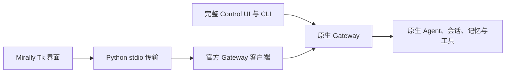

# Mirally 的 OpenClaw 实验浮窗客户端

状态：已通过首版功能验收，现转为实验入口；主产品使用[完整官方界面桌面套壳](openclaw-desktop-shell.md)。更新日期：2026-10-04。本文只描述 Tk 客户端，不作为主入口的功能说明。

## 启动与使用

在项目根目录执行 `.\run-openclaw.ps1 companion`。它连接已运行的本地 Gateway，默认地址为 `127.0.0.1:18789`；不会启动第二个核心或重启正在工作的 Gateway。首次安装和模型配置见 [原生运行说明](openclaw-native-setup.md)。也可使用 `.\run.ps1 --companion`。

普通问答、文件和网络请求全部直接发送给原生 Agent，不经过旧的 reply/desktop 分类。回复流式显示，工具活动以实际事件为依据，不生成虚假的步骤或进度百分比。「工具记录」展示当前加载历史中的参数和结果；较长结果只截取显示，完整内容可以在原生界面查看，这不影响模型的原生上下文。

大窗口直接点击侧栏切换会话，小窗口点击「历史」。新建会话使用 `sessions.create`，切换后从原生历史恢复。执行中的会话允许切换到其他会话，旧任务仍由 Gateway 管理；未发送草稿按会话在本次客户端运行期间保留，关闭窗口后不保证恢复。

点击「浮窗」收至屏幕侧边。靠近展开可查看工作状态或输入，离开立即开始收起；正在输入的草稿会保持展开。浮窗提交信息后仍留在浮窗，不先打开普通窗口。展开状态下的「历史」进入会话列表，「−」最小化到任务栏，「打开会话」返回主窗口。普通问答不会自动改变窗口位置。

运行中发送的信息通过原生 `chat.send` 的 `queueMode: "steer"` 处理。界面显示发送与进入历史的真实状态，不把接收 ACK 标成“已用于下一步”。模型具体采用补充的时机和效果由原生执行决定。网络中断或超时可能发生在服务接收之后，此时保留待核对状态；相同消息的明确重试复用发送标识，重连读取原生历史。

「停止」针对原生报告的当前单个精确 run ID。多个执行回合或身份暂不可确认时，使用完整原生界面选择停止目标。中止 Agent 回合不能据此宣称所有独立后台进程均已退出。

关闭 Mirally 只关闭客户端连接，不中止任务或关闭 Gateway。Gateway 离线时输入草稿仍可编辑，发送按钮暂不可用，连接按官方客户端的机制重试。

## 原生交互与完整功能

客户端读取执行、插件、OpenClaw 审批和问题列表，并展示属于当前会话的提醒。首版通过「到原生界面处理」完成审批与问题回答；不伪造本地确认，也不因这里没有专门按钮而禁止原生能力。查看提示不会自动抢焦点或打开浏览器；用户点击入口后才进入完整界面。

「原生界面」使用官方 Dashboard 的一次性浏览器配对 URL。模型、记忆、Skills、插件、渠道、调度及其他尚未呈现的原生功能继续在那里或 CLI 中管理。审批/问题的实际真人操作和特殊交互内容还没有全部验收，不能把列表可读取等同于所有交互已验证。

界面偏好与原生功能配置分别保存。晴空蓝、其他现有主题、正式图标、设置卡片、开屏和浮窗视觉组件得到复用。原生会话和工具仍是唯一的执行依据，不受旧版暂停、接管、输入租约或前端心跳规则约束。

## 实现边界



| 文件 | 职责 |
| --- | --- |
| `openassist/native_shell.py` | 会话、输入、流式回复、工具活动和原生入口的展示 |
| `openassist/gateway_transport.py` | 后台读取 stdio，关联请求与结果；不执行任务 |
| `integrations/openclaw/desktop-bridge.mjs` | 官方客户端连接、订阅、原生 RPC 与事件转发 |
| `integrations/openclaw/device-store.mjs` | 持久 Ed25519 设备身份、签名回调和按 Gateway/设备/角色区分的令牌存储 |
| `integrations/openclaw/session-view.mjs` | 基于官方投影 helpers 合并历史、原生消息与运行流；不生成模型上下文 |

设备与令牌保存在私有的 `config/openassist/openclaw/mirally-client/`。请求 `operator.read`、`operator.write`、`operator.approvals`、`operator.questions`；没有请求 `operator.admin` 或 `operator.pairing`。首次连接与权限变化服从原生设备配对策略，本机已验证正式设备连接及令牌复用。存储回调遵循官方 `expectedToken`、取消信号和当前连接检查，避免旧连接覆写新令牌。

客户端只提供自身已实现的展示能力，当前只声明 `tool-events`，没有宣称已经内嵌完整审批处理器。会话订阅使用官方 coordinator；断开重连恢复列表、选定会话订阅和权威历史。旧生命周期的显示在原生 reset 后替换，延迟到达的流事件不能重新激活已完成回合。

原生入口绕过 UFO 的目录初始化，不创建 `TaskController` 或 `ConversationStore`。窗口只复用几何、背景和任务栏辅助方法，不启动 Raw Input 监测、桌面热键、截图握手、鼠标操作或输入控制权切换。查看浮窗和编辑补充均不暂停后台运行。

## 验证

以下检查不调用模型：

```powershell
& .\.artifacts\node\node-v24.21.0-win-x64\node.exe --test integrations\openclaw\desktop.test.mjs
.\.venv\Scripts\python.exe -m unittest discover -s tests -p test_native_shell.py
& .\.artifacts\node\node-v24.21.0-win-x64\node.exe integrations\openclaw\verify-desktop.mjs --live
```

Node 检查覆盖设备签名和身份保留、令牌作用域与条件写入、流式快照/增量、最终回复去重、旧流事件、原生 reset、发送接收与历史持久化的区别。Python 检查用真实 Tk 的隐藏窗口验证输入不申请桌面控制权、精确停止、流式文本更新、会话草稿、失败发送与重试，以及关闭客户端不会中止工作。只读连接检查使用正式桌面设备访问本机原生会话及交互列表。

以下检查会调用实际配置模型：

```powershell
& .\.artifacts\node\node-v24.21.0-win-x64\node.exe integrations\openclaw\verify-desktop-turn.mjs --live
```

测试建立独立的临时会话和文件目录，运行等待外部释放的后台脚本。在客户端断开后重新连接，核对原执行回合，发送新的文件内容要求，然后释放脚本并回读实际文件。2026-10-03 的 7 项检查通过：真实工具活动、重连执行身份、补充改变产物、补充进入历史、最终回复仅显示一次、权威空闲状态，以及流式回复可见。

复用组件的 22 项浮窗回归检查通过。另用合成会话检查了晴空蓝窄窗、石墨黑宽窗、设置页面和展开浮窗，真实截图已打开核对；预览未改变前台窗口归属。截图与测试产物保存在本机忽略目录，不含在提交内容中。

原生后台体验已有用户实测确认。新 Mirally 客户端的真实使用体验、首次最大化、任务栏恢复及审批/提问的人机流程仍需要继续观察；界面截图与隐藏窗口检查不能代替这些实机验收。
