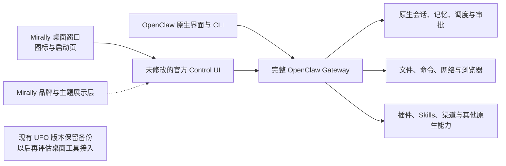

# Mirally 接入 OpenClaw 的路线

状态：原生后台基线与 Mirally 桌面套壳已接通。当前主入口承载完整官方 Control UI，并应用独立的 Mirally 品牌、默认主题和侧边伙伴视图；首版 Tk 客户端保留为实验入口。更新日期：2026-10-04。安装、入口和实际验证边界见 [原生运行与验收](openclaw-native-setup.md) 及 [桌面套壳说明](openclaw-desktop-shell.md)。

2026-10-05：在 feat 上合并 main 的 UFO 适配层，并通过官方 Agent Harness 添加可选 UFO 智能体。默认智能体与前端保持 feat 的路径；UFO 使用原生 `normal` Session。配置、已验证链路与未覆盖限制见 [UFO 智能体接入](ufo-openclaw-agent.md)。

## 方向与优先级

**完整保留 OpenClaw，让 Mirally 适配 OpenClaw。**先把原生系统用起来，再决定现有界面和交互如何接入。OpenClaw 的会话、记忆、Agent 循环、工具、任务调度、补充消息、停止、审批和恢复机制是接入依据；旧 Mirally 的控制逻辑不是新系统必须遵守的规格。

产品目标是能够处理文档、文件、命令和网络任务，并尽量在后台完成，不占用用户正在使用的鼠标和窗口。优先使用原生文件/API/命令工具和独立浏览器；确实需要桌面操作时再考虑 UFO。具体选择由原生能力与实际任务决定，不再先把任务分类成“聊天或者桌面操作”。

“保留所有功能”指不裁剪 OpenClaw 核心能力、配置入口和扩展方式。Mirally 暂未呈现的功能继续由原生 Control UI、CLI 或其他官方入口提供；不要求第一期重写完整管理界面。功能启用、认证和权限继续按 OpenClaw 的原生配置管理。

本路线优先于旧 [前端体验目标](frontend-experience-goals.md) 中针对 UFO 制定的控制器、状态、输入协调和前端心跳约束。旧文档仍可解释已发布版本的行为。

## 最终关系

OpenClaw 是完整运行核心。Mirally 提供展示与交互，不再建立第二套主 Agent、会话上下文、工具调度或长期记忆。官方入口和 Mirally 应连接同一目标实例，通过原生协议看到对应会话与任务；不直接修改其内部数据库。

## 路线一：先建立原生可用基线

1. 选择并固定 OpenClaw 发行版，按对应官方文档安装运行；先使用原生 Control UI/CLI，必要时使用官方 Windows Hub。
2. 按原生方式配置现有模型服务和工作目录，核实当前 Qwen 中转的工具调用能力。
3. 在原生界面完成代表性工作：读取本地文档并生成摘要、处理文件或表格、执行命令、检索网页、在独立浏览器完成任务、持续追问及运行中补充；同时验证重连同一会话、停止任务和原生审批行为。
4. 验证任务结果与产物，同时观察是否抢焦点、移动用户鼠标或弹出不必要窗口。记录模型、依赖、登录和平台限制，先在原生系统中解决。

这个阶段不改 Mirally，不把原生工具缩减为自定义子集。测试先用合成文档和临时目录，便于核对结果。每个样例保留实际操作与产物证据，不能只凭最终回答判断成功。

2026-10-03 已完成首批原生验收：本机 Node `24.21.0`，`openclaw` 与 `@openclaw/gateway-client` 均固定为 `2026.9.6`。首先安装的最新 `2026.9.8` 存在 Windows 新建会话回归，因此保留其本地状态，使用此前版本重新验证。文件、命令、会话上下文、重连、网页、独立浏览器、运行中补充和停止回合均已通过；未覆盖范围见 [首批验收记录](openclaw-native-validation.md)。

优先评估 Windows 原生运行，减少用户文件路径转换；若对应依赖或功能在 WSL2 下更成熟，就采用官方推荐部署。环境选择服务于完整原生能力，不为了保留旧 Python 启动器而限制它。

## 路线二：确定最小的 Mirally 接入方式

已采用品牌启动页与 WebView2 独立窗口，进入完整官方界面；后续加入独立的品牌展示层，统一默认晴空蓝、图标和产品文案，并隐藏上游推广卡。主入口不重写业务交互、不裁剪原生功能导航、不覆盖模型或服务配置。CLI 与未应用桌面皮肤的浏览器控制台继续可用。

之前的 Tk + 官方 Gateway 客户端方案已通过首版功能验收，按当前产品方向转为 `companion` 实验入口。后续特色功能先从完整官方界面及原生能力出发，再决定如何接入，不要求保留这套客户端的布局或业务逻辑。

当前套壳通过官方 `dashboard --json` 取得一次性浏览器配对入口，复用已有 Gateway；需要时用现有本地配置后台启动原生进程。窗口关闭只断开显示入口，不截断后台工作。详见 [桌面套壳说明](openclaw-desktop-shell.md)。

不要把 OpenAI-compatible HTTP 聊天接口当成完整 UI 协议；交互客户端需要对应的会话、事件和审批能力。最终使用哪个接口，以锁定发行版的官方支持范围与验证结果为准。

## 路线三：逐步接入 Mirally 的体验资产

可复用资产包括名称与矢量图标、主题、对话布局、侧边浮窗、开屏和任务状态展示。复用顺序按用户收益决定，视觉行为服从原生任务语义。

| 现有部分 | 后续处理方向 |
| --- | --- |
| `assistant.py` 的 reply/desktop 路由 | 不放在 OpenClaw 前面拦截请求；使用原生 Agent 决定工具和执行路径。 |
| `task_controller.py` 的任务控制 | 不作为新核心；按原生会话和运行事件重接按钮、进度与状态。 |
| `conversation.py` 的本地摘要与上下文 | 旧记录归档保留；新会话和记忆使用 OpenClaw，避免重复注入历史。 |
| `shell.py` 与各视觉组件 | 按实际成本复用；未覆盖功能继续进入官方界面。 |
| `window_session.py` / `task_controller.py` 的桌面截图、输入协调和心跳 | 不套在普通后台任务上；只有未来需要 UFO 桌面执行时再评估复用。 |
| `__main__.py`、`run.ps1` 的启动方式 | 不再强制 OpenClaw 依赖 UFO 初始化或切换到 UFO 工作目录；遵循官方运行与宿主管理方式。 |

会话管理、长任务、补充消息、审批、产物预览等可以逐步获得 Mirally 的界面呈现。先保证调用的是原生能力，再优化视觉，不为保留旧按钮含义而重新实现一套调度。

首轮已实现「侧边伙伴」，作为完整工作台的轻量视图：边缘连续展开与立即收缩、原生运行中补充、真实工具活动、任务结束回顾、Files 面板与已更改文件/产物入口、近期会话切换，以及审批或提问时返回完整工作台。最小化和恢复仍通过任务栏管理。附件与草稿沿用原生 composer，完整原生功能入口保留。

「接着上次」当前仅展示原生会话摘要及最近回复；「接着推进」准备可编辑草稿。它不代表另建的项目记忆，也不保证自动识别所有命令生成的文件。下一步优先通过日常办公和教学展示观察这些交接是否清楚、伴随视图是否打扰，再决定哪些功能值得扩展。

随后已加入三个可编辑办公起点、明确交接标题的纯文本呈现、优先显示待确认事项与确认草稿入口，以及原生已加载会话的后台工作/需查看列表。双材料演示生成了真实汇报和清单，后续老师版修改保留上下文；另在持续后台工具中确认实际浮窗的运行中 steer 发送、接收与最终采用。本轮仍需核对自然办公响应耗时和实际桌面体感。复现步骤与待验范围见[办公协作演示](demo/README.md)。

这轮没有增加模型调用、记忆数据库或运行依赖。适配固定 OpenClaw `2026.9.6` 内部 Control UI 结构；升级前需要检查原生状态、草稿、文件预览与审批恢复。主入口 `mirally` 的侧边伙伴与旧 `companion` 实验 Tk 客户端区分使用。

## 完整能力如何保留

| OpenClaw 能力 | 初期入口与后续关系 |
| --- | --- |
| 对话、会话、历史和记忆 | 原生界面直接使用；Mirally 后续读取原生投影，不自建另一份权威上下文。 |
| 文件、命令、后台进程、网页和浏览器 | 保留原生工具与配置；Mirally 可渐进展示活动和产物。 |
| Skills、插件、MCP、模型和权限配置 | 使用官方管理方式；没有 Mirally 设置页面也不影响使用。 |
| 多 Agent、渠道、自动化和其他扩展 | 保留原生入口及配置，不因首轮只验证少量样例而删除或禁用这些能力。 |
| 更新、诊断、恢复和维护 | 沿用官方机制；优先做外围客户端，减少对上游内部实现的修改。 |

第三方服务、可选插件或模型能力各有其配置和依赖；保留功能不代表这些服务已经配置完成。需要在原生环境中逐项启用和验证，不在界面中虚报可用。

## 接入时已发现的几个易错点

以下用于提醒实施者核对版本，不要求重新发明这些机制：

- 官方当前文档中，普通运行中补充使用 `chat.send` 的 `queueMode: "steer"`；已弃用的 `sessions.steer` 对应中断语义，名字容易误导。
- 原生发送 ACK、消息进入历史、模型消费消息是不同阶段。界面显示其真实状态，不硬套旧 `queued/applied/unused` 协议。
- 取消请求、Agent 结束和后台子进程退出不能混为一谈；按原生工具和生命周期展示，不用本地线程存活猜测远端状态。
- 会话重连使用官方历史和订阅机制；不把旧 `ConversationStore` 的“恢复时全部标中断”沿用到仍在运行的 Gateway。
- 独立浏览器配置目录与无头运行不是同一个设置；按原生浏览器方案选择，验证用户使用电脑时不被无意抢焦点。
- 现有 Qwen 路径能返回自定义 JSON，不代表原生 `tool_calls`、工具结果配对和多轮执行已经验证。先在原生 OpenClaw 中定位模型兼容问题。

## Sol 的第一项工作

从原生安装和可用性验证开始，不从重写 Mirally 开始。交付一份简短验证记录：选定版本与环境、模型配置方式（不含密钥）、原生能力实际结果、未满足依赖、接入界面的最小选择。

随后根据结果更新本路线。若保留 Tk 成本高，可以改；若官方客户端或界面更适合，可以直接复用；若某个推荐接口已变化，以对应发行版为准。调整只需解释具体依据，不需要为迁就这份规划保留多余结构。

实施从原生运行与验证开始，不预先接回 UFO，也不为“统一两套引擎”增加编排。先获得一个完整、好用的 OpenClaw，再逐步形成 Mirally 的体验。

## 基线与参考

迁移前基线：提交 `f85ea9e`，标签 `mirally-pre-openclaw-2026-10-03`。原版本与本机备份已保留，旧会话不自动迁移。默认入口改为官方界面的桌面套壳；UFO 使用 `run.ps1 --ufo`，原配置保留。实验 OpenClaw 浮窗使用 `run-openclaw.ps1 companion`。

- [OpenClaw Windows](https://docs.openclaw.ai/platforms/windows)
- [Gateway 客户端](https://docs.openclaw.ai/gateway/clients)
- [嵌入与宿主管理](https://docs.openclaw.ai/gateway/embedding)
- [Gateway 协议](https://docs.openclaw.ai/gateway/protocol)
- [会话控制 RPC](https://docs.openclaw.ai/gateway/protocol/rpc-session-control)
- [会话与记忆](https://docs.openclaw.ai/concepts/session)
- [工具与扩展](https://docs.openclaw.ai/tools)
- [独立浏览器](https://docs.openclaw.ai/tools/browser)
- [自定义模型服务](https://docs.openclaw.ai/concepts/model-providers/custom-providers)
