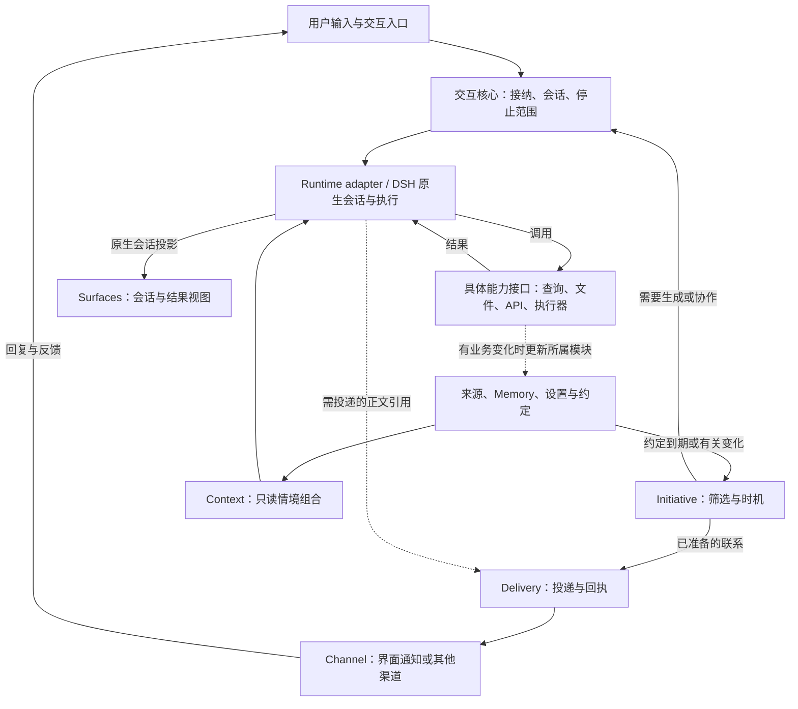

# Mirally personal agent 产品框架方案

状态：调研后推荐案 v0.7，2026-10-22，明确扩展接口、交互归属与 Skill/MCP/插件兼容。产品方向和扩展性要求来自用户；具体结构与取舍是 Agent 的研究建议，尚未实施或决定迁移。现行 OpenClaw Control UI、Gateway 和维护边界保持有效。

建议采用**具有明确扩展接口的模块化本地应用：Mirally 拥有长期个人状态、交互规则和能力边界，DSH 提供原生会话与推理执行基础**。首选验证方式是自有 DSH Profile / Bundle、产品组合插件与现有 Python worker；暂不建设独立 SDK 外宿主、自研模型循环或耐久工作流平台。选型理由、反对证据和验证边界见[调研报告](research/personal-agent-architecture-2026-10-22.md)，扩展机制见[接口与组合设计](framework-extensions.md)。

## 1. 产品中心与范围

Mirally 面向一个人持续变化的生活与工作：减少反复解释背景的负担，延续重要经历和约定，在合适的时候交流，并将需要行动的帮助落实为可核实的结果。

活动理解、记忆与个性化、主动联系、生活与工作陪伴、行动协作共同构成方向，不能用某条工作主线限定整体结构。但它们不是必须全部、全量、同时实现的清单。每项能力都要说明带来的体验收益、增加的状态与成本、失误后如何恢复；局部目标可以调整、延后或舍弃。

| 保留的产品价值 | 收紧后的承诺 |
| --- | --- |
| 了解用户的经历 | 基于获准来源形成有覆盖说明的部分理解；窗口出现不等于读过，摘要完成不等于细节全部保留 |
| 连续的 personal agent | 身份、相关经历、明确偏好和约定可以延续；不依靠永不结束的模型 Session |
| 自主联系 | 先有值得联系的事情，再判断时机、入口和预算；允许延后、过期和安静 |
| 便捷陪伴 | 少重复背景、自然接续、允许说完与结束；不预设需要独立人格进程或全天自主闲聊 |
| 更好的记忆与个性化 | 有来源、范围、时间与纠正；个性化改善行为，不扩大行动权限 |
| 实际帮助 | 按需使用文件、API、浏览器或 UFO；过程返回与实际结果分别核实 |

关闭 Activity、后台模型整理或一般主动消息，都是合法使用方式。用户提供的材料、对话和明确约定仍可支持连续性。高主动程度、低打扰和接近零资源消耗不能同时无限满足，应由范围、策略与预算调节，而非建设三套个人 Agent 核心。

未来首次使用建议一个明确默认：只使用用户提供的内容，不自动开启 Activity；背景模型预算为零，一般主动话题关闭；明确偏好和提醒按指令落实。关窗保留可见托盘 Host，明确“退出”才终止后台，不默认承诺开机自启、唤醒设备或离线准点送达。用户需要更多连续理解时再开启相应能力，不先填写框架设置问卷。这是未来新安装的建议，不覆盖已有用户设置或当前关窗行为；A 路线的固定常驻成本仍须验证。

## 2. 建议采用的设计原则

1. **领域有自己的权威状态。** 观察、记忆、显式设置、约定、投递、原生会话与实际动作分别有责任方；不复制第二份可写 transcript，也不建立万能 PersonalState。
2. **普通行为保持普通。** 观察可以只存观察，闲聊可以只回答，提醒可以直接投递；不强制创建 Intent、Task、Run 或完整快照。
3. **情境按需组合。** Context 是带来源、时间、版本和预算的只读结果，不是新数据库或另一个常驻 Agent。
4. **有限推理服务于具体需要。** 去重、变化筛选、过期与简单时机判断先用程序完成；小型模型整理可直接调用模型服务，不必进入完整工具循环。
5. **用户表达优先且有范围。** 本次、今晚、以后、不要再提、纠正与遗忘分别处理。明确设置与约定在已有权限内直接落实并可撤销；已发生的外部动作不保证可撤回。不把低价值推断变成待用户审核的画像。
6. **效果在实际边界检查。** 模型计划、记忆、观察内容和工具输出不能代替授权；访问数据、投递、写文件和桌面动作各自检查当前有效条件。
7. **恢复尊重未知。** 收到、持久接收、进入模型、请求停止、实际停止和业务完成分别表达。崩溃后没有证据的外部效果不盲目重做。
8. **扩展性进入核心设计。** 来源、情境、模型、执行、投递、策略与交互通过明确契约接入和组合；内置与外部实现使用同一接入面。普通内部规则仍用普通模块，事实通知用于视图更新；不要求先建设通用事件总线、插件市场或多内核平台。

### 2.1 怎样判断结构是否优雅

新场景应主要组合现有来源、状态、策略与能力；新入口应共享同一伙伴与会话依据。新增模块必须带来明确的责任、故障或替换边界。若增加一个场景就要修改万能调度器、复制个人画像或同步另一份聊天日志，先检查结构。

元数据也要有用途：Context 默认瞬时，低价值候选可以直接丢弃；只为恢复、撤回、去重、约定兑现和问题定位保存必要引用。少几个框并不比清楚表达观察与推断、投递与同意、动作与结果更重要。

## 3. 结构骨架与能力组合

六类产品方向是覆盖地图，不对应六个服务或六个模型 Agent。“个人 Agent”是这些机制共同形成的体验，无需再设置全知中枢。



这描述需要回应或帮助的路径，不是所有事件必须经过的流水线。Activity 写入、偏好更新、固定提醒和记忆维护可以直接调用所属模块。接纳只处理入口与资源，不另写一套规划—工具循环；“本次帮助范围”先是调用参数，不建设独立 Intent 平台。

| 模块责任 | 拥有什么 | 不承担什么 |
| --- | --- | --- |
| Activity | 原始观察、来源、质量、缺口与有限派生 | 用户意图、长期偏好、动作授权 |
| Memory | 值得保留的经历与可修正主张、来源和替代关系 | 全部原始活动、完整聊天历史、任务调度 |
| Settings / 设置 | 显式偏好、关注范围、授权策略与资源限制的配置 | 提醒的到期/兑现状态、从点击自动学习人格 |
| Commitments / 约定 | 提醒与承诺的条件、到期、取消和兑现依据 | 模型对话历史、联系渠道的传输事实 |
| Initiative | 有理由的联系候选、有效期、时机和打扰策略，以及候选跟进 | 改写承诺本身、直接控制 UI 或冒充送达 |
| Interaction / 交互核心 | Conversation、命令身份、会话代际、正在进行的帮助与停止/对账范围 | 另写规划循环、接管所有领域状态或维护第二份模型运行历史 |
| Context | 从上述来源按本次需要选取情境 | 顺手采集、写画像、扩大权限 |
| Runtime adapter | 固定版本 DSH 的输入、原生状态与事件映射 | 通用内核、第二份运行真相 |
| Delivery / 投递 | 待联系正文的引用、渠道选择的执行、提交去重、回执和回复关联 | 决定一件事是否值得联系、以提交代替用户已读 |
| Capabilities / 能力接口族 | 查询、文件、执行器、投递等各自具体契约；实现负责实际效果与核验 | 一个统一拥有所有业务状态的 execute 模块、用模型一句“完成了”证明结果 |
| Surfaces | 工作台、伙伴入口及未来语音的显示和输入 | 独立记忆、独立人格、第二个相互竞争的会话写入者 |

这些是代码责任，不是部署清单。设置和约定分模块，可以同包同库；Channel 是投递接口的具体适配，文件与 UFO 是其他具体能力实现。新增产品逻辑优先放普通模块；Profile 中的插件负责组合。现有 Python Activity / Memory / UFO 保留，避免为统一语言搬运已验证的平台代码。

### 3.1 扩展接口与组合

扩展单元 Extension 声明身份、兼容范围、依赖与所需访问，向领域导出的 typed 扩展点贡献实现，并负责资源生命周期。一个日历集成可以同时提供来源、检索、触发、动作和 UI 卡片；无需各建一个 Agent。内置能力同样通过这些契约接入。

来源、模型/服务、Context 检索、记忆整理、执行器、投递渠道、UI 和策略各有符合自身语义的接口，不统一成任意输入输出的万能 plugin。多来源并存、检索合并、单一权威后端选择和策略约束的组合规则由相应领域明确。新增真正不同的能力时，领域可定义新的命名、版本化扩展点，不把核心写死为当前几类功能。

采用 DSH 时复用它的加载、依赖和生命周期机制，通过薄适配注册 Mirally 的产品贡献；不另造第二个通用插件宿主。停用、升级、来源撤回、在途取消与错误传播也是接口的一部分。接口应支持进程内模块及 Python/MCP 等适配，实际隔离方式按能力需要选择。

第一版就验证公共接入、依赖、组合与退出，插件市场和任意热更新可以后做。详细契约及日历、手机入口、外部执行器和记忆后端的检验见[扩展接口与组合设计](framework-extensions.md)。

Skill、MCP 与现有插件生态是正式兼容面：Skill provider 保留 SKILL.md/资源并按需加载流程知识；MCP 适配分别接入工具、资源与提示模板；插件可组合提供上述能力及产品服务/UI。独立 Skill 和 MCP server 无需重写为 Mirally 插件。脚本执行、协议能力与宿主插件格式分别验证，具体支持矩阵见[生态兼容设计](framework-extensions.md#7-skillmcp-与现有插件生态)；不把通用接口的存在写成已全部兼容。

### 3.2 怎样耦合与运行

上述图是运行时的数据与控制流，允许结果反馈；代码依赖则通过明确接口隔开。主要关系如下：

- 交互核心读取 Settings，调用 Context 和 Runtime 的产品接口；DSH adapter 实现 Runtime 接口，隔离原生 API。原生工具通过具体能力适配调用相应领域或执行器。
- Context 只读取 Activity、Memory、设置、约定及已注册来源。日历、文件等来源可有自己的读取接口，不要求所有外部资料先变成桌面 Activity。
- Initiative 读取有关状态和设置，接收有类型的变化通知，产生/延后候选；需生成内容时请求交互核心，内容准备好后请求 Delivery。Delivery 使用 Channel，实际回执由 Initiative 与约定 owner 各自更新本领域状态。
- 跨领域写入调用 owner 的方法，不直接操作它的数据库；使用来源引用、Conversation/命令身份、版本等必要的共同语义，不共享一个任意修改的全局个人对象。事实通知只提示变化，不隐式授权动作。
- 宿主提供装配、生命周期、时钟、共用模型路由、预算与后台资源管理；不负责替所有领域做业务决定。普通读取直接调用，长调用异步等待，视图消费原生事件/领域通知，无需所有通信都经过事件总线。

三条主要运作链：

1. **用户交互。** 入口提交 → 交互核心唯一接纳并绑定会话代 → Context 选取相关依据 → Runtime 推理并按需调用具体能力 → 原生会话呈现回答；业务结果回到相应 owner。普通聊天可以到回答为止，明确交付才按需创建业务目标与产物引用。
2. **观察与记忆。** 来源在启用范围内提供观察 → Activity 或相应来源 owner 留存依据 → Memory 按游标、预算和来源版本整理 → Context 以后按需读取。需要模型整理时调用共用模型服务，不创建用户聊天；记忆更新不等于立即联系用户。
3. **主动联系。** 约定到期或有关变化 → Initiative 检查价值、时机与预算 → 使用模板，或经交互核心生成内容 → Delivery 投递前重新检查 → Channel 提交与回执 → 更新候选及原约定，用户回复进入同一 Conversation。固定提醒可以绕过模型推理。

启动顺序为：宿主加载配置与扩展、恢复必要状态与禁令 → 建立依赖和接入点 → 开放用户输入与后台触发 → 按已启用能力启动 worker。界面读取投影与发送命令，不拥有后台状态。首选部署仍是一个 DSH Profile 主宿主、薄窗口及按需 Python worker；共享宿主意味着仍共享一定故障/升级影响，接口解耦不等于进程隔离。

## 4. 数据与状态归属

物理存储先尊重已有所有权：Activity 与 Memory 继续使用原有 SQLite；DSH 保存原生 Session；产品新增的低吞吐元数据只选择一种存储。可先验证官方 storage-domain，若承诺与投递需要多记录事务和可靠查询，则采用一个产品 SQLite。二者不并建为相互同步的权威库；具体选择是原型要解决的一个局部问题。

| 状态 | 保存规则 |
| --- | --- |
| 观察与长期主张 | 来源、观察时间/有效时间、质量、状态、版本；推断和用户确认分开。显式设置由设置模块管理，不藏进摘要 |
| 约定与待接续事情 | 谁希望做什么、何时/什么条件触发、取消/完成依据。普通话题无需变成 Task |
| 主动候选与联系 | 关联事情、来源版本、理由、有效期、去重身份、下次判断和必要投递状态；瞬时无价值候选不持久化 |
| Conversation | 稳定产品 ID、一个当前原生 Session、必要的历史代际与交接原因。初始可只有一代，不锁死永久一对一 |
| DSH Session | 原生模型历史与工具事实的唯一权威；UI 读取其投影，产品仅保存引用和业务状态 |
| Context | 默认只在本次调用存在；每个采用来源的 Session 代保留 source/version 使用回执，以定位后续纠正或撤回，不重复保存整份敏感正文 |
| Task / 动作尝试 / 产物 | 仅明确交付、跨 worker/重启或具有外部效果时增加业务状态；普通 turn 优先读取原生运行状态。产物必须实际存在、可定位 |

跨数据库读取的版本集合不是全局原子快照。产品状态与待投递项在同一个数据库时可以事务提交，但不因此得到与 DSH、Windows 或外部服务之间的原子性。采用稳定身份、版本检查和对账，不承诺全局 exactly-once。

原始资料保留到期与用户要求遗忘分别处理。处理回执证明约定输入已处理，不能证明有损摘要保留了未来任意问题需要的信息。展示与回答应区分观察覆盖、持久记忆范围和原始证据是否还能打开。

### 4.1 纠正与停止使用

普通纠正更新适用范围和替代关系，并按来源使用回执处理活跃 Session 中的旧引用：加入明确修正、阻止旧引用再次选入，必要时遮蔽或换代；不能只修改 Memory 而继续把旧摘要当事实。无需每改一条偏好就轮换 Session。现有 Memory 的同 ID 保护和 conflict_key 是可复用资产，不能冒充通用语义矛盾检测。

“不要再主动提”修改联系策略；“停止使用这条记录”还需撤回相关记忆和可追溯派生内容、封锁后台迟到结果、取消待发联系，并处理已被召回的原生上下文。

DSH 有 surface replacement，可遮蔽部分未来模型输入，但保留原始日志，也不能自动清除派生回答、压缩摘要和子会话。严格停止后续使用优先采用**冻结受影响的旧代、从仍有效的产品状态建立新代**；不让模型总结旧对话后冒充清洁交接。新旧代共享产品 Conversation 身份。

冻结是持久执行禁令，不只是改 current_session_id：宿主启动先读取禁令，再开放输入、schedule、resume 与子任务；所有执行入口和投递前检查会话代与来源状态。旧代只读，相关在途工作必须收尾。使用回执只追踪已知来源，不假装建立完整语言因果图；无法精确判定时保守扩大冻结范围并说明未覆盖之处。

撤回先持久记录失效并阻止后续使用，再完成跨模块清理；未完成时明确范围。历史文件擦除、附件及备份清理、已经发送给模型服务的数据是更强的删除问题，应单独验证，不能只删除 Memory 就报告全部遗忘。

## 5. 主动性是一套独立机制

建议链路为：`变化/约定 → 确定性筛选、合并、去重 → 有依据的机会 → 时机、范围与预算 → 必要时有限推理 → 投递前复查 → 联系与反馈`。

| 行为 | 起点与默认处理 |
| --- | --- |
| 明确提醒、结果送达 | 已有约定或真实结果，可直接用模板；不必让模型重新判断用户是否想知道 |
| 关注事项变化 | 明确关注加可核验的新信息；没有变化便不反复分析 |
| 当下帮助建议 | 有依据的当前目标与障碍；目标不清时降低范围、延后或不提出 |
| 陪伴与话题接续 | 有共同经历和愿意被联系的范围；轻量、可结束，不以收到回复为必须完成的议程 |

提醒、机会判断和投递分开。一般候选延后会过期，不积攒一个要求用户清理的建议收件箱；从睡眠或停机恢复后按约定补送、过期或重新判断，不补跑每一个错过的 tick。空闲只说明缺少输入，不证明愿意聊天。

Mirally 约定与主动事项保持单一产品调度归属，不在原生 schedule 中为同一件事另建可自主执行的副本；若复用原生计时机制，只作为经过相同产品门控的触发源。

明确提醒只有在持久约定创建成功、返回稳定 ID 和可执行的时间/条件后，才显示“已建立”；模型口头答应不算。用户提出提醒本身已授权该范围内的建立，不再二次确认；能力不可用时如实说明，不用人设承诺替代功能。

面向交流的联系先有可接续正文和话题，再投递预览；正文保持一个权威来源，投递记录只引用它。仅状态卡无需制造模型聊天。区分提交给渠道、渠道确认、用户查看、回复、稍后、拒绝与采纳；点击和沉默都不自动成为满意、同意或长期偏好。

先用明确规则与分档，只有确需理解时才启用有限模型判断；不提前建设精确收益打分器或规则 DSL。评价同时看有用性、时机、负担、成本，以及被抑制机会的漏失，避免只靠什么都不说获得好看的准确率。

## 6. 记忆、个性化与陪伴如何结合

长期连续性优先来自有依据的经历、范围明确的偏好、真实约定和自然接续。Context 按当前问题选择相关部分，当前注意力不成为永久画像。授权、隐私范围与产品显式设置不会因“越来越熟悉”而自行放宽。

工作台与伙伴入口使用同一会话数据模型；会话可以按话题分别组织，但不复制人格和记忆。初版一个会话保持一个活跃编辑入口，另一入口可显示与接续；共享草稿需明确归属，不能默认 DSH 支持两个 root composer 同时编辑。

陪伴先验证四项实际收益：少重复背景、恰当接续、允许说完和结束、确实兑现约定。若同模型普通聊天已经足够，而后台自主闲聊没有净收益，应舍弃该后台。人物小传、关系等级、复杂情绪模型和不断反思不是核心依赖。

先用现有 SQLite/FTS 建立中文、时间、跨会话、知识更新、弃答和纠正评测。只有测出词法召回的缺口，再增加语义检索；embedding 能力和聊天模型分别声明，不因“需要记忆”立即增加向量或图数据库。

## 7. DSH 的位置与复用策略

**下一阶段原型首选：自有 Web Profile + Mirally Bundle + 受限产品 Preset + 正式客户端扩展。** 复用原生 Agent / loop / Session / 持久化 / Session Controller，以及 ClientSessions、Conversation/Chat 投影；Host 产品服务负责组合领域与 worker。框架独立体现在状态、规则与代码边界，不要求先建设第二个常驻 Host。

DSH 的 Profile 组合应用，Bundle 分发插件与配置，Preset 限定单个 Agent 的工具和行为。普通产品模块不遍地依赖 Cordis ctx。UI 优先使用 Slots / Component Factories 和同一个 SessionBinding，不复制官方 transcript，不依赖私有 DOM。桌面窗口壳优先评估复用现有 WebView2 资产；安装、客户端打包和生命周期必须独立验收后确定。

**暂缓独立 Host + 官方 SDK。** 固定 rc.2 SDK 缺逐会话取消、客户端 prompt 去重身份、历史 page/follow 和审批请求；run 的最后回复也不等于单 prompt 的因果结果。该路线要补产品协议和双端监督，适合出现明确隔离收益时重开，不能包装成一层轻薄调用。

**保留 OpenClaw 官方 Feature UI 扩展作为现实对照。** 它已能增加页面并替换 composer/transcript/workspace，现有 DOM 注入不是唯一途径。自己的产品架构可以先在现有宿主中成立；只有 DSH 原型证明控制、UI、维护或资源方面的实际收益，才值得迁移。

DSH Web profile 仍加载较完整的 base；缩减模型可见工具不等于缩减安装与常驻资源。固定匹配版本、最小必要扩展和受控工具范围，测量后再裁剪。先不 fork 内核，不把 sdk-minimal 的空框架成本当 Mirally 完整成本。

产品 Preset 的默认工具采用明确允许列表：受控查询、获准材料/文件能力、投递及受控执行器。通用 shell、任意路径 read、PTC 和可生成不受限子 Agent 的能力不默认开放；所有子任务继承相应范围。允许范围须在实际执行 guard 与具体能力内强制检查，不能只从模型 schema 隐藏工具。否则模型可绕过 Mirally 数据与动作边界。还需核验 bootstrap、自动上下文和请求 hook 的数据来源。插件是受信代码，这一设计不承诺隔离任意恶意同用户插件；Windows ACL 也不能补成完整读取/网络隔离。

### 7.1 运行依赖与接入形态

DSH 是首选 Agent 执行基础，不是产品的唯一依赖。目标采用一套主 Agent 宿主；Mirally 自有代码、平台环境、模型服务和按需集成仍有各自依赖。

| 依赖范围 | 目标关系 |
| --- | --- |
| DSH / 配套 Node 运行环境 | 复用 Agent/Session/模型路由、工具、Skill/MCP 和正式客户端机制；Cordis 随 DSH 配套使用，不另拼一套独立框架 |
| Mirally 自有模块 | 交互、Context、Memory 产品规则、设置、约定、主动性和投递由本产品维护；组合插件是装配入口 |
| Python / SQLite / Windows 能力 | 继续承载已有 Activity、Memory、采集与平台资产；具体 worker 按启用功能启动 |
| 窗口与前端 | 正式客户端扩展承载 Mirally UI；薄 WebView2 壳是待验证首选，不能只计算 DSH 空进程成本 |
| 模型服务 | 经宿主 provider/路由使用用户配置的本地或远端模型；采用 DSH 不要求使用 DeepSeek 服务 |
| UFO 与其他扩展 | 可选执行器、Skill、MCP server 等按能力启用，引入各自依赖，不作为所有使用方式的前提 |
| OpenClaw | 当前正式运行和迁移对照；切换成功后的目标主链不再叠加 OpenClaw |

推荐物理形态是一个 DSH 主宿主中装入 Mirally 产品组合，外接薄窗口和按需 Python worker：

```text
Mirally 启动与配置
  ├─ DSH 主宿主：mirally Profile
  │    ├─ 官方会话、推理循环、持久化与模型/工具服务
  │    ├─ Mirally Bundle / 组合插件 → 普通产品模块
  │    ├─ 产品 Preset / 实际执行 guard
  │    └─ Mirally 客户端扩展 → 共享原生会话投影
  ├─ 薄 Windows 窗口（WebView2 候选）
  └─ Python Activity / Memory / 可选 UFO worker
```

具体接入分四处：Profile 选择组件；Bundle/插件注册产品服务和扩展；正式客户端 Slots/Factories 接入界面；本地 MCP 或明确 RPC 协议连接 Python 能力。查询可走 MCP，持续采集、后台维护、宿主模型桥、停止与退出由对应生命周期适配负责，不能认为挂一个 MCP 就完成所有集成。现有 OpenClaw 专用适配需替换，Python 内核与存储优先复用。

产品入口的目标形式可使用 `dsh --profile mirally`，但该 Profile、Bundle 和启动链本轮尚未创建；现有启动脚本仍运行 OpenClaw。新接入需先在独立临时 home 中验证，尤其是公开控制入口、客户端打包、worker 生命周期与模型桥。

## 8. 宿主、资源与恢复

启用后台能力时，产品 Host 可独立于窗口可见性存活；关闭窗口、退出产品、暂停来源与禁用背景模型有不同语义。按需启动 Activity / Memory / UFO worker，不为框图数量增加进程。若选择全部退出，停机期间不能承诺主动到达；本地定时器也不保证设备睡眠/关机期间准点。

A 路线仍有 DSH 主宿主的固定成本与故障耦合。关闭模型和采集不会让 Node 宿主消失。若实测不满足低资源模式或后台必须跨 DSH 故障存活，再转独立 Host；不假装这一取舍已消除。

- **资源**：交互优先，背景理解、整理和主动分析有独立上限、并发与退避。长期模型调用不持有数据库事务；没有变化时不重复调用。小型整理使用正式 LLM 服务，记录作业版本与用量，不伪装为用户聊天。
- **输入**：原生 requestId、序列流与历史查询优先复用，但原生检查不覆盖所有并发和取消后重放。产品门面对同一 Conversation 的命令 ID 唯一接纳，首次即绑定目标会话代与内容摘要；重试不重新绑定新代，持久保留取消/拒绝终态身份，不保存第二份 transcript。原生 accepted 不等于崩溃后持久接收，需要等待原生 flush 并保存待对账引用。崩溃窗口先对账，不凭单一状态重新发送；applied 只能依据原生证据。所有写入口须经过此边界或受等效原生执行 guard 约束；公开扩展能否覆盖它们是迁移门槛，不假设现成 composer 自动满足。
- **停止**：先封锁本次帮助的新效果与派生排队项，再请求引擎和 worker 停止，等待真实确认。保留用户草稿和无关约定。旧结果不能恢复旧计划；已发生动作的迟到回执仍记录为事实。DSH Web cancel 会保留 inbox，不能直接充当产品停止闭环。
- **恢复**：UI 重建投影，原生 Session 恢复历史；worker、浏览器和外部动作不假定原地续跑。无结果且可能产生外部效果时，使用提供方幂等键或先核对，否则标为未知，不自动重做。
- **数据**：访问、向模型发送、主动投递、实际行动分别受控。采集或网页内容是资料，不是修改产品规则的指令。DSH 反馈遥测、官方 API Session 日志及可选桌面统计分别配置、验证；不照搬未知默认值。
- **部署**：固定配套 DSH 与插件版本；路径基于仓库/配置/系统目录，保留 Python 资产。非默认目录、空格/中文路径、工作目录变化、退出树和 Windows 权限均为迁移门槛。

## 9. 用多种体验检验同一框架

| 场景 | 必须证明什么 |
| --- | --- |
| 昨晚的视频或材料 | 跨会话与本地日期正确、有来源；缺失和原始资料已清理时能弃答，不补写细节 |
| 今晚安静 / 以后晚上不聊工作 | 临时范围不永久化，明确长期设置跨重启生效，无重复确认与画像审核负担 |
| 主动接续与明确提醒 | 同一机制可延后、安静、到期或模板投递；点开延续原语境，过期内容不补发 |
| 已召回后纠正或撤回 | 在途作业、当前上下文、子会话和待发联系遵守失效；必要交接后旧代无法自动唤醒 |
| 两份材料生成报告 | 普通输入、补充、停止、实际产物、未知结果与重启对账可核实 |
| 低资源 / 低打扰 / 高主动 | 同一底座改变策略；明确各自可用范围与固定成本，不以三个核心实现 |
| 窗口切换、断连和崩溃 | 不新增聊天权威，不重复外部效果；显示收到、停止请求和实际结果的差别 |

体验评估以同模型普通聊天、确定性提醒为基线，再比较规则筛选加模型的边际价值。资源评估比较功能相同的完整进程树，分离冷启动、热交互、准备耗时、模型时间、空闲 CPU/RSS 与后台调用。当前没有功能对等的 DSH 性能实测，不能据此宣称更轻或更快。

## 10. 从构想到验证

1. **固化最小契约与产品对照脚本。** 明确状态 owner、扩展接口/依赖/组合/退出、纠正/停止使用范围、提醒/一般联系差异、停止与未知语义；并行准备生活回忆、偏好/话题接续、明确提醒三个对照，比较是否少解释背景、正确遵守范围、可结束并兑现。系统正确与实际体验分别验证，不按单条主线设计。
2. **一个隔离的 DSH 可行性切片。** 临时 home、fake 模型与 worker，验证正式 UI、原生会话投影、命令身份与 flush、取消、来源失效、Python 接入和重启。证明公开扩展可承载；fake 只验证协议，不证明记忆理解或陪伴价值。产品对照不等待整套宿主完成才开始。
3. **补关键缺口的对照。** 用 OpenClaw 官方 Feature 插件验证 DSH 最需要证明收益的 UI/控制点，不平行建设两套完整产品。只有必要时才做获准的真实模型或桌面验收。
4. **过门槛再迁移。** 固定发布、配置/数据备份、旧会话只读保留、唯一采集者与 Memory 维护者、回退步骤全部明确；切换后一个正式入口。运行数据与 UFO 内核本轮不动。

暂不做：永久 Workflow 表示个人生命史、常驻多 Agent 社会、自研通用 loop、无限反思与画像、通用多内核协议、任意插件市场、默认多端同步，以及未经验证的完整遗忘/任意任务无损恢复。出现实际约束和证据后再重开，避免为未来可能的小点承担今天的核心复杂度。

推荐可以被推翻：正式 DSH 扩展无法满足核心控制/UI、必须持续补私有结构、Python 资产被迫大量重写，或完整成本不优于现有路线时，应保留 OpenClaw 或转独立 Host。最强反对理由与验证顺序见[调研报告](research/personal-agent-architecture-2026-10-22.md)。

依据与演进见[产品记录](product-notes.md)、[现有模块](../mirally/ARCHITECTURE.md)、[现有 Memory 边界](activity-memory.md)及[调研证据](research/personal-agent-architecture-2026-10-22.md)。本稿是推荐设计，不是实现清单或当前功能承诺。
