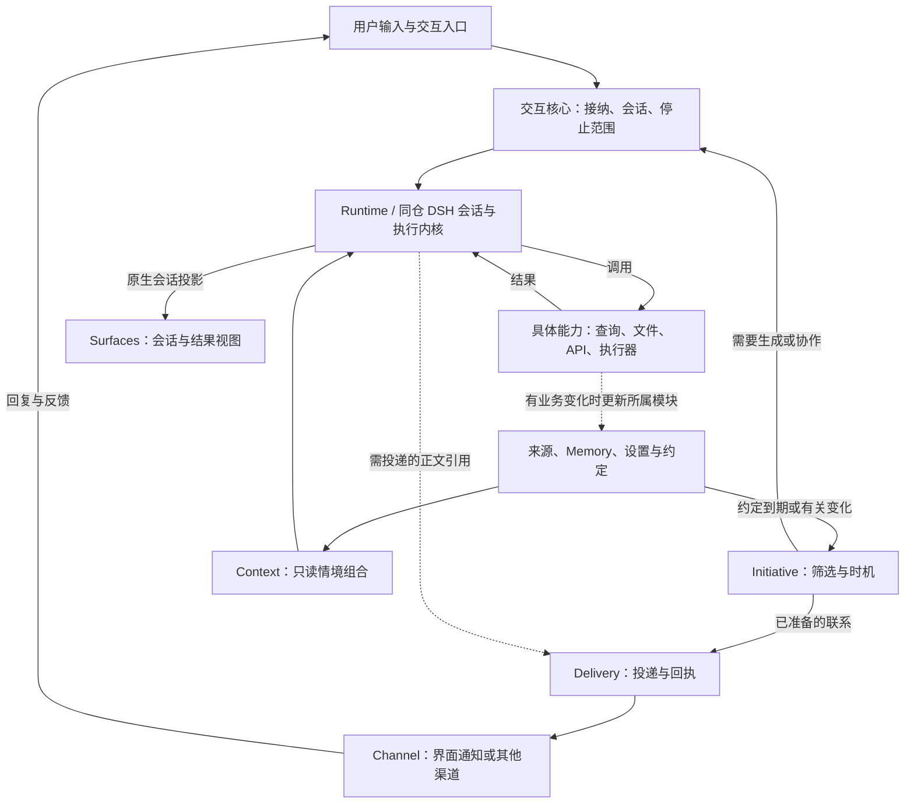

# 产品方向

更新：2026-10-31，Asia/Shanghai。状态：现行方向。本文描述长期目标、设计原则与边界，不代表全部已实现；实际能力见[系统概览](../architecture/overview.md)与[能力矩阵](../reference/capabilities.md)。

Mirally 面向一个人持续变化的生活与工作：减少反复解释背景的负担，延续重要经历和约定，在合适的时候交流，并把需要行动的帮助落实为可核实的结果。

## 产品中心

活动理解、记忆与个性化、主动联系、生活与工作陪伴、行动协作共同构成方向，不能用某条工作主线限定整体结构。它们不是必须全部、全量、同时实现的清单。每项能力都要说明体验收益、增加的状态与成本、失误后如何恢复；局部目标可以调整、延后或舍弃。

| 产品价值 | 有边界的承诺 |
| --- | --- |
| 了解用户的经历 | 基于获准来源形成有覆盖说明的部分理解；窗口出现不等于读过，摘要完成不等于细节全部保留 |
| 连续的个人 Agent | 身份、相关经历、明确偏好和约定可以延续；不依靠永不结束的模型 Session |
| 自主联系 | 先有值得联系的事情，再判断时机、入口和预算；允许延后、过期和安静 |
| 便捷陪伴 | 少重复背景、自然接续、允许说完与结束；不预设独立人格进程或全天自主闲聊 |
| 更好的记忆与个性化 | 有来源、范围、时间与纠正；个性化改善行为，不扩大行动权限 |
| 实际帮助 | 按需使用文件、API、浏览器或明确实现的系统适配；过程返回与实际结果分别核实 |

关闭活动采集、后台模型或一般主动联系，都是合法使用方式。用户提供的材料、对话和明确约定仍可支持连续性。高主动程度、低打扰和接近零资源消耗不能同时无限满足，应由范围、策略与预算调节，而不是建设三套个人 Agent 核心。

## 设计原则

1. **领域有自己的权威状态。** 观察、记忆、显式设置、约定、投递、原生会话与实际动作分别有责任方；不复制第二份可写 transcript，也不建立万能 PersonalState。
2. **普通行为保持普通。** 观察可以只存观察，闲聊可以只回答，提醒可以直接投递；不强制创建 Intent、Task、Run 或完整快照。
3. **情境按需组合。** Context 是带来源、时间、版本和预算的只读结果，不是新数据库或另一个常驻 Agent。
4. **有限推理服务于具体需要。** 去重、变化筛选、过期和简单时机判断先用程序完成；小型模型整理可直接调用模型服务，不必进入完整工具循环。
5. **用户表达优先且有范围。** 本次、今晚、以后、不要再提、纠正与遗忘分别处理。明确设置与约定在已有权限内直接落实并可撤销；已发生的外部动作不保证可撤回。
6. **效果在实际边界检查。** 模型计划、记忆、观察内容和工具输出不能代替授权；访问数据、投递、写文件和桌面动作各自检查当前有效条件。
7. **恢复尊重未知。** 收到、持久接收、进入模型、请求停止、实际停止和业务完成分别表达。崩溃后没有证据的外部效果不盲目重做。
8. **扩展性进入核心设计。** 来源、情境、模型、执行、投递、策略与交互通过明确契约接入和组合；内置与外部实现使用同一接入面。

## 结构骨架

| 模块方向 | 拥有什么 | 不承担什么 |
| --- | --- | --- |
| Activity | 原始观察、来源、质量、缺口与有限派生 | 用户意图、长期偏好、动作授权 |
| Memory | 值得保留的经历与可修正主张、来源和替代关系 | 全部原始活动、完整聊天历史、任务调度 |
| Settings | 显式偏好、关注范围、授权策略与资源限制 | 提醒的到期/兑现状态、从点击自动学习人格 |
| Commitments | 提醒与承诺的条件、到期、取消和兑现依据 | 模型对话历史、渠道传输事实 |
| Initiative | 有理由的联系候选、有效期、时机、打扰策略 | 改写承诺、直接控制 UI 或冒充送达 |
| Interaction | Conversation、命令身份、会话代次、正在进行的帮助与停止/对账范围 | 另写规划循环、维护第二份模型运行历史 |
| Context | 从来源按本次需要选取情境 | 顺手采集、写画像、扩大权限 |
| Runtime | 产品执行接口、同仓 DSH 输入与原生状态 | 通用多内核平台、第二份运行真相 |
| Delivery | 待联系正文的引用、渠道选择、提交去重、回执和回复关联 | 决定一件事是否值得联系、以提交代替用户已读 |
| Capabilities | 查询、文件、执行器、投递等具体契约 | 统一拥有所有业务状态的 execute 模块 |
| Surfaces | 工作台、伙伴入口及未来语音的显示和输入 | 独立记忆、独立人格、第二个会话写入者 |

这些是代码责任，不是部署清单。设置和约定可以同包同库；Channel 是投递接口的具体适配；文件与 Windows 系统适配是具体能力实现。

## 三条运作链

1. **用户交互**：入口提交 → 交互核心唯一接纳并绑定会话代 → Context 选取相关依据 → Runtime 推理并按需调用能力 → 原生会话呈现回答；业务结果回到相应 owner。普通聊天可以到回答为止，明确交付才按需创建业务目标与产物引用。
2. **观察与记忆**：来源在启用范围内提供观察 → Activity 或相应来源 owner 留存依据 → Memory 按游标、预算和来源版本整理 → Context 以后按需读取。需要模型整理时调用共用模型服务，不创建用户聊天；记忆更新不等于立即联系用户。
3. **主动联系**：约定到期或有关变化 → Initiative 检查价值、时机与预算 → 使用模板，或经交互核心生成内容 → Delivery 投递前重新检查 → Channel 提交与回执 → 更新候选及原约定，用户回复进入同一 Conversation。固定提醒可以绕过模型推理。

## 主动性

建议链路：`变化/约定 → 确定性筛选、合并、去重 → 有依据的机会 → 时机、范围与预算 → 必要时有限推理 → 投递前复查 → 联系与反馈`。

| 行为 | 起点与默认处理 |
| --- | --- |
| 明确提醒、结果送达 | 已有约定或真实结果，可直接用模板，不必让模型重新判断用户是否想知道 |
| 关注事项变化 | 明确关注加可核验的新信息；没有变化便不反复分析 |
| 当下帮助建议 | 有依据的当前目标与障碍；目标不清时降低范围、延后或不提出 |
| 陪伴与话题接续 | 有共同经历和愿意被联系的范围；轻量、可结束，不以收到回复为必须完成的议程 |

提醒、机会判断和投递分开。一般候选延后会过期，不积攒一个要求用户清理的建议收件箱；从睡眠或停机恢复后按约定补送、过期或重新判断，不补跑每一个错过的 tick。空闲只说明缺少输入，不证明愿意聊天。

## 记忆、个性化与陪伴

长期连续性优先来自有依据的经历、范围明确的偏好、真实约定和自然接续。Context 按当前问题选择相关部分，当前注意力不成为永久画像。授权、隐私范围与产品显式设置不会因“越来越熟悉”而自行放宽。

陪伴先验证四项实际收益：少重复背景、恰当接续、允许说完和结束、确实兑现约定。若同模型普通聊天已经足够，而后台自主闲聊没有净收益，应舍弃该后台。人物小传、关系等级、复杂情绪模型和不断反思不是核心依赖。

## 暂不做

- 永久 Workflow 表示个人生命史、常驻多 Agent 社会、自研通用 Agent loop、无限反思与画像。
- 通用多内核协议、任意插件市场、默认多端同步。
- 未经验证的完整遗忘、任意任务无损恢复或跨设备过程迁移。
- 为凑齐场景而增加的核心复杂度；出现实际约束和证据后再重开。

## 验证方式

用多种体验检验同一框架：昨晚的视频或材料、临时与长期偏好、主动接续与明确提醒、召回后纠正/撤回、两份材料生成报告、低资源/低打扰/高主动、窗口切换与崩溃恢复。体验评估以同模型普通聊天和确定性提醒为基线，再比较规则筛选加模型的边际价值；系统正确与实际体验分别验证。

产品决策的演进与理由见[产品思考记录](product-notes.md)，选型历史见[架构调研](research-2026-10-22.md)。
