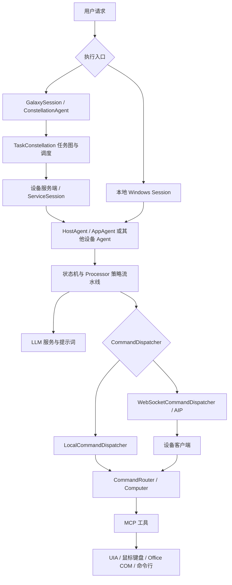
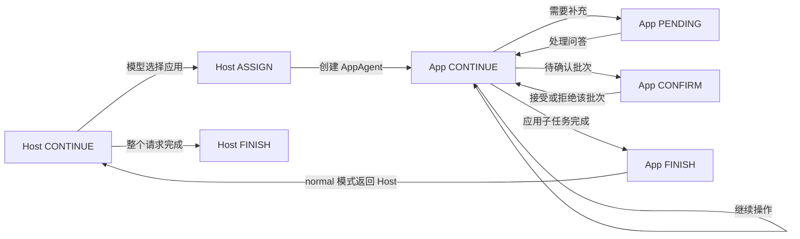
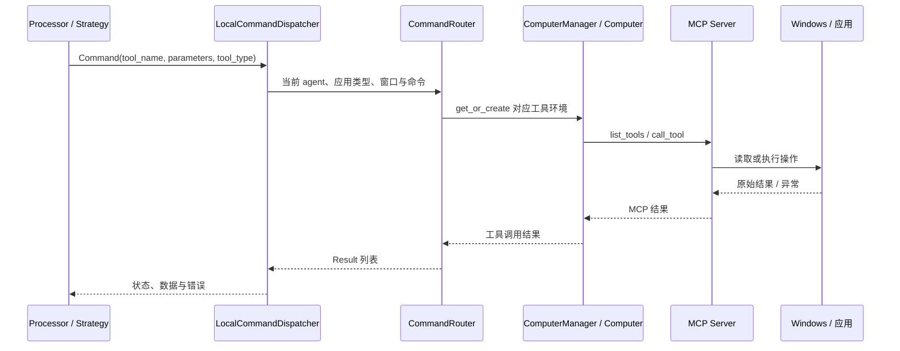

# UFO 仓库架构与源码导读

本文解释当前 UFO 子模块中各主要部分的职责，以及一个桌面任务怎样从自然语言走到 Windows 操作。Mirally 如何接入这些部分，见 [OpenAssist 与 UFO 接入详解](ufo-integration.md)。

核对日期：2026-10-04。源码快照为 `UFO@a795552d976c4c019d7c2f778a0effb5cef7de6b`。这只是本文核对的 commit，不代表产品永久固定在某个 UFO 发布版本；实际版本由主仓库的 gitlink 决定。本文以该快照的实现为准，上游 README 中的产品愿景不等于每条代码路径都已验证。

## 阅读导航

- [整体分层与术语](#整体分层与术语)
- [仓库目录地图](#仓库目录地图)
- [设备执行层](#设备执行层)
- [一次 Windows 任务的完整链路](#一次-windows-任务的完整链路)
- [观察与动作能力](#观察与动作能力)
- [模型、提示词与记忆](#模型提示词与记忆)
- [配置与运行记录](#配置与运行记录)
- [服务模式与 AIP](#服务模式与-aip)
- [Galaxy 跨设备编排](#galaxy-跨设备编排)
- [辅助工程与源码阅读顺序](#辅助工程与源码阅读顺序)

## 整体分层与术语

当前仓库同时包含 UFO² 的设备执行能力和 UFO³ Galaxy 的跨设备编排能力。二者可以组合使用；本地 Windows Session 可以直接运行，不要求启动 Galaxy。

图中的设备 Agent 按平台选择，并非所有设备都运行 Windows 的 HostAgent/AppAgent。Galaxy 图中的节点是子任务；Windows Session 中的 step 是一次 agent 状态处理，两者不是同一个粒度。

| 名称 | 在源码中的含义 |
| --- | --- |
| UFO² | 单设备、尤其是 Windows 桌面的 agent 执行体系，主要实现在 `ufo/` |
| UFO³ / Galaxy | 在设备 agent 之上做任务图规划、跨设备分配、并行调度与动态调整，主要实现在 `galaxy/` |
| Session | 一次执行会话，管理共享上下文、若干 round、日志、结果与可选评估 |
| Round | 处理一个用户请求，可以跨多个应用、包含多个 agent step |
| Step | 一次状态处理；`CONTINUE` 通常运行完整的观察—模型—动作流水线，`ASSIGN` 等状态则承担切换职责 |
| HostAgent | 观察桌面窗口，拆分当前请求，选择应用或已启用的其他 agent |
| AppAgent | 面向选定应用执行任务，读取控件与截图，选择并调用应用工具 |
| Computer | 按 agent、窗口/进程及应用类型组装的工具环境对象，不是虚拟机或虚拟桌面 |
| MCP | 工具发现、参数描述与调用机制，连接 agent 和具体读写能力 |
| AIP | Agent Interaction Protocol，负责设备/agent 之间的注册、任务、命令、结果和心跳通信 |
| Constellation | Galaxy 中由任务节点和依赖边组成的有向无环图（DAG） |

来源：[仓库总览](../UFO/README.md)、[Session 与 Round](../UFO/ufo/module/basic.py)、[Computer](../UFO/ufo/client/computer.py)、[AIP 包说明](../UFO/aip/__init__.py)。

## 仓库目录地图

这里覆盖主要受版本控制的子系统；`__pycache__/`、本地日志和环境目录属于运行产物。

| 路径 | 负责什么 | 与 Mirally 当前运行的关系 |
| --- | --- | --- |
| [`ufo/`](../UFO/ufo/) | 设备 agent、Session、模型调用、桌面工具、服务端和客户端 | 核心依赖 |
| [`galaxy/`](../UFO/galaxy/) | 多设备任务图编排、设备管理、可视化与 WebUI | 当前未启用 |
| [`aip/`](../UFO/aip/) | 共享消息模型、WebSocket 协议、连接与恢复机制 | 本地执行复用 `Command`、`Result` 等类型；未建立远程会话 |
| [`config/`](../UFO/config/) | 新配置加载器、schema、UFO/Galaxy 默认配置和模板 | 使用加载器；运行时配置由产品层提供 |
| [`learner/`](../UFO/learner/) | 将离线帮助文档制作成检索索引 | 可选离线准备工具，当前未接入产品流程 |
| [`record_processor/`](../UFO/record_processor/) | 解析用户演示记录，整理成可检索的操作示例 | 可选示范学习工具 |
| [`dataflow/`](../UFO/dataflow/) | 面向 Large Action Models 的任务实例化、执行与评估数据流水线 | 数据生产工程，不是产品请求入口 |
| [`model_worker/`](../UFO/model_worker/) | 自定义模型推理接入示例及模型服务说明 | 当前使用模型 API，不启动此目录的 worker |
| [`vectordb/`](../UFO/vectordb/) | 文档/演示向量索引等数据；经验索引也可按配置写入此树 | 按 RAG 配置使用，不等于产品会话存储 |
| [`tests/`](../UFO/tests/) | 内核、Galaxy、AIP、配置、安全与集成测试及部分演示脚本 | 不同测试有不同环境要求 |
| [`documents/`](../UFO/documents/) | 上游文档源码及文档站资源 | 阅读参考，部分旧页面使用旧配置路径 |
| [`assets/`](../UFO/assets/) | 上游 README、文档和演示资源 | 不负责 Mirally 窗口 UI |
| [`.github/`](../UFO/.github/) | 仓库工作流、协作模板等 | 上游工程管理 |
| [`requirements.txt`](../UFO/requirements.txt) | Python 依赖清单 | 当前根目录 `.venv` 沿用它安装依赖 |
| `LICENSE`、`SECURITY.md`、`CONTRIBUTING.md` 等 | 许可证、安全报告和上游贡献约定 | 保留于子模块 |

## 设备执行层

### `ufo/` 内部职责

| 路径 | 主要内容 | 建议首先阅读 |
| --- | --- | --- |
| `__main__.py`、`ufo.py` | 命令行参数、日志初始化、Session 工厂与批次运行入口 | [`ufo.py`](../UFO/ufo/ufo.py) |
| `module/` | Session、Round、Context、命令分发、用户交互 | [`basic.py`](../UFO/ufo/module/basic.py)、[`context.py`](../UFO/ufo/module/context.py) |
| `agents/agent/` | agent 类、工厂和注册表，持有状态、记忆、提示词构造器 | [`basic.py`](../UFO/ufo/agents/agent/basic.py)、[`host_agent.py`](../UFO/ufo/agents/agent/host_agent.py)、[`app_agent.py`](../UFO/ufo/agents/agent/app_agent.py) |
| `agents/states/` | Host/App/Linux/Mobile/Operator 等状态机 | [`host_agent_state.py`](../UFO/ufo/agents/states/host_agent_state.py)、[`app_agent_state.py`](../UFO/ufo/agents/states/app_agent_state.py) |
| `agents/processors/` | 每一步的策略流水线、局部上下文、结果 schema 和日志 middleware | [`processor_framework.py`](../UFO/ufo/agents/processors/core/processor_framework.py) |
| `agents/memory/` | agent 的步骤记忆及共享 Blackboard | [`blackboard.py`](../UFO/ufo/agents/memory/blackboard.py) |
| `agents/presenters/` | agent 响应的展示接口、工厂和 Rich 终端呈现 | [`rich_presenter.py`](../UFO/ufo/agents/presenters/rich_presenter.py) |
| `prompter/` | 将历史、观察、任务、工具 schema 等组装成模型消息 | [`agent_prompter.py`](../UFO/ufo/prompter/agent_prompter.py) |
| `prompts/` | YAML 提示词、示例、经验摘要模板 | [`prompts/`](../UFO/ufo/prompts/) |
| `llm/` | 模型服务选择、主备回退、provider 适配、成本估算和视觉 grounding 服务 | [`llm_call.py`](../UFO/ufo/llm/llm_call.py)、[`base.py`](../UFO/ufo/llm/base.py) |
| `automator/` | GUI 和应用 API 的具体执行实现 | [`action_execution.py`](../UFO/ufo/automator/action_execution.py)、[`puppeteer.py`](../UFO/ufo/automator/puppeteer.py) |
| `client/` | 工具环境、MCP 管理、本地执行与远程设备客户端 | [`computer.py`](../UFO/ufo/client/computer.py) |
| `server/` | FastAPI/WebSocket 设备 agent 服务，会话和客户端连接管理 | [`app.py`](../UFO/ufo/server/app.py) |
| `config/` | 历史配置兼容入口；`get_config()` 转到新 loader，返回字典视图 | [`__init__.py`](../UFO/ufo/config/__init__.py) |
| `rag/` | 离线文档、在线搜索、经验、用户演示检索 | [`retriever.py`](../UFO/ufo/rag/retriever.py) |
| `experience/` | 从执行轨迹生成经验摘要、更新 YAML/向量库 | [`summarizer.py`](../UFO/ufo/experience/summarizer.py) |
| `trajectory/` | 读取步骤日志、截图和评估数据，导出 Markdown | [`parser.py`](../UFO/ufo/trajectory/parser.py) |
| `logging/` | Python 日志初始化与显示 | [`setup.py`](../UFO/ufo/logging/setup.py) |
| `tools/` | 配置迁移、转换和验证工具 | [`tools/`](../UFO/ufo/tools/) |
| `utils/` | JSON、图像、坐标、路径、文本等共享辅助函数 | [`utils/`](../UFO/ufo/utils/) |

### Session、Round 与共享状态

[`Session`](../UFO/ufo/module/sessions/session.py) 继承 `WindowsBaseSession`，后者建立 Windows HostAgent；更底层的 `BaseSession` 负责生命周期与日志。Session 的 `_init_context()` 创建 `MCPServerManager` 和 `LocalCommandDispatcher`，挂入共享 `Context`。

`BaseSession.run()` 循环创建 round、等待 round 执行、保存结果；结束后按配置截图、评估、导出轨迹。`BaseRound.run()` 则反复执行 `agent.handle(context)`，再根据状态机选择下一状态和下一 agent。请求完成、错误或步数/轮数上限都会影响退出。

有三类容易混淆的数据容器：

| 容器 | 生命周期与内容 |
| --- | --- |
| `Context` | Session 共享状态，例如请求、当前应用、子任务、全局步数、日志 writer、dispatcher |
| `ProcessingContext` | 当前 processor 的执行上下文，连接全局 Context 和本步骤的截图、控件、解析响应、动作结果、耗时 |
| `Memory` / `Blackboard` | agent 历史与多 agent 可共享的问答、请求、轨迹、截图，供后续 prompt 使用 |

这些容器本身不是 Mirally 的长期聊天记录。任务日志、可选经验库和产品会话存储也各有独立生命周期。

### Session 入口与其他 Agent

[`SessionFactory`](../UFO/ufo/module/session_pool.py) 按平台和 mode 选择会话实现。主要入口如下；这是源码入口清单，不表示每种模式在当前部署都已完成端到端验证。

| 会话/模式 | 职责 |
| --- | --- |
| Windows `Session` / `normal` | 本机 HostAgent/AppAgent 工作流，Mirally 当前使用的路径 |
| `FollowerSession` / `follower` | 通过 `PlanReader` 按计划文件提供后续子任务 |
| `FromFileSession` / `batch_normal` | 从任务文件读取请求，包含文档/应用环境准备和批量任务相关处理 |
| `normal_operator`、`OpenAIOperatorSession` / `operator` | 使用 Operator 风格的执行 agent；与常规 AppAgent 工具决策路径不同 |
| Windows `ServiceSession` / `service` | 把执行命令经 WebSocket dispatcher 发送到设备客户端 |
| Linux / Mobile 的 normal、service Session | 各自平台的执行流程和工具环境，不使用同一套 Windows UIA 逻辑 |
| `SessionPool` | 顺序运行创建出的 Session 列表；这个类本身不是并行设备调度器 |

除了 HostAgent/AppAgent，`agents/agent/` 中还有 `EvaluationAgent`、`OpenAIOperatorAgent` 和 `CustomizedAgent` 扩展类；Hardware、Linux、Mobile agent 位于 `customized_agent.py`。`AgentRegistry` 位于 `basic.py`，按名称注册/查找 agent；`AgentFactory` 和配置解析逻辑在 `host_agent.py` 中选择具体实现。第三方 agent 受启用配置约束，仅导入类不等于它会出现在 Host 可分配目标中。

### Agent、状态机、Processor 的分工

Agent 持有当前状态、模型配置、提示词和记忆。状态对象决定“现在应做什么、下一步交给谁”。Processor 承担一个实际工作步骤，按策略流水线运行。这样 `PENDING` 可以走追问逻辑，`CONFIRM` 可以恢复待确认动作，而不必无条件重新请求模型。

[`HostAgentProcessor`](../UFO/ufo/agents/processors/host_agent_processor.py) 和 [`AppAgentProcessor`](../UFO/ufo/agents/processors/app_agent_processor.py) 都基于 `ProcessorTemplate`，主流水线有四个阶段：

| 阶段 | HostAgent | AppAgent |
| --- | --- | --- |
| `DATA_COLLECTION` | 桌面截图、可用窗口、可选第三方 agent 信息 | 应用截图、窗口信息、UIA/可选视觉控件检测与标注 |
| `LLM_INTERACTION` | 构建桌面决策 prompt，选择应用/子任务，解析 Host 响应 | 构建应用操作 prompt，解析一个或多个动作 |
| `ACTION_EXECUTION` | 选择应用窗口，或分发可用命令 | 确认门禁、动作批次分发、结果与控件记录 |
| `MEMORY_UPDATE` | 更新步骤记忆、共享轨迹和结构化日志 | 更新应用步骤记忆、共享轨迹和结构化日志 |

`strategies/` 实现阶段逻辑；`core/` 提供流水线、依赖检查和 middleware 接口；`context/` 保存类型化的步骤数据；`schemas/` 定义 `HostAgentResponse`、`AppAgentResponse`、`ActionCommandInfo`、`TargetInfo` 等结构。middleware 负责阶段外围的日志、耗时与错误处理，不能将其存在理解为所有恢复策略均已实现。

### 常见状态转移

这是正常任务的主要路径。Host 也有 `PENDING`、`CONFIRM`、`ERROR`、`FAIL` 状态；App 还有 `SCREENSHOT`、错误和失败状态。具体终止语义要看各状态的 `next_state()`、`next_agent()` 和 `is_round_end()`，不能把所有状态名直接映射为产品任务状态。

在当前 `normal` 模式里，AppAgent 完成应用子任务后通常交还 HostAgent；Host 再决定切换应用还是结束。因此它会比单一 agent 直接持续操作多出部分规划、切换和模型调用。App 内连续步骤通常由 AppAgent 自己执行，并非每次点击都重新交给 Host。

## 一次 Windows 任务的完整链路

以“在浏览器里查看一个网页”为例，下面展示的是源码规定的流程，不是已执行的真实任务记录。

1. **建立 Session。** 原生命令行经 `SessionFactory → SessionPool` 创建并运行 Session；嵌入式产品可以直接创建 `Session`，Mirally 采用后一种方式。
2. **准备工具。** Host 的工具上下文通过 dispatcher 查询 `list_tools`，将可用动作的说明和参数 schema 加进提示词。
3. **观察桌面。** `DesktopDataCollectionStrategy` 请求桌面截图和窗口目标信息，生成带编号的候选窗口列表。
4. **Host 决策。** 模型返回结构化响应，其中可以包含 `status=ASSIGN`、当前子任务、给 AppAgent 的消息和 `select_application_window` 调用。
5. **选窗并初始化 UI 状态。** `HostUIExecutor` 校验窗口编号，设置焦点，按配置决定是否最大化/描边；`UIServerState` 保存选定窗口并建立 `AppPuppeteer`。
6. **进入 AppAgent。** `ASSIGN` 状态按应用类型/运行模式创建子 agent，挂到 Host，共享 Blackboard。App 加载该应用可用工具和按配置启用的 RAG。
7. **观察应用。** 采集应用截图、窗口信息和控件列表；将控件转为 `TargetInfo`，建立编号和实际控件对象之间的对应关系，生成必要的图像标注。
8. **App 决策。** 模型结合子任务、Host 消息、历史、截图、控件和工具说明返回动作或动作列表。
9. **执行或等待确认。** 动作进入 `AppActionExecutionStrategy`；需要确认的批次先保存在上下文。确认后恢复该批次，拒绝则记为跳过，不重新拿一份不同动作当成已批准内容。
10. **调用 MCP 工具。** 动作转成 `aip.messages.Command`，经 dispatcher、router、Computer 和 MCP 执行，返回 `Result`。
11. **记录并再次观察。** 保存动作结果、记忆和步骤日志；继续、追问、完成或失败由状态机决定。动作返回成功不等于业务目标完成，后续观察与最终判断仍然必要。
12. **回到 Host 或结束。** App 子任务完成后 Host 可选下一个应用；请求结束后 Session 收尾并根据配置运行评估/经验保存。

### 从动作到工具的分层

[`ComputerManager`](../UFO/ufo/client/computer.py) 使用 agent 名、应用 root name 和 process name 区分工具环境。这里的 root name 通常是 `EXCEL.EXE` 一类可执行文件名，process name 在 Windows 链路中常是窗口名称；它们不是操作系统 PID。

`mcp.yaml` 先按 agent，再按应用类型选配置。没有应用专用配置时使用 `default`；选中专用配置时不会自动把 default 的所有动作再合并进来。`data_collection` 和 `action` 是路由分类，不构成操作系统权限隔离，名字也不能保证一个工具没有副作用。

## 观察与动作能力

### MCP 服务与传输方式

[`MCPRegistry`](../UFO/ufo/client/mcp/mcp_registry.py) 注册本地服务工厂，`MCPServerManager` 按配置创建或复用服务。工厂注册、实例创建、模型看到工具、模型实际调用工具，是四个不同阶段。

| `type` | 实现方式 | 使用场景 |
| --- | --- | --- |
| `local` | 当前 Python 进程中的 FastMCP 实例 | UFO 内置 Windows UI、Office 和命令行工具 |
| `stdio` | 启动配置中的命令，以标准输入输出通信 | 外部工具进程 |
| `http` | 配置 HTTP MCP 地址，可配置鉴权 | 已部署工具服务或其他设备上的工具 |

本地 MCP 不意味着必须监听 TCP 端口。`Computer._run_action()` 为工具调用使用线程池和独立 asyncio loop，并用 `MCP_TOOL_TIMEOUT` 限制等待。等待超时不等于底层同步 COM/系统调用已被强制终止。

### 内置 Windows 工具

以下是当前源码已有的代表能力，实际可见范围还受应用路由和服务配置影响。

| Namespace / 源码 | 代表能力 |
| --- | --- |
| `UICollector`，[`ui_mcp_server.py`](../UFO/ufo/client/mcp/local_servers/ui_mcp_server.py) | 桌面窗口、应用信息、控件列表、桌面/应用截图、UI tree、补充视觉检测控件 |
| `HostUIExecutor`，同上 | `select_application_window`，选择并聚焦窗口 |
| `AppUIExecutor`，同上 | 按控件点击、坐标点击/拖动、文本填写、键盘输入、鼠标滚轮、读取控件文本、摘要工具 |
| `CommandLineExecutor`，[`cli_mcp_server.py`](../UFO/ufo/client/mcp/local_servers/cli_mcp_server.py) | `run_shell`，带当前实现的命令策略检查；并非任意命令都获准 |
| `WordCOMExecutor`，[`word_wincom_mcp_server.py`](../UFO/ufo/client/mcp/local_servers/word_wincom_mcp_server.py) | 插表、选文本/表格/段落、设置字体、另存为 |
| `ExcelCOMExecutor`，[`excel_wincom_mcp_server.py`](../UFO/ufo/client/mcp/local_servers/excel_wincom_mcp_server.py) | 区域读取、表格转 Markdown、插表、选择范围、重排列、另存为 |
| `PowerPointCOMExecutor`，[`ppt_wincom_mcp_server.py`](../UFO/ufo/client/mcp/local_servers/ppt_wincom_mcp_server.py) | 设置背景颜色、另存为等 |
| `PDFReaderExecutor`，[`pdf_reader_mcp_server.py`](../UFO/ufo/client/mcp/local_servers/pdf_reader_mcp_server.py) | 提取 PDF 文本、列出目录 PDF、批量提取文本 |
| `ConstellationEditor`，[`constellation_mcp_server.py`](../UFO/ufo/client/mcp/local_servers/constellation_mcp_server.py) | 编辑 Galaxy 任务图；不属于 Mirally 当前 Windows 工具集 |

`client/mcp/http_servers/` 还包含 Linux、Mobile 和 Hardware 服务。代码存在不表示服务已经部署，也不表示对应 agent 已经启用。Office COM 依赖实际安装、可用的桌面 Office 环境；PDF 文本提取不能直接等同于 OCR。

### UI 观察如何工作

[`ControlInspectorFacade`](../UFO/ufo/automator/ui_control/inspector.py) 封装控件后端。当前产品选择 UIA。UIA 策略枚举桌面时先用 Win32 获取可见窗口句柄，再转成 UIA 对象；应用内部控件则通过 UI Automation COM 接口查询。

UI MCP 保存 `UIServerState`：当前窗口、上次枚举的窗口列表、当前控件字典和 Puppeteer。返回给模型的是序列化后的控件编号、名称、类型、位置等，COM 控件对象留在本地。编号对应当前观察快照，不能把旧编号当作永久标识。

`automator/ui_control/` 各部分的边界是：

| 文件/目录 | 作用 |
| --- | --- |
| `inspector.py` | 枚举窗口/控件，读取 UIA 等属性 |
| `screenshot.py` | 应用/桌面截图，裁剪、坐标换算、矩形和编号标注；封装 PIL、窗口捕获及 Win32 回退 |
| `control_filter.py` | 文本、语义、图标等控件筛选能力，是否使用由策略与配置决定 |
| `grounding/` | 将视觉检测结果转成统一控件目标，例如 OmniParser |
| `ui_tree.py` | UI 树结构采集与序列化 |
| `controller.py` | 在控件或应用窗口上执行点击、输入、滚动和坐标操作 |

App 的观察策略支持 UIA 和可选 OmniParser 检测，将候选目标统一后用于标注和动作选择。OmniParser 需要额外服务；当前产品的 `CONTROL_BACKEND` 只有 `uia`。

### UI 和应用 API 如何落到系统操作

UI MCP 将动作交给 `ActionExecutor`，后者按目标编号找到实际控件并检查可交互状态。`AppPuppeteer` 和 `ReceiverManager` 再按命令名称找到具体 receiver/command。UI receiver 使用 pywinauto、Windows UIA 和 pyautogui 等完成操作；坐标动作相对于当前应用窗口做转换。

[`automator/app_apis/`](../UFO/ufo/automator/app_apis/) 放 Word、Excel、PowerPoint、shell、web 等直接 API receiver。Office MCP 的部分实现也复用这些 receiver。**底层 receiver 已实现的方法未必都暴露成 MCP 工具**，需同时核对服务注册和模型实际获得的工具列表。

这些操作仍在真实登录桌面和应用中进行；`Computer`、MCP、本地 Session 都不会自动生成后台桌面或隔离环境。

## 模型、提示词与记忆

### 模型调用链

`Agent.get_response()` 通过 `llm_call.get_completion()` / `get_completions()` 选择 agent 配置，再由 `BaseService.get_service()` 获取 provider 实现。该工厂按 provider、agent 类型和模型缓存服务对象。

源码包含 OpenAI/Azure、Claude、Gemini、Qwen、DeepSeek、Ollama、部分自定义模型和 Operator 等适配。这里描述的是代码入口，实际可用性取决于依赖、模型协议与配置。普通 OpenAI-compatible 服务也经该接口接入。

提示词由 `prompter/` 结合 `prompts/` 模板动态生成，通常含任务、截图、窗口/控件、历史、工具参数和 Host/App 消息。MCP schema 进入 prompt 后，模型输出 UFO 定义的 JSON，processor 解析后主动调用工具；不能把这条链路一概理解为模型 provider 自己执行 function calling。

Host 响应主要表达状态、子任务、计划、工具函数及参数。App 响应包含动作或动作列表，每个 `ActionCommandInfo` 带函数、参数、目标、状态与结果。模型输出 `thought` 等字段会进入部分原生日志，产品界面需要单独决定可展示字段。

### 主备、重试与等待

Host/App 的模型策略在线程 executor 中运行同步 provider 调用，避免直接堵住 asyncio loop。但外部请求仍可能很慢：

- OpenAI chat-completions 服务初始化会进行一次 `Hello` 结构化输出探测。
- SDK 的 `MAX_RETRY` / `TIMEOUT` 控制其请求尝试。
- `llm_call` 可在主服务失败后切换备用模型。
- 策略层另有 JSON 重试；当前实现捕获较宽的 `Exception`，网络失败也可能再次触发该层重试。

因此单次网络 timeout 不是 agent 步骤或整个任务的总期限。具体产品默认值与协作式停止边界见 [接入文档](ufo-integration.md#当前接入范围与限制)。

### 四类检索与经验保存

| 能力 | 数据来源 | 主要入口 |
| --- | --- | --- |
| 离线文档 RAG | 为应用整理的帮助文档与向量索引 | `learner/` 建索引，`OfflineDocRetriever` 读取 |
| 在线检索 RAG | 搜索结果及相关文档 | `OnlineDocRetriever`、`rag/web_search.py` |
| 经验 RAG | 历次执行提炼的经验 | `experience/` 生成，`ExperienceRetriever` 读取 |
| 演示 RAG | 用户录制的操作示范及摘要 | `record_processor/` 处理，`DemonstrationRetriever` 读取 |

这些能力增强 prompt，并不自动训练或更新模型权重。保存轨迹、把轨迹总结成经验、下次检索经验是不同步骤，有各自开关。当前产品 RAG 和经验自动保存均关闭。

## 配置与运行记录

### 配置分层

[`config/config_loader.py`](../UFO/config/config_loader.py) 是新 loader；[`config/config_schemas.py`](../UFO/config/config_schemas.py) 把常用字段映射为 `AgentConfig`、`SystemConfig`、`RAGConfig`、`UFOConfig` 和 Galaxy 相关配置，同时保留动态字段。

`config/ufo/` 面向设备执行；`config/galaxy/` 面向跨设备编排。`ufo/config/__init__.py` 中的新 `get_config()` 返回新 loader 的字典视图，而同一文件仍保留历史 `Config` 实现，阅读时需看实际调用了哪个入口。

loader 在模块配置目录内按文件名排序读取基础 YAML，再合并对应环境覆盖；`mcp.yaml` / `agent_mcp.yaml` 特殊嵌入 `mcp` 键。它还支持环境变量展开和旧路径回退。Mirally 的具体 base path 和作用域见 [配置和初始化](ufo-integration.md#配置和初始化)。

### 执行日志与评估

| 产物 | 含义 |
| --- | --- |
| `request.log` | 模型请求构造记录，可含完整 prompt 和图像数据 |
| `response.log` | 步骤结构化记录，包含响应、动作、结果和耗时等；不是每个网络响应抵达时立刻写出的原始 HTTP 日志 |
| `evaluation.log` | 启用评估时的结果，关闭评估时可能为空 |
| `action_step*.png` 等 | 当前步骤及标注/拼接/最终截图，具体产物受路径和配置影响 |
| `output.md` | 按 `LOG_TO_MARKDOWN` 导出的可读轨迹 |

`FileWriter` 独立写请求、响应和评估记录，Python logging 则记录运行过程，Rich 输出负责终端展示。三者不是同一通道。仅看到 `request.log` 最后一条，不能断言模型请求已发到服务端；`response.log` 为空也不能单独证明网络死锁。

评估 Agent 在 round/session 收尾时按配置使用轨迹判断完成情况，需要模型和额外耗时。框架状态结束、动作调用成功与实际任务完成也必须区分。

## 服务模式与 AIP

本地模式通过 `LocalCommandDispatcher` 直接调用工具。服务模式用 [`ServiceSession`](../UFO/ufo/module/sessions/service_session.py) 与 `WebSocketCommandDispatcher` 将命令发送到设备客户端。

| 部分 | 职责 |
| --- | --- |
| `ufo/server/app.py` | FastAPI 入口、HTTP/WebSocket 路由与服务配置 |
| `server/services/session_manager.py` | 管理设备执行 Session |
| `server/services/client_connection_manager.py` | 管理连接设备和连接生命周期 |
| `server/ws/handler.py` | WebSocket 接入与消息处理 |
| `ufo/client/client.py`、`ufo_client.py`、`websocket.py` | 设备客户端启动、接收命令、调用本机 Computer/MCP 并返回结果 |
| `client/device_info_provider.py` | 提供设备信息和能力描述 |

AIP 的目录按职责分开：`messages.py` 定义数据结构；`protocol/` 实现注册、任务执行、命令、设备信息和心跳；`transport/` 封装 WebSocket 传输；`endpoints/` 组合设备服务端、设备客户端和 Constellation 端点；`resilience/` 管理超时、重连和心跳；`extensions/` 提供协议扩展/middleware。

MCP 解决“如何调用一个工具”，AIP 解决“如何与一个设备 agent 通信”。本地执行复用 AIP 的数据类型，也不意味着已经启动远程 AIP 连接。分离服务端和客户端本身同样不提供虚拟桌面，工具最终在哪台设备、哪个桌面执行取决于部署。

## Galaxy 跨设备编排

Galaxy 将“完成一个请求”提升到多个设备子任务的协调。例如数据处理在 Linux 设备上完成，随后由 Windows 设备生成报表；互不依赖的任务可以并行执行。

### 目录与核心对象

| 路径 | 职责 |
| --- | --- |
| [`galaxy_client.py`](../UFO/galaxy/galaxy_client.py)、`__main__.py` | 编程接口与 CLI，启动 Galaxy 会话 |
| [`agents/`](../UFO/galaxy/agents/) | `ConstellationAgent` 的状态、响应 schema、创建/编辑任务图策略与提示词构造器 |
| [`constellation/task_star.py`](../UFO/galaxy/constellation/task_star.py) | 一个可执行子任务，记录内容、目标设备和状态等 |
| [`constellation/task_star_line.py`](../UFO/galaxy/constellation/task_star_line.py) | 子任务之间的依赖边 |
| [`constellation/task_constellation.py`](../UFO/galaxy/constellation/task_constellation.py) | 整张 DAG，管理任务、依赖、循环检测、状态与序列化等 |
| [`constellation/editor/`](../UFO/galaxy/constellation/editor/) | 任务图编辑命令、命令历史和编辑器；`ConstellationEditor` MCP 对外暴露编辑能力 |
| [`constellation/orchestrator/`](../UFO/galaxy/constellation/orchestrator/) | 按依赖与状态调度可执行任务，管理执行过程和图修改协调 |
| [`client/`](../UFO/galaxy/client/) | 设备注册、连接、心跳、任务队列、消息处理和设备状态管理 |
| [`core/`](../UFO/galaxy/core/) | 共享接口、类型、依赖注入容器和事件总线 |
| [`session/`](../UFO/galaxy/session/) | `GalaxySession` / `GalaxyRound`，组合 agent、任务图、调度器与 observer |
| [`session/observers/`](../UFO/galaxy/session/observers/) | 响应 agent 输出、任务事件、图修改、可视化和会话指标 |
| [`prompts/`](../UFO/galaxy/prompts/) | 任务图创建和动态编辑所需的模型提示词 |
| [`trajectory/`](../UFO/galaxy/trajectory/) | Galaxy 运行轨迹解析与后处理 |
| [`visualization/`](../UFO/galaxy/visualization/) | DAG、任务状态和相关执行信息的可视化 |
| [`webui/`](../UFO/galaxy/webui/) | Galaxy 自带的 WebUI 及后端桥接，不是 Mirally 当前 Tk 界面 |

### 运行关系

`GalaxySession` 将请求交给 `ConstellationAgent`。创建策略产出 TaskConstellation，orchestrator 调度满足依赖的 TaskStar，经设备管理和 AIP 发送到设备执行端。设备结果改变任务和图状态，事件/observer 触发展示和同步；agent 可以根据反馈进入编辑阶段调整后续任务。

任务依赖管理、设备连接管理、模型规划和可视化分别由不同对象承担。Galaxy 自身仍使用 LLM；每个设备上的 agent 也可能使用 LLM，因此接入它会增加部署、状态和模型调用链路。

Mirally 当前没有跨设备任务需求，使用本地 Windows Session 即可。此前 Galaxy 配置错误来自共享代码的导入耦合：Context 的一个默认字段导入 Galaxy schema，本地 MCP 自动扫描又导入 Constellation 服务。产品适配层已在作用域内处理这两个入口，详见 [接入代码地图](ufo-integration.md#集成边界与代码地图)。

## 辅助工程与源码阅读顺序

`learner/` 和 `record_processor/` 面向运行前/后的知识准备。`dataflow/` 则面向训练数据生产：`instantiation/` 选择模板、预填和过滤，`execution/` 执行与评估，controller 将两者串成流水线；`schema/`、`prompter/`、`prompts/`、`templates/`、`env/` 和 `config/` 提供其数据结构与运行材料。它不是 Mirally 的默认任务调度器。

`model_worker/custom_worker.py` 提供自定义视觉模型生成接入代码，相关 README 也含其他 provider 的示例。不能把该目录当成所有 LLM 调用的统一入口，实际在线路径是 `ufo/llm/`。

上游 `tests/` 同时有单元、集成、设备、Galaxy 和安全测试，也有需要特定服务的脚本。测试文件存在不等于可在任意机器一次性执行，更不等于 Mirally 已启用对应能力。

建议按下面顺序阅读，而不是从所有 `__init__.py` 一路展开导入：

1. `ufo/module/sessions/session.py`、`module/basic.py`：先建立 Session / Round / Context 的概念。
2. `agents/states/host_agent_state.py`、`app_agent_state.py`：看 agent 如何切换、追问、确认和退出。
3. `agents/processors/host_agent_processor.py`、`app_agent_processor.py`：看一个步骤由哪些阶段组成，再进入对应 `strategies/`。
4. `module/dispatcher.py`、`client/computer.py`：追踪一个 `Command` 的路由和返回值。
5. `client/mcp/local_servers/ui_mcp_server.py`、`automator/ui_control/`：看截图、控件编号、点击和输入如何实现。
6. `llm/llm_call.py`、`llm/base.py`、`prompter/agent_prompter.py`：理解模型请求和提示词来源。
7. `config/config_loader.py`、`config/config_schemas.py`：核对有效配置，尤其是同名键覆盖和缓存。
8. 需要远程部署时再看 `server/`、`client/ufo_client.py` 与 `aip/`；需要跨设备任务编排时再看 `galaxy/session/ → agents/ → constellation/ → client/`。

回到产品开发时，应先读 [OpenAssist 与 UFO 接入详解](ufo-integration.md) 和根目录 [AGENTS.md](../AGENTS.md)，确认修改应落在哪个仓库边界内。
