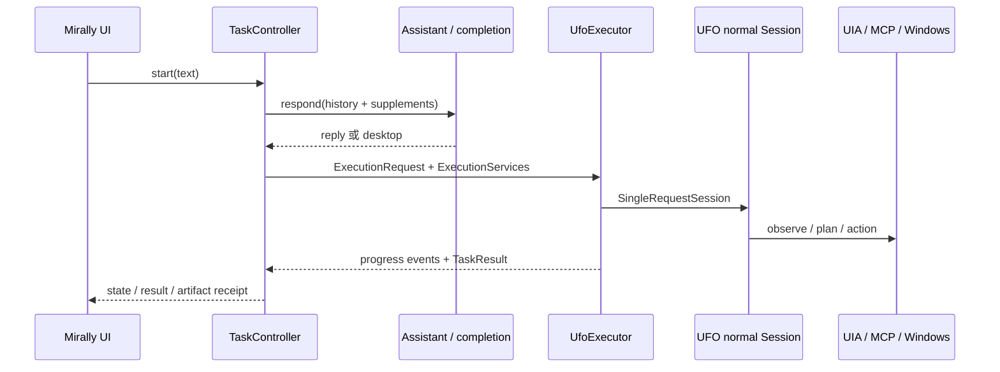

# OpenAssist 与 UFO 接入详解

本文按 2026-10-04 的产品工作区核对。UFO 子模块固定为当前 gitlink；它是外部只读依赖，不在本次产品改动中修改。产品使用 UFO 原生 `normal` Session 的 HostAgent/AppAgent 桌面链路，Galaxy（UFO³ 跨设备编排层）没有接入。

## 集成边界与代码地图

`run.ps1` 使用根目录 `.venv`，`openassist/__main__.py` 检查 Windows、配置根和 UFO 导入路径，然后启动 `OpenAssistShell`。默认请求经过以下链路：



| 产品路径 | 责任 | 原生连接 |
| --- | --- | --- |
| `core/execution.py` | 任务请求、能力、服务回调和终态结果 | 不依赖 UFO、Tk 或 Windows |
| `core/task_controller.py` | 任务线程、停止/暂停/接管、输入版本和会话结果 | 只依赖 `Executor` 协议 |
| `core/assistant.py` | 普通回答与桌面意图路由 | 注入 `runtime/completion.py`，不直接导入 UFO |
| `runtime/ufo/adapter.py` | 创建一次原生 Session、安装适配层、收尾 | `Session`、原生控制和事件结果 |
| `runtime/ufo/controls.py` | 模型/工具预算、动作准入、补充、重观察 | 包装 UFO 的实际线程/工具边界 |
| `runtime/ufo/observation.py` | 排除产品进程、截图握手和控件过滤 | `Photographer`、`Inspector`、UI MCP |
| `runtime/ufo/compat.py` | Galaxy 默认值、Windows MCP 列表、UIA 恢复 | 作用域内临时替换函数，退出恢复 |
| `runtime/ufo/events.py` | 结构化 JSONL 事件和保守结果判定 | 读取当前 Host FINISH、子任务和已验证产物 |
| `platform/window_session.py` | 产品窗口显示、输入穿透和 Windows 捕获排除 | 由 UI 回调驱动，实际窗口状态在收尾时恢复 |
| `runtime/ufo_full.py` | 旧调用方兼容入口 | 委托给 `UfoExecutor`，不再是另一条执行实现 |

## 配置和初始化

产品配置只维护在 `config/openassist/ufo/`。`configure_ufo_config_root()` 在导入依赖配置的 UFO 模块前设置 `ConfigLoader` 的绝对 base path，并清空相关缓存；不会复制或编辑 `UFO/config`。本地 `agents.yaml` 可能含凭据，检查和测试不会读取它。

原生执行另有 `config/openassist/execution.yaml`，只包含产品侧总等待、初始化、模型、工具、重试次数和上下文大小预算。`bounded_model_services()` 在任务作用域内把 UFO provider 重试和 SDK client retry 降到产品预算，并在退出时恢复全局对象。多个原生任务由 `UFO_RUNTIME_LOCK` 串行，避免同时改动 UFO 的模块级 loader 或服务工厂。

适配器启动时依次进入：UFO 兼容层、模型服务边界、控制钩子、观察隔离。Session 构造和模型请求在单线程池中执行，初始化、模型和工具分别记录耗时。清理会等待实际在途 worker，而不是把 `Future.cancel()` 当成系统调用已停止。

## 上下文、补充与控制语义

`ExecutionRequest.conversation_context` 带最近会话、当前原始要求和已保存结果；适配器把它作为明确的上下文消息追加到真实 Host/App prompt，并保留最新答案全文（超过历史摘要预算时也不替换为截断文本）。运行中的补充通过带 `receipt_id` 的 `Supplement` 进入下一次模型请求；只有适配器确认已注入后，控制器才发出“已加入当前任务上下文”回执。

控制器维护 revision。用户编辑、补充、暂停或接管都会增加 revision；模型迟到、排队工具和旧确认都必须在实际动作准入处重新比较。接管/恢复会清理 UFO processor 的待执行动作、确认结果和旧规划，使下一步重新观察，而不是直接调用原生 `resume()` 跳过观察。

停止关闭新的动作准入；模型或工具已经实际开始后，系统操作可能继续到返回。默认能力声明为 `cancellation_mode=between_tools_after_in_flight_settles`。暂停在安全边界确认后才进入 `paused`，输入期间动作门禁等待编辑结束；界面状态不会单独伪造执行器能力。

## 截图与控件隔离

`observation_isolation()` 在实际 UFO photographer、UIA inspector 和 UI MCP 入口安装作用域钩子：

- 产品进程 PID 和产品窗口从窗口枚举、选中、控件后代和控件验证中排除；未知 PID 的元素不会被当作安全目标。
- 捕获前后调用 `ExecutionServices.capture`，复用 `WindowSession` 的 `WDA_EXCLUDEFROMCAPTURE`；原生排除失败才在捕获期间隐藏窗口。
- ControlPhotographer、DesktopPhotographer 和递归回退共享同一握手锁；异常、取消和 UIA 缓存错误都会走清理路径。
- `WindowSession` 记录同一进程的全部顶层窗口，动态重建、最小化和 affinity 设置在捕获结束时恢复，不抢焦点。

自动化原生场景使用真实 UFO 导入和合成 Windows 端点，验证了过滤、清理和回退。`tools/verify_desktop_isolation.py` 还可在 Windows 交互桌面启动一个独立的合成测试子进程，做实际像素对比；该脚本不调用模型，只控制它创建的窗口。

## 工具、进度和结果

原生 UFO 仍负责 Host/App 状态机、UIA、鼠标键盘、Office/PDF/CLI 及 MCP 路由。产品当前配置的路由以 `config/openassist/ufo/mcp.yaml` 为准；应用专用分组可能替代 default。外部 HTTP/stdio MCP、RAG、OmniParser、Follower、批量和 Galaxy 仍是 UFO 内核能力，未自动变成产品功能。

适配器发出带 task/run id、递增 sequence 和 timestamp 的 `phase`、`waiting`、`action_result`、`context_applied`、`retry` 和 `finished` 事件，并写入 UFO 任务日志目录的 `openassist-events.jsonl`。界面只接收公开阶段、动作名称和脱敏摘要，不直接展示 thought、原始观察或 Python traceback。

结果只把最终 Host `FINISH` 的业务答案视为完成证据；早期 `ROUND_RESULT`、单纯窗口切换和动作计数不能单独算成功。错误、用户拒绝、无最终答案和已有完成子任务会分别归并为 failed、incomplete 或 partial。绝对且已存在的产物路径才进入结果；原始工具参数和内部诊断不进入会话记忆。

## 当前接入范围与限制

已接入并有产品/隔离进程回归覆盖：

- 默认 `normal` Session 的真实初始化、Host/App/MCP/Computer 链路；
- 会话历史、最新正文、运行中补充和 receipt 回执；
- 模型等待、工具队列和动作前的停止/版本/编辑门禁；
- 暂停、人工接管后的旧计划失效和重新观察；
- 原生捕获、隐藏回退、窗口/控件自身排除和异常恢复；
- 结构化阶段、等待原因、业务答案、已验证产物和部分失败结果。

需要明确的限制：

- 任意第三方 DLL、COM 或 MCP 阻塞调用不能被 Python 线程强制杀死；总预算到期后保持 stopping 并等待实际 worker 收尾。
- 真实模型服务、浏览器 provider、混合 DPI、全屏独占捕获、多显示器和用户当前桌面组合尚未作为默认自动化测试环境覆盖。
- `EVA_SESSION`、Galaxy 和 UFO³ 跨设备编排没有启用；执行器仍固定一次请求一个 `normal` Session。
- 语音 Provider 已有配置和 API 层，但录音采集/按钮尚未接入；OpenClaw 接入推迟到协议在实际需求下再评估。

## 验证与修改边界

产品回归：

```powershell
.\.venv\Scripts\python.exe -m unittest discover -s tests -v
```

其中 `test_ufo_native_execution.py` 的 11 个场景使用隔离临时配置和离线 completion，不读取凭据、不连接真实模型、不操作用户应用。Windows 专用像素验证：

```powershell
.\.venv\Scripts\python.exe tools/verify_desktop_isolation.py
```

运行前关闭会遮挡测试区域的其他窗口；脚本只创建和关闭自己的测试子进程及 Mirally 窗口，输出写入被忽略的 `.artifacts/interface/`。它不能证明真实模型质量。

修改位置遵循：协议和控制在 `core/`，UFO 适配在 `runtime/ufo/`，Windows 行为在 `platform/`，展示文案在 `ui/`，回归在根目录 `tests/`。不得为了适配产品而修改 `UFO/` 子模块；必须升级内核时先取得明确授权并更新 gitlink。
