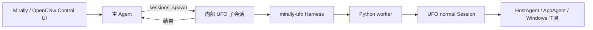

# UFO 桌面任务子代理

Mirally 只提供 OpenClaw Control UI 对话入口。UFO 是插件承载的内部桌面执行子代理，由主 Agent 通过 `sessions_spawn(agentId="ufo")` 委派任务；不作为用户可直接选择、独立对话的助手。

## 执行链路

主 Agent 负责对话、整体规划、文件和后台工具；需要 Windows 桌面操作时，给子代理一个清晰目标及验收条件。Harness 使用 OpenClaw 官方 `isSubagentSessionKey` 判定子会话类型，在准备上下文和启动 worker 前拒绝普通 UFO 对话。此判定依据会话 Key，不能替代注册表来源认证。内部 `ufo` 配置定义用于运行时路由，不代表第二个产品对话入口。

当前实现使用官方 Agent Harness 和独立 worker，并未把 UFO 进一步拆成可供主 Agent 逐个调用的 SDK 桌面工具插件。普通问答继续由主 Agent 处理。

## 配置与代码

- `integrations/openclaw/ufo/` 注册插件、Harness、宿主模型路由及原生会话回调。
- `mirally/runtime/ufo/worker.py` 处理一次桌面任务及私有控制协议。
- `mirally/runtime/ufo/adapter.py` 创建 `normal` Session；`model_bridge.py` 在任务作用域内注入宿主模型并恢复。
- `mirally/platform/frontend_registry.py` 登记产品窗口与编辑状态；`desktop_lock.py` 保证一次只有一个 UFO worker 占用桌面。
- `tools/configure_ufo_agent.py` 以官方定向补丁维护插件、内部子代理与主 Agent 的委派授权，默认只验证，`--apply` 才应用。默认调用方为 `main`；自定义调用方通过 `--requester-agent-id` 指定。

UFO 是可选安装。仅加载插件不足以执行委派，还须配置内部子代理及调用方的 `subagents.allowAgents`。脚本只向调用方追加目标 ID，保留其已有或继承的授权（包括 `*`）；其他 Agent 的授权不变。无既有名单时保留原生自我委派权限，显式空名单则只增加 UFO。常规初始化不会自动启用 UFO。

模型只配置在 OpenClaw。内部子代理的 `models["provider/model"].agentRuntime.id` 为 `mirally-ufo`；模型变更需保留对应 runtime 路由。worker 只接收本次所需的一次性模型路由，不读取本地 OpenClaw 凭据文件，不获得主 Agent 的整套工具。

UFO 公共配置维护在 `config/mirally/ufo/`，执行预算在 `config/mirally/execution.yaml`。worker 使用临时配置与 `agents.yaml.template`，不复制凭据到子模块。`UFO/` 是只读 Git submodule。

## 控制与限制

UFO 使用当前交互桌面，会影响鼠标、键盘和窗口。停止先撤销新动作准入，给已发出的调用协作收尾；worker 未及时退出时由 Harness 终止进程树。停止不能撤销已经发生的操作，关闭 Mirally 窗口也不等同于停止桌面任务。

补充沿用 OpenClaw 原生会话输入和授权，然后使旧观察及计划失效；只有模型实际采用后才确认。敏感操作接原生审批，追问接 Gateway question。带独立来源撤销权限的补充和不支持的媒体会明确拒绝，不丢掉附件后继续执行。当前界面没有另外一套 UFO 暂停、接管或会话管理页。

WebView 宿主登记草稿编辑状态和窗口，以便新动作准入及截图/控件排除；外部浏览器和未登记窗口不在此隔离保证内。已进入操作系统的调用不能由页面状态立即中断。

首版支持 Windows 本机、具备图像输入的 OpenAI-compatible Chat Completions 与 API Key。自定义请求传输、沙箱和不适配的工具策略在桌面动作前拒绝；不绕过宿主权限。不接入 Galaxy，不把 UFO 内核具备的所有 MCP、RAG 或跨设备能力自动宣称为产品功能。

结果区分完成、部分完成、未完成、失败和取消，由主会话汇总。UFO 本地日志和截图仍是诊断产物，目前没有完整注册进 OpenClaw Files 面板；不承诺自定义上下文引擎的完整压缩/记忆生命周期。

## 诊断与验证

每次运行的阶段日志在 `.artifacts/ufo-runs/<runId>.jsonl`，Session 创建后的原生记录在 `UFO/logs/<taskId>/mirally-events.jsonl`。阶段区分配置、模型绑定、导入、Session 创建、模型/工具等待和收尾。初始化超过 10 秒记录等待阶段；启动截止仍生效，心跳不是无限等待许可。

修改插件后在任务收尾时重启 Gateway。Mirally 窗口图标菜单的重启入口只管理已核实属于本项目的本机服务；其他部署沿用自身管理方式。

产品测试在根目录 `tests/`，完整命令见 [Agent 协作约定](../AGENTS.md)。隔离 worker、合成模型/Windows 端点和协议测试不能替代真实桌面任务验收。本次入口删除未额外调用真实模型或验证用户应用成功率。
