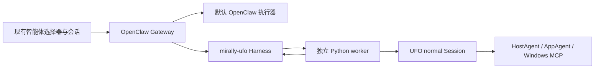

# UFO 作为 OpenClaw 智能体

更新日期：2026-10-06。feat 保留官方 Control UI、Mirally 皮肤、侧边伙伴和默认 OpenClaw 智能体；main 的 UFO 配置桥接、执行协议、原生 Session 和回归测试合并到同一分支。UFO 使用 main 的 gitlink `a795552d976c4c019d7c2f778a0effb5cef7de6b`，没有修改子模块源码。

## 两条执行路径

用户在已有智能体选择器中选择后端，或者由默认 OpenClaw 智能体通过 `sessions_spawn(agentId="ufo")` 创建桌面子会话。默认 OpenClaw 智能体继续拥有整体规划、文件、命令和其他工具；UFO 只负责被委派的 Windows 桌面任务。



直接选择 UFO 时，worker 直接进入桌面执行器，不再额外调用一次对话意图模型；普通聊天应继续使用默认 OpenClaw 智能体。由 `sessions_spawn` 创建的子会话也直接进入桌面执行器，因为父 Agent 已经完成了任务分流。子会话模式由 OpenClaw 的受信任生命周期元数据维护，不接受用户文本中的伪造标记。

主 Agent 的委派提示应包含一个清晰、可独立执行的桌面目标和验收条件，例如“在当前浏览器打开 Gmail，告诉我是否已登录及未读数量”。UFO 返回结构化的完成、部分完成、未完成、失败或取消结果，子会话的结果再由 OpenClaw 主会话汇总给用户。UFO worker 只接收本次调用所需的一次性模型路由，不读取 OpenClaw 本地凭据配置，也不会获得主 Agent 的文件工具或 `sessions_spawn` 工具面。

## 代码与配置归属

| 位置 | 责任 |
| --- | --- |
| `integrations/openclaw/ufo/` | 官方插件注册、模型路由预检、会话读取与结果持久化、停止/补充句柄、审批和问题回调 |
| `openassist/runtime/ufo/worker.py` | 单次任务的私有 stdio 协议、输入回调与桌面任务执行服务；保留旧 conversation 模式以兼容协议调用 |
| `openassist/platform/stdio_pipe.py` | Windows 控制管道读取；先检查可读字节再读取，避免空闲同步读取阻塞原生扩展初始化 |
| `openassist/runtime/ufo/model_bridge.py` | 将 Gateway 准备好的模型、endpoint、认证和受支持生成参数传给真实 UFO 模型服务；退出时恢复 |
| `openassist/runtime/ufo/adapter.py` | main 的 `SingleRequestSession(mode="normal")`、控制、观察隔离、预算及收尾 |
| `openassist/platform/frontend_registry.py` | 前端 PID 与创建时间登记，识别 WebView 子进程、编辑状态、跨进程截图隐藏/恢复 |
| `openassist/platform/desktop_lock.py` | Windows 命名互斥量；不同会话、worker 和产品实例同时只能有一个 UFO 使用桌面 |
| `tools/configure_ufo_agent.py` | 使用官方 `config patch --stdin` 添加智能体与插件；默认 dry-run |

模型只配置在 OpenClaw。`agents.entries.ufo.models["provider/model"].agentRuntime.id` 指定 `mirally-ufo`，该智能体不会因插件不可用而悄悄回退成普通执行器。切换成另一模型也需要为它显式配置 UFO runtime。脚本保留默认智能体、已有插件路径和 allowlist；同名非 UFO 智能体拒绝覆盖。

UFO 的系统、MCP 和提示词设置继续维护在 `config/openassist/ufo/`，等待预算在 `config/openassist/execution.yaml`。worker 在临时目录中使用这些公共设置与 `agents.yaml.template`，从 Gateway 注入选定模型；它不读取本地 `agents.yaml` 凭据，也不向子模块复制配置。独立旧界面 `run.ps1 --ufo` 仍使用产品自己的 YAML 模型配置与会话库。

## 交互边界

停止先通过控制通道撤销新动作的准入，给已经发出的调用约 1.5 秒协作收尾；若 worker 仍未退出，Harness 终止该 worker 进程树，避免不可中断的初始化或 COM 调用无限占用会话。桌面互斥量会随进程退出释放，但强制退出不能保证所有窗口恢复回调完成，也不能撤销已经发生的系统操作。子会话停止由主会话的 OpenClaw 生命周期传入同一个 worker 控制通道。

普通文字补充先沿用原生输入持久化，然后使 worker 的观察和计划版本失效；在后续模型实际使用后确认采用。等待超过回执预算会报告未确认，不能据此重复发送。每次模型请求和工具调用都再次核对宿主执行权；工具先经过 `runBeforeToolCall`，UFO 敏感操作确认转成原生审批，追问转成原生 Gateway question。

具有独立来源权限的补充（SDK `source-bound`，例如可独立撤销的访问来源）在排队前明确拒绝。目前尚未验证从已采用的 UFO 原生记忆中移除单条被撤销来源的方法；不能假装已经支持。此类场景请停止后发起新任务。普通输入不具备的图片、文件媒体补充也会拒绝，而不是丢掉附件继续执行。

WebView 桌面宿主登记输入状态；有焦点且包含草稿时，worker 阻止新桌面动作，并使旧观察失效。发送清空草稿后可继续。这是执行边界上的输入协调，不能中断已经进入操作系统的动作，也不意味着用户可以在 UFO 操作同一桌面时任意同时使用鼠标键盘。当前 Control UI 沿用现有停止与补充交互，没有新增暂停/人工接管按钮；main 的完整暂停/接管界面保留在独立 UFO 入口。

截图时优先保留已经设置 Windows 捕获排除的产品窗口；其他已登记窗口临时隐藏、合成器刷新后捕获，再不激活地恢复。窗口与控件枚举同时排除前端和 WebView 子进程。异常时恢复，句柄/PID 创建时间改变时不恢复旧窗口。外部浏览器和未登记的客户端窗口不在保证范围内。

会话读取使用官方 SessionManager 和上下文装配，保留前文正文，并加入工作区 bootstrap 内容。超过 32,000 字符的 UFO 上下文会明确拒绝，不截断引用后继续执行。结果区分完成、部分完成、未完成、失败和取消，具体回答回到原生历史；日志/截图继续作为 UFO 本地诊断产物。目前未把 UFO 产物注册进 OpenClaw Files 面板，也未承诺自定义上下文引擎的完整记忆/压缩生命周期。

## 支持与验证

### 等待时查看具体阶段

每轮 Gateway UFO 调用从 Harness 入口开始写入 `.artifacts/ufo-runs/<runId>.jsonl`，不必等原生 Session 创建成功。Gateway 的日志中也会记录这个运行 ID 和诊断文件位置。修改 Harness 后需要重启 Gateway，可在任务收尾后点击 Mirally 顶部「⋯ → 重启 Gateway…」，确认后窗口自动重新连接。关闭 Mirally 窗口不会停止 Gateway，已有任务也不会加载新代码。按钮只处理已核实的本项目本机进程，其他部署按原管理方式重启。

在项目根目录实时查看最近一轮：

```powershell
$ufoRunLog = Get-ChildItem .artifacts/ufo-runs/*.jsonl | Sort-Object LastWriteTime -Descending | Select-Object -First 1
Get-Content -LiteralPath $ufoRunLog.FullName -Encoding UTF8 -Tail 20 -Wait
```

`stage` 区分上下文装配、配置加载（`configuring`）、模型路由绑定（`model_binding`）、Session 导入（`session_import`）、原生适配安装（`native_compatibility`）、运行时钩子（`runtime_hooks`）、Session 创建（`session_creation`）、原生运行（`session_running`），以及模型、工具和收尾等待（`model` / `tool` / `cleanup`）。Session 类定义与兼容层都加载完成后才创建原生 Session。`agent` 和 `attempt` 标识 Host/App 模型调用与重试；`action` 是工具名称。`elapsed_seconds` 在等待事件中表示该阶段耗时，`run_elapsed_seconds` 表示整轮耗时。`host_callback` 与 `host_callback_finished` 可以定位宿主授权或用户确认的等待。

Windows 上曾复现控制线程挂起同步 stdin 读取时，NumPy 原生扩展初始化阻塞，表现为 `session_import` 或 `native_compatibility` 心跳持续停在 `overrides.py:8`。改变导入顺序不能解决这个并发条件。worker 现在借用输入管道句柄，通过 `PeekNamedPipe` 检查可读字节，只读取已到达的数据；保留 UTF-8 分帧、EOF 撤销和取消消息。回归测试在 `python.exe` 与实际使用的 `pythonw.exe` 子进程中保持 stdin 打开且无数据，加载真实 UFO Session 导入链后再发送取消；不会调用模型或操作桌面。使用 `subprocess.run/communicate` 提前关闭 stdin 的导入测试无法覆盖这个问题。

同步初始化超过 10 秒时，`startup_wait` 每 10 秒记录当前阶段及主线程调用栈中的文件名、函数和行号；不记录源代码行或局部变量。原生等待预算继续记录超时与收尾状态。启动心跳不会取消初始化截止时间；60 秒内未进入原生 Session、模型/工具或明确的用户等待时，Harness 终止本轮启动。此诊断日志只保留白名单元数据，不复制任务正文、回答、截图、工具参数、完整异常或模型凭据；每轮最多写入约 512 KB，旧文件保留在被 Git 忽略的本地目录。

若本地扩展加载阻塞并占用 Python 的 GIL，心跳线程也可能无法继续输出；Gateway 的独立启动计时仍生效，日志中的最后一个 `stage` 可用于判断阻塞边界。

Control UI 的通用“等待响应”文案目前没有细分这些 UFO 阶段；详细诊断以此文件为准。`UFO/logs/<taskId>/openassist-events.jsonl` 是 Session 创建后的原生事件记录，可能包含任务数据，请按需本地查看。

首版限定 Windows 本机、支持图像输入的 OpenAI-compatible Chat Completions、API Key 认证、无自定义请求传输。使用宿主准备的自定义 baseUrl；带 URL 凭据、查询参数或 Azure API-version 语义的端点拒绝。支持 `temperature`、`maxTokens` 以及模型明确声明的 `reasoning_effort` 映射；其他思考或生成设置拒绝。受限工具策略、禁用工具、工作区限定和沙箱执行不绕过：不适配的会话在桌面动作前拒绝。没有通过 UFO 暴露 OpenClaw 的整套工具、Skill 或跨设备 Galaxy 能力。

OpenClaw 的 `requestTransportOverrides` 也会标记模型兼容声明。适配器逐项检查配置，允许已实现的 `thinkingFormat: openai`、`supportsReasoningEffort`、`supportedReasoningEfforts` 和 `reasoningEffortMap`；不能仅凭这个汇总标记拒绝所有路由，也不能忽略真正的自定义请求。请求头、代理、额外请求体、超时覆盖或未知兼容字段仍拒绝。

记录实际输入/输出 token；费用字段的零值是尚未估算的占位，不表示免费。Python 原生日志与模型异常不直接转发到界面，以免包含凭据或私人桌面内容。

验证入口：

```powershell
.\.venv\Scripts\python.exe -m unittest discover -s tests -v
& .\.artifacts\node\node-v24.21.0-win-x64\node.exe --test tests/test_control_ui_context.cjs tests/test_control_ui_intake.cjs tests/test_control_ui_office.cjs tests/test_control_ui_ufo_input.cjs tests/test_ufo_harness.mjs
```

`test_ufo_gateway.py` 用临时配置、独立端口和本地合成 OpenAI 服务，验证真实 Gateway 的插件加载、智能体列表、worker 调用与跨轮正文；不会读开发者凭据或进入桌面观察。`test_ufo_native_execution.py` 保留真实 Session、处理器、Computer、FastMCP 和动作接收器，仅替换模型/Windows 端点，并新增宿主模型路由贯穿 Host/App 与恢复测试。协议与 JS 测试验证停止、问题答案、审批等待、补充授权、UTF-8 分帧及输入登记。

这些测试不代表真实用户应用成功率；WebView 真实编辑交互、跨进程窗口截图隔离、真实模型的桌面任务、后台关闭与长调用停止仍需人工验收。不要把规划或模拟验证写成实际桌面效果已通过。
